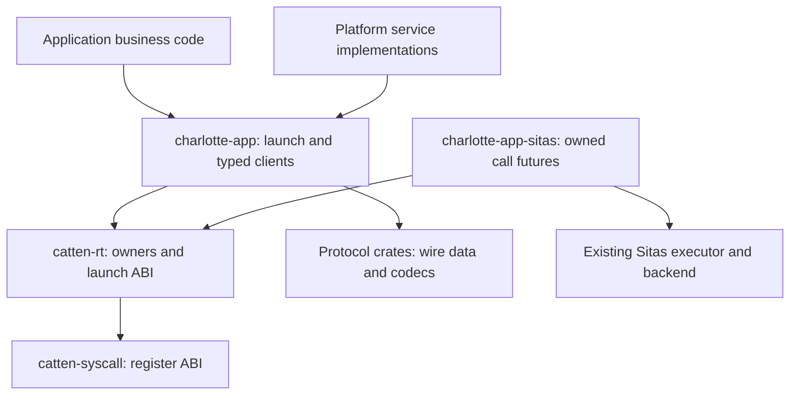

# Userspace development ergonomics

**Status:** Application foundation implemented following the 14 November 2026
source review of CharlotteOS `327a50a7`. Current interfaces and commands are in
[the application SDK guide](../guides/application-sdk.md). Validation limits and
remaining extensions are listed below. The
[broker consumer review](../reports/audits/2026-11-14-broker-sdk-review.md)
identifies the remaining socket-handoff, Sitas-worker and existing-workspace
requirements for a concurrent TCP application.

The application library composes existing resource owners, launch grants,
deadlines and service clients. Ordinary applications see declared dependencies
and typed operations. Service authors additionally handle authenticated
requests, bounded work and publication. Drivers retain hardware-specific MMIO,
DMA and quiescence obligations.

## Layers and current implementation

| Layer | Responsibility |
| --- | --- |
| [`catten-syscall`](../../crates/catten-syscall) | Register ABI; integers at the native boundary. |
| [`catten-rt`](../../crates/catten-rt) | Existing capability/mapping owners, launch context and crt0; shared monotonic deadlines, bounded admission, owner-preserving call observations, length-bearing payload preparation and native worker groups. |
| [`charlotte-protocol-grant`](../../crates/charlotte-protocol-grant) and other protocol crates | Wire data and codecs; no live capability ownership. |
| [`charlotte-app`](../../crates/charlotte-app) | Borrowed application context, returning entry wrapper, synchronous serving scope and scalar test seam. Optional socket, Kafka and S3 clients are extracted implementations, independent of platform service code. |
| [`charlotte-app-sitas`](../../crates/charlotte-app-sitas) | Bounded task registration and owned call futures on the existing Sitas reactor/executor. |
| [`catten-services`](../../crates/catten-services) | Platform services, catalog policy, broker-facing transports, hardware adapters and reexports of the shared application clients. |
| [SDK exporter](../../scripts/export-app-sdk.sh) and [CLI](../../scripts/app-sdk.py) | Exact input snapshot, target/build tools, starter workspace, host business tests and explicit artifact signing. |

No application/client implementation depends back on `catten-services`.
Extraction removes its unconditional network/catalog/TLS implementation
package from an application's dependency graph. Binary size, build latency and
runtime overhead still need measurement; shorter source and dependency
separation do not establish a performance result.

## Operation and ownership contract

Admission, observation and cleanup carry different evidence:

| Outcome | Treatment |
| --- | --- |
| Submission rejected before acceptance | Return the request owner where the consuming API supports it. Retry only explicitly classified queue pressure within the original deadline. |
| Reply observed | Validate protocol result and exact permitted attachments; adopt returned owners once. |
| Deadline after acceptance | Return the pending owner and its loans. Remote outcome may remain unknown. |
| Wait registration rejected | Preserve the distinct error and original pending owner; it is neither expiry nor completion. |
| Endpoint loss or cancellation | Report the fact; the application protocol decides reconnection and replay. |
| Cleanup incomplete | Retain the exact owner under the existing close/Drop policy. No error code or wake grants physical cleanup or replay authority. |

`OwnedPayload` delegates resource lifetimes to `OwnedMemory` and `MappedMemory`;
its extra information is the exact initialized byte length. It bounds encoding
before publication, uses checked page rounding and distinguishes an empty owned
attachment from no attachment. Preparation failures do not introduce a separate
cleanup ladder.

`Admission` replaces retry-all behavior with bounded `QUEUE_FULL` backoff.
Queue-capacity readiness is not currently observable, so this precise unstarted
case retains timer backoff. Grant acquisition similarly has no publication
subscription and retries only a confirmed unavailable response. An accepted
request's local timeout no longer looks like confirmed remote unavailability.

`CallObservation` retains memory loans until actual completion or confirmed
cancellation. `cancel_on_failure` explicitly selects the existing fail-closed
policy. A deadline bounds result observation, not destruction latency or remote
rollback. The [reconnecting example](../../crates/charlotte-app/examples/reconnecting_client.rs)
keeps business progress and replay policy separate from these shared mechanics.

## Launch, serving and workers

`Application` borrows `Context`, the grant-controller connection and signed
profile. The controller still authorizes every acquisition/publication; local
manifest parsing never grants authority. The returning entry wrapper performs
its terminal action only after the application's resource-owning scope returns.
Workers must already have been drained/joined.

`Server` owns one endpoint and one publication attempt. It binds to CQ zero,
drains ready messages before parking and checks lifecycle between requests.
Handlers keep the complete authenticated envelope and its owning attachments.
Publication is explicit after initialization. A handler/wait error leaves the
endpoint retained in the server.

`Workers` prepares bounded native-handle storage before accepting workers.
Failed join registration/observation returns the captured generation-bound
handle to the group; it does not establish thread exit. A nonempty group Drop
aborts instead of silently detaching. This group does not yet own Sitas worker
handles or provide sound scoped spawning with borrowed captures.

The [broker adoption](../reports/audits/2026-11-14-broker-sdk-adoption.md) adjusts
the demo to this ownership model: a bounded CQ-driven session scope keeps sockets
borrowing one enclosing connection, and partition workers retain their actual
Sitas join handles. No process-lifetime connection leak or session-thread handoff
is needed. The earlier `Arc` compiler limitation remains relevant when an
application actually requires transferring a borrowed socket to a `'static`
worker; generic shared-socket custody is a future extension.

The SDK's Sitas source pin now matches the hardened backend at
`6d63266eb52492c1958c45f3ed71c8c7a451489a`, including exact spawn generations,
terminal spawn rejection and owned exit observations. The demo checks exit
readiness before consuming those handles, closes network scopes before joins,
and acknowledges lifecycle only after successful drain.

## Async integration and SDK

`WakeReactor` wraps the existing Sitas backend; it does not consume the ring
independently. IPC reply readiness can be an explicit CQ wake without a cookie,
so backend wakes dispatch the bounded registered task interests and futures
recheck their pending owners. Waker updates precede readiness rechecks,
callbacks/destruction leave the registration lock, and waiting is clipped to
the earliest original deadline. Registration/drop uses exact slot generations.
At expiry a call future returns its pending owner. Future Drop retains the
runtime's existing potentially blocking/aborting cancellation behavior.
Backend wait rejection terminates with the executor's complete owners retained;
it is not returned to older executors that retry backend errors indefinitely.

The SDK contains the application/runtime source closure and CI-pinned Sitas
sources. `sdk.json` binds the exact distributed file hashes, source dirty state,
OS/Sitas revisions, runtime ABI and toolchain. CLI commands validate the snapshot
and the project fingerprint. `new` creates host business logic plus an EL0
adapter; `package` requires explicit key/version/rollback inputs and does not
deploy. `charlotte.json` is a development plan, not a new signed wire format.
External dependencies and toolchain components still require normal resolution.

## Remaining extensions and qualification

- Add existing-workspace CLI configuration if more consumers need it. The public
  manifest/binary builder already supports the broker's workspace; the starter
  CLI retains its simpler layout rather than encoding broker-specific policy.
- Add a connection-owning socket handoff or scoped workers when applications
  require moving accepted sockets between threads. Bounded reactors can retain
  current Rust borrows within one application scope.
- Generalize Sitas worker custody/fallible spawning after qualifying those
  contracts. The demo retains its actual handles and uses terminal rejection
  for mandatory startup; it does not reconstruct native handles from TIDs.
- Generate typed dependency/client bindings and reviewed deployment inputs from
  one application plan. Current publication/acquisition still use explicit names
  and rights; the signed controller remains authoritative.
- Add endpoint/completion futures after qualifying their registration and
  cancellation contracts. Current async
  support is owned pending calls, not a replacement executor.
- Unify higher-level connector operation budgets where their protocols support
  it. Existing synchronous connector methods retain their documented blocking
  and remote teardown behavior.
- Coordinate lifecycle wakes across per-shard queues explicitly. The current
  serving helper uses queue zero; lifecycle does not automatically wake every
  per-shard CQ.
- Extend host scripted transports beyond scalar calls without fabricating kernel
  capability ownership. Native fixtures remain necessary for revocation, DMA
  and actual wake delivery.
- Measure setup commands, platform-specific code, dependency closure, binary
  size, host test turnaround and runtime overhead using the same client, server
  and connector workload.

Validation must distinguish host tests, freestanding builds, SDK source
consistency and native execution. The
[14 November checkpoint](../reports/audits/2026-11-14-application-sdk.md) records
the passing 19-test AArch64 TCG security campaign, target builds and SDK checks.
The initial HVF test-kernel build stopped before boot with 24 denied dead-code
diagnostics in hardware-only fixture helpers whose callers were excluded.
The follow-up aligns those helpers' feature conditions and builds a complete
HVF compatibility image with denied warnings. Accelerated HVF execution remains
unqualified by this checkpoint; passing TCG does not establish that result. Follow the
[contributor contracts](../reference/contributor-contracts.md),
[resource ownership](../guides/resource-ownership.md) and
[shutdown contract](../guides/shutdown.md) for further changes.
