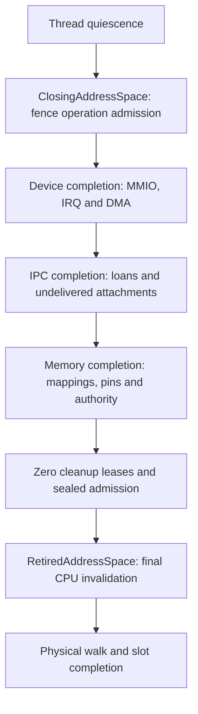

# Cleanup ownership and recovery strategy

Current owner-family map and acceptance gates, consolidated 2026-10-30. This
page describes operation ownership and supported continuation; it does not
record a new execution campaign or close SEC-07/18. Use the
[security engineering guide](../guides/security-engineering.md) for the learned
patterns and the [security ledger](security-remediation.md) for remaining
milestones and unresolved incidents.

The unit of design is a resource/operation category. Custody retains one exact
complete operation, possibly spanning several roots and objects. An IPC
cancellation's token, loans and roots cannot become independent retries.

## Common lifecycle

Every category must identify these boundaries, even when its representation
differs:

1. Admit resources and retirement storage before publication. Capture exact
   generations, sponsorship, root dependencies and any hardware identity.
2. Claim the operation and fence competing access under subsystem serialization.
   Detach authority or mappings only while a complete owner retains the work.
3. Leave serialization before waiting, invalidating, draining hardware, invoking
   notifications or releasing physical backing. Check the caller's outer guard
   and IRQ context as well as the callee's own guards.
4. Obtain category-specific completion evidence. CPU invalidation, DMA drain,
   scratch completion and thread quiescence are distinct proofs.
5. Consume physical ownership exactly once. Refund only confirmed released
   backing; retain original charges for uncertain or rejected release.
6. Publish completion and return slot/authority admission only where that
   category's proof permits it. Restart/reassignment is a separate policy step.

Three outcomes need different treatment before successful completion:

| Outcome | Permitted continuation |
| --- | --- |
| Unstarted admission rejection | Explicit rollback may restore the exact source and refund unused reservations. A new application operation may subsequently be attempted. |
| Pending or safely retryable work | Continue only with the returned/still-held complete owner and its recorded phase. Retaining backing alone is insufficient. |
| Uncertain cleanup, abandonment or partial physical release | Keep fences and original charges. No adoption from IDs, timeout-based refund, force-clear or replay of physical addresses. |

Quarantine is a safety outcome, not implemented recovery. The ability to call a
function twice is not proof of a valid retry contract.

## Composition order

The current final-root path composes earlier cleanup rather than repairing it:

An error before final detachment leaves the closing lifetime fenced. The
final-root registry cannot recover that earlier operation. Conversely, successful
root retry must not silently turn a supervisor's cached teardown failure into
restart permission. Each completed sub-operation must remain recorded when a
later phase fails; restarting the entire sequence can repeat irreversible work.

## Receipt coverage map

The [shared metadata admission layer](metadata-admission.md) supplies typed
charges and read-only samples to existing families; it creates no new owner
family or physical completion proof.

Each row names the complete owner and its continuation boundary. Detailed
subsystem contracts define the physical proof and disposal order. Keep this map
current; execution chronology belongs in [historical reports](../reports/README.md).

| Family | Owner / contract | Continuation and remaining qualification |
| --- | --- | --- |
| C01: live root retention | [`AddressSpaceOperation`](live-address-space-operations.md), exact `SlotLease` | Explicit completion releases the captured generation; abandonment retains it. A root lease needs containing backing/authority/scratch ownership. It cannot recover an abandoned count. |
| C02: staged domain close | [`ClosingAddressSpace`](address-space-retirement.md), closing slot and progress | Pending returns the same owner; terminal failure retains the fence/root. Device, IPC and memory receipts plus zero leases precede admission sealing. [Node/device coordinators](live-address-space-operations.md#node-shutdown-plan-ownership) keep complete inline plans and suppress all nested destruction/abort work on abandonment; explicit polling still requires qualified outer context. The optional [OTLP domain](otlp-export.md) retires through this plan before clock/transport dependencies; export acknowledgement is not retirement proof. Final metadata joins the root owner; no general error-owner retry API exists. [ASID-table backing](root-table-admission.md) stays charged beyond root close: registration owns complete root/namespaces/accounts and candidate buffers, prepares outside lifecycle/table guards, and disposes old/unused backing after unlock. Only unstarted capacity conflicts permit bounded metadata re-preparation; abandonment retains every field. The [scoped-probe controls](../reports/audits/evidence/2026-10-30-security-fixture-budgets.json) require explicit teardown of both separately bounded probe kinds before campaign pass; they add no recovery path. |
| C03: detached final root | [`RetiredAddressSpace` / recovery](root-recovery.md), detached namespace metadata and linear slot completion | [Shared typed backing charges](metadata-admission.md) preserve the same root metadata lifetime and original sponsorship. Eight custody slots, two bounded invalidation retries and checked serials. Confirmed invalidation precedes metadata/backing/slot release. ARM hardware-tag returns use [boot-prepared capacity](boot-allocation-boundaries.md#hardware-asid-return-storage) without growing allocation; storage supplies no invalidation proof or retry authority. [Root data-frame catalogs](page-table-lifetime.md#root-data-frame-catalogs) retain shared bytes and their original signed-principal charge through physical rejection and guarded failed-root Drop; only a complete successful walk frees the catalog before both refunds. Retained allocation supplies no physical retry custody. Physical rejection or abandonment is terminal. The [memory-account node](root-metadata-admission.md) keeps its original admission in the exact-generation ledger through outstanding object charges after root close/reuse; final detachment leaves the ledger before allocation disposal and refund. Independently retained [waiter accounts](waiter-account-admission.md) and [timer accounts](timer-account-admission.md) keep their original principal’s actual Arc/holder bytes and backing classification through root close/reuse and final weak/allocator release; partial preparation fallback remains inert under publication/heap/pool guards. [Capability/IPC/mailbox account backing](namespace-account-admission.md) retains original classification and principal actual-layout bytes through delegated records, closing-root metadata and final weak release. [Global namespace nodes](namespace-node-admission.md) keep original byte/count admission through failed final invalidation, terminal abandonment and actual deallocation; confirming a root barrier does not refund independently retained payload accounts. [Mailbox endpoint backing](mailbox-node-admission.md) retains original-principal bytes and family bytes/count through rejected invalidation and guarded custody-attempt abandonment; confirmed retry refunds before root backing and preserves successor charges. Supervisor reconciliation/operator policy remain G5/G6. |
| C04: detached kernel range | [`RetiredKernelRange`](kernel-frame-retirement.md) | [Owned-epoch invalidation](hardware-quiescence.md#cpu-completion) rechecks completion at the deadline and retains a concrete missing target on timeout. Failed invalidation may retry on the same receipt before physical release starts. Incomplete detach rejects; physical failure/interruption is terminal. Bounded extents and sixteen-frame release batches; no controller adapter. |
| C05: memory mapping retirement | [`MappingRetirementPin` / `RetiredObjectMappings`](memory-object-retirement.md), detached mapping nodes and peer leases | Mapping-node backing uses [shared typed charges](metadata-admission.md); physical proof and disposal remain with this owner. CPU preparation frame snapshots retain [original-principal and family bytes](snapshot-buffer-admission.md) until actual buffer disposal; that refund supplies no invalidation proof. Retain backing through leaf detachment, invalidation and scratch completion. Last DMA/copy unpin cannot bypass the retirement pin. Explicit map/unmap failure diagnostics use the pin's captured generation/prefix and typed cause without registry reentry. Failure retains the complete dependency set; current consumed errors provide no retry owner. |
| C06: loan revocation | [`LoanRevocation` / `LeasedRevocation`](../../crates/catten/src/memory/object/revocation.rs) | Own both exact roots and borrower state through physical completion and authority removal. Unstarted receipts may roll back; uncertain cleanup retains the Revoking fence/pin. CPU invalidation cannot discharge DMA pins. |
| C07: reply completion | [`PreparedReply` / returned resources](../../crates/catten/src/ipc/reply.rs), `ReplyCompletion` and memory `PreparedTransfer` | Exclusive reply and source claims retain roots, loans and returned grants. Hidden outputs publish jointly after cleanup. [Revocation-work backing](ipc-node-admission.md#revocation-work-buffers) retains original token class and full capacity through actual disposal before root completion. Complete parent abandonment retains work, returned-memory escrow/pin, hidden grants, roots and notifications without child destruction under lifecycle/table/IPC/heap/physical/registry/pool guards. Ordinary rejection rolls back only known-unstarted work; cleanup headroom is not pre-reserved. |
| C08: call/reply cancellation | [`PreparedCancellation`](../../crates/catten/src/ipc/cancellation.rs), exact claim epoch and reply-CQ interest | Revoke outside IPC, then publish terminal results. Failed cleanup retains live authority and fences delivery. Waiting preserves the same transaction; rejection or wake cannot authorize replay. [Revocation work](ipc-node-admission.md#revocation-work-buffers) retains original token class and full capacity through child cleanup and actual buffer disposal before roots. Complete standalone and borrowed endpoint/namespace parents retain work, queue/claim, roots and pins under cleanup guards. Empty work allocates nothing; saturated cleanup headroom remains a progress gate. [Deferred source-disposal backing](deferred-source-admission.md) remains admitted through claim completion and producer-LP queued release; metadata delivery supplies no cleanup authority. |
| C09: endpoint close | [`PreparedEndpointClose`](../../crates/catten/src/ipc/endpoint_close.rs), retained server lease and active call | Fence enqueue/receive/mint/resize; cancel one front at a time borrowing the server owner. No fresh lease beneath staged close. Final completion signals death; ordinary rejection re-signals productive work. Failure retains the claim. [Endpoint backing](ipc-node-admission.md) and its original resource charge remain in the same node through hidden connection references and actual deallocation; existing complete endpoint/growth/list abandonment also holds the backing-pool guard. [Attachment retirement catalogs](ipc-node-admission.md#attachment-retirement-capacity) retain original requester class/principal byte admission through post-IPC delivery disposal and FIFO child handoff; callback interruption retains remaining owners and full capacity. Complete call/send/received storage fallback is inert under the pool guard. |
| C10: namespace IPC cleanup | [`namespace_close`](../../crates/catten/src/ipc/namespace_close.rs), closing root and per-token cancellation | Retain captured peers, including closing generations, before claiming. Cleanup runs outside lifecycle/IPC without snapshots; exact receipts precede drain/seal. Serialized raw adapters remain boot fixtures. The global IPC node retains [byte/count admission](namespace-node-admission.md) through detachment and actual release. IPC endpoint/record account backing stays [independently admitted](namespace-account-admission.md) through delegated connections, closed endpoints and final weak release. |
| C11: namespace memory cleanup | [`PreparingNamespaceObject` / completion receipts](../../crates/catten/src/memory/object/namespace_close.rs) | Acquire mapped-peer leases before registry detachment; retain pin, mappings, scratch and closing root across failure. No lifecycle-under-registry acquisition, snapshot or implicit retry. |
| C12: namespace device cleanup | [`PreparedNamespaceDevices` / `NamespaceDevicesClosed`](../../crates/catten/src/device/retirement.rs) | Detach admitted records/routes under lifecycle/device guards, then release guards for MMIO/DMA cleanup. Authority and original node storage survive failure; exact completion precedes IPC cleanup. Device namespace/payload [backing admission](device-node-admission.md) follows candidates and detached work through actual deallocation; complete fallback retains the original bytes/count under the pool guard. |
| C13: explicit device/MMIO close | [`PreparedClose`](../../crates/catten/src/device/close.rs), exact root/capability and reset-visible descriptor | Keep claimed payload/authority through invalidation, scratch or backend completion. Ordinary rejection restores only proven unstarted state. Failure retains the claim; consumed errors are not custody. Claimed/detached device [node backing](device-node-admission.md) remains charged through confirmed cleanup and actual deallocation, independently of unified authority. Flat boot topology keeps endpoint Boxes stable; bounded real-RAM builder controls cover cycle/range rejection, multifunction lookup and private-prefix cleanup without a hardware claim. Reset backend coverage/retirement authority is unchanged; see [boot boundaries](boot-allocation-boundaries.md#address-regions-and-pci-firmware-topology). |
| C14: DMA domain and requester retirement | [`Maintenance` / `DetachedDomain`](../../crates/catten/src/device/detached_domain.rs), complete domain/engine and original pin | Claim before unlocked maintenance; preserve requester fence and command state after uncertainty. The original DMA pin keeps [snapshot principal/family bytes](snapshot-buffer-admission.md) through root close/reuse and uncertain hardware work; confirmed unpin frees metadata before both refunds and independent backing-pin release. Confirm DMA completion separately from CPU teardown. Physical partial release is terminal. Reset/reassignment requires its own hardware contract. Containing grant and capability [node backing](device-node-admission.md) retains original charges through hardware uncertainty and guarded abandonment. [Backend domain/requester/context nodes](iommu-node-admission.md) retain independent original bytes/count through preparation and actual deallocation; zero fences and context metadata keep their unit-owned charge beyond domain destruction, including trusted reuse. Complete grant abandonment remains inert under both device/backing pool guards. [Readiness disposal nodes](deferred-source-admission.md) retain original backing admission with the grant/unit and through producer-LP delivery; metadata progress supplies no hardware completion proof. [DMA mapping/quarantine and SMMU cache backing](iommu-node-admission.md#dma-mapping-records-and-smmu-walker-cache) retains original domain-grant class through node deallocation; ordinary quota rejection precedes table/data publication. The existing complete mapping/private-grant abandonment fixtures hold the shared metadata-pool guard. |
| C15: IOMMU table backing | [`Tables` / `PreparingRegion`](iommu-table-admission.md) | [Shared typed backend-node charges](metadata-admission.md) preserve unit/domain ownership and original classification. Charge before allocation; retain ledger/backing through hardware reachability, weak or detached lifetime and failed release. Explicit private cancellation needs confirmed completion; no physical cleanup from abandonment. VT-d context metadata has separate [node backing](iommu-node-admission.md) retained with its unit-owned hardware table; domain completion cannot refund it. [Ledger capacity](iommu-table-admission.md#ledger-buffer-admission) shares metadata byte admission with immutable domain-grant/boot class and full old/candidate overlap. Explicit completion frees the buffer before refund; uncertain, frozen and abandoned owners retain both budgets. Guarded existing table/region/private-grant fixtures qualify the metadata-pool hold too. |
| C16: thread retirement and stack pair | [`ReapBatch`, complete thread and `Stacks`](cleanup-recovery-details.md#c16-thread-retirement-and-stack-pair) | [Shared typed backing charges](metadata-admission.md) preserve node-before-principal refund order after deallocation. Owner-LP IRQ-enabled reapers require exact thread quiescence, then one-shot pair release and explicit metadata disposal. Failed pairs remain terminal in their nodes. [Prepared kernel workers](user-thread-admission.md#prepared-kernel-workers) retain their exact unstarted table owner until consuming start or post-guard cancellation; failed cancellation returns complete retaining ownership. [Master-table backing](thread-table-admission.md) reserves overlapping vector sets before allocation, swaps complete exact-generation entries under publication guards and disposes old/unused buffers afterwards; abandonment retains the buffers and original principal/classification. Thread-held [waiter accounts](waiter-account-admission.md) and [timer accounts](timer-account-admission.md) retain independent family admission and original-principal actual-layout funding beyond root retirement through actual allocation release. Thread wakers and watchdogs use [admitted observer handles](observer-ownership.md), retaining original backing through final weak/private-holder release; borrowed notification preserves generation and installed-waker identity. Wider caller/IRQ/implicit-drop and bounded-copy latency qualification remain G1/G7. |
| C17: provisional CPU backing | [`PreparingUserBacking`](kernel-backing-preparation.md), table/frame/stack preparations | Retain exact borrowed account, backing and original reservation before publication. Ordinary unused cancellation is consuming and explicit. Failed/interrupted cleanup keeps the complete charge; address-based re-adoption is forbidden. |
| C18: publication rollback and detached memory | [Complete transfer, IPC, completion and service operations](cleanup-recovery-details.md#c18-publication-rollback-and-detached-memory) | [Shared typed metadata charges](metadata-admission.md) preserve local complete-operation ownership and disposal contracts. Admit storage before mutation; retain source escrow, destination authority, pins, backing and original charges together. [Scalar submissions](ipc-receive.md#scalar-attachment-submission) retain both roots around unlocked preparation; single-send fallback retains the complete operation. [Deployment launch](scoped-deployment-launch.md#deployment-record-admission) reserves fixed capacity/identity before construction; serial ARM/Intel migration and retirement are qualified. [Status](status-observation.md#client-progress-and-ownership) and [deployment](deployment-ingress.md) drain every client phase through consuming logical close; deployment continues accepted controller/output work. [Native OTLP](otlp-export.md) owns pending calls before socket/buffer teardown in ordinary EL0 context, consumes remote close, and aborts on unconfirmed teardown; collector faults do not authorize replay. [Shared TLS SHA/HMAC contexts](tls-client.md#authentication-and-erasure) erases on ordinary local Drop; this does not end remote work. Completion namespace timer accounts retain [original-principal actual-layout funding](timer-account-admission.md) through replacement, retained cancellation and final weak/allocator release. [Record/CQ/watch account backing](completion-account-admission.md) keeps actual Arc/holder principal funding and original classification through real retained work, root close/ASID reuse and final weak release; actual unpublished/retired namespace abandonment remains inert under heap/registry/account-pool guards. [Capability/IPC/mailbox backing](namespace-account-admission.md) retains actual Arc/holder principal bytes and survives actual root/namespace/mailbox parent abandonment under heap/registry/account-pool guards, without changing resource grant policy. [Global namespace-node owners](namespace-node-admission.md) also retain requested-byte/count charges under the actual publication/heap/pool guards; explicit post-guard release refunds after node deallocation. [Individual authority-record nodes](authority-node-admission.md) retain original-principal layout funding and separate byte/count admission through candidates, detachment, root close/ASID reuse and actual deallocation; existing preparation/retirement fallback is inert under the node-pool guard too. [Mailbox endpoint nodes](mailbox-node-admission.md) retain original-principal backing and resource charges through final-root invalidation rejection and actual node deallocation; existing guarded preparation/close/root-attempt abandonment keeps the complete original owner. [IPC/memory-close/DMA-readiness disposal nodes](deferred-source-admission.md) retain independent byte/count admission through preparation and producer-LP queued release, separately from observer-list backing; existing complete DMA parent abandonment retains its source charge under the new pool guard. [Completion registry nodes](completion-node-admission.md) retain independent original bytes/count through preparation, detached backlog, root close/ASID reuse and actual deallocation; complete preparation/retirement abandonment remains inert under the pool guard. Completion and IPC callback targets use opaque [admitted observer handles](observer-ownership.md) with captured original sponsorship; observation cancellation, queued weak references and slot reuse cannot refund live backing. Bare preparation retention does not qualify active parent destructors. No error, timeout or retained allocation supplies physical replay authority. [Object-record backing](memory-capability-node-admission.md#object-records-and-backing-sponsorship) follows the exact original backing-sponsor class through moves, detached physical cleanup and actual node deallocation; allocation/copy third-node rejection cancels the complete prefix before publication. Existing private/published backing abandonment holds the metadata-pool guard too. [IPC payload-node backing](ipc-node-admission.md) retains recipient namespace storage classification separately from logical grantor/requester charges; endpoint/call/reply nodes retain their original reservation class through candidates, detached cleanup and actual deallocation. Complete capability/call/endpoint/growth and retirement-list abandonment holds the pool guard too. [Object frame catalogs](memory-capability-node-admission.md#object-frame-vector-capacity) retain byte-only admission and capacity with the same complete backing owner; empty length never proves physical completion. Vector free precedes metadata refund, while failed release retains both original budgets. [Attachment retirement catalogs](ipc-node-admission.md#attachment-retirement-capacity) retain original requester class/principal byte admission through post-IPC delivery disposal and FIFO child handoff; callback interruption retains remaining owners and full capacity. Complete call/send/received storage fallback is inert under the pool guard. [Staging and token-loan vectors](ipc-node-admission.md#staging-and-loan-vectors) retain original class/principal allocation-lifetime bytes through growth overlap, partial failure and post-guard disposal. Complete vector-send abandonment retains both exact roots, authority, copied backing and buffer charges under lifecycle/IPC/heap/physical/registry/pool guards; this qualifies that parent, not every active transfer destructor. [Descriptor snapshots](ipc-node-admission.md#staging-and-loan-vectors) keep captured byte admission until actual temporary-buffer disposal before roots complete; quota/parse rejection preserves source and descriptor, without active capability elements or new physical authority. [Diagnostic scratch](telemetry-snapshots.md) uses captured signed-principal and shared snapshot-byte admission; plain-value vector disposal occurs after observation guards and deallocation precedes both refunds. Promotion, root exit and ASID reuse do not redirect retained capacity. This supplies no physical completion or broader caller qualification. [Primitive syscall input/plaintext owners](snapshot-buffer-admission.md#primitive-syscall-inputs) retain complete private byte prefixes and captured original class/principal admission through ordinary disposal; plaintext wipes before free/refund. These byte owners add no physical/replay authority and do not qualify active supervisor parents or every enclosing caller. [Supervisor launch/handoff and store-image ownership](service-launch-ownership.md) retains complete target/source roots, profiles, transfer prefixes and original vector charges; only explicit post-guard cancellation runs cleanup, stopping at its first error. Fixed image-cache slots/counts precede I/O and separate bytes survive private preparation or immutable kernel-lifetime publication. These controls add no retry or universal loader/caller qualification. The optional [boot framebuffer context](boot-allocation-boundaries.md#framebuffer-terminal) retains its complete opaque C allocation without a Rust base-type destructor; a checked RGB32 plan bounds the complete six-allocation prefix to 12 MiB and the framebuffer span to 256 MiB before C entry. Local failure cleanup and minimum/padded/scaled rendering are host-qualified; retirement and wider outer contexts remain explicitly unqualified. |

Generic slot leases, retirement nodes, reservations and escrow support these
families. Each remains inside its containing transaction; none independently
establishes payload quiescence or a recovery right.

### Formal coverage of ownership boundaries

| Projection | Checked policy boundary | Assumed or outside the projection |
| --- | --- | --- |
| [`CharlotteRootRetirement`](../tla/CharlotteRootRetirement.tla) | Exact leases, staged close, complete-owner invalidation retry, terminal retention and physical-once charges | Subsystem/thread/hardware completion, arbitrary outer contexts and interruption inside physical teardown |
| [`CharlotteCheckedWait`](../tla/CharlotteCheckedWait.tla) | Fixed deadline, admission/timeout retention, accepted-request fencing and readiness/result separation | The source's real notification contract and full implementation refinement |
| [`CharlotteIpcPublication`](../tla/CharlotteIpcPublication.tla) | Reservation/escrow rollback, hidden output and exact namespace replacement | Confirmed loan/payload retirement, physical release and outer-context safety |
| [`CharlotteDmaOperation`](../tla/CharlotteDmaOperation.tla) | Fixed-unit admission, pending pin/root retention and non-replayable started attempts | Genuine backend acknowledgements, physical release, grant cancellation and recovery |

Models and local controls cover their specified boundaries. They do not close
the call-chain inventory or integrated pressure gates.

### Entry boundaries and caller obligations

| Entry | Required composition | Remaining caller qualification |
| --- | --- | --- |
| Domain abort / cooperative runtime-page access | Retain exact executor/root before publication; validate fixed image mappings before access; complete root before executor | Force-request callers, exceptional paths and unrelated retained operations |
| Domain teardown / staged close | Enter without unrelated guards; retain the same closing owner and cached failure episode | Every deployment/node/device/loader caller and implicit field drop; completion reconciliation |
| Final-root recovery | Reject masked callers before claim; leave the registry for invalidation/release; disarm once before slot reuse | IRQ-enabled entry alone cannot establish absence of unrelated locks; operator authorization is separate |
| Memory/device map, unmap and close | Capture root/capability before subsystem claim; leave local guards for physical work; retain complete rollback/retirement metadata | Enclosing IPC/lifecycle/allocator masks, active transfer/scoped-pin destructors and hardware failure phases |
| Completion, observer and timer production/disposal | Prepare captures/storage before local publication; notify and dispose detached nodes/charges after guards leave | Active token/source/final-handle/parent destruction, callback contexts and aggregate allocation |
| Thread reaping / metadata disposal | Pinned owner-LP worker, exact stack quiescence, pair completion before metadata/node release | Ordinary constructor/syscall rollback and all enclosing masks/guards; serialized fixtures establish only their own scope |

### Coverage boundary

C01–C18 are an owner-family inventory. R18-1 still requires every production call
chain and implicit field drop, including scheduler/IRQ/observer/allocator paths,
supervisor preparation and service-local protocol owners. R7-1 separately needs
each allocation's bytes/count, sponsor, lifetime and rejection behavior.

Inherited boot roots/stacks and shared kernel/IOMMU unit backing are lifetime
exclusions from ordinary domain recovery; they still need locking and admission
review. Serialized fixture adapters cannot become production fallbacks. x86's
never-dispatched migration and ARM's switch handoff remain architecture-specific.
Physical qualification is R18-6; the immediate recovery milestone targets QEMU.

## Shared recovery controller contract

The following is the **required design**, not an implemented controller.
Share custody and policy machinery; keep physical operations and proofs typed.
Do not introduce an erased callback plus scalar object ID as a recovery owner.

| Shared responsibility | Required rule |
| --- | --- |
| Admission and custody | Fixed/admitted storage, original sponsor and a complete owner. Capacity rejection returns that owner after unlock. Never allocate an unbounded spill queue or reserve anew after failure. |
| Identity | Category-qualified, registry-qualified, nonwrapping ticket/serial; any external reference also binds the boot/node identity. A diagnostic ticket is not mutation authority. |
| Claim and attempt | One exclusive attempt, stable abandonment storage and finite per-category quota. Claim only after policy/context checks; unlock before adapter work. Busy/stale/masked/terminal rejection cannot change physical state. |
| Phase-aware outcome | Adapter returns the same complete owner only for a proven retryable phase, or a consuming completion proof. Fenced, exhausted, physical-partial and abandoned outcomes remain distinct terminal states. Do not invent a completion receipt from an error code. |
| Dependencies | Retain exact root/peer/loan/device owners as one operation until their completion rules allow release. Borrowed namespace receipts need a containing owned transaction, not lifetime erasure or a pointer to a dropped parent. |
| Drop and interruption | No wait, physical release, logger, arbitrary callback or lock acquisition in the custody/attempt Drop path. Disarm abandonment under serialization before publishing a reusable slot. Adapter and implicit field destructors need their own context proof. |
| Scheduling | Bounded attempts and work admission, no busy loop; a finite frame batch is not a latency guarantee. Establish a measured deadline and essential-service progress budget per adapter. Never enable IRQs under an unknown outer mask. |
| Diagnostics | Capability-scoped bounded snapshots distinguish waiting, running, exhausted, completed, quarantined and abandoned state, plus capacity loss. State counts and original-charge counts are not cumulative recovery/refund totals. Diagnostic addresses are never adoption inputs. |
| Mutation authorization | Separate authority from `SystemObserver`. Authorize target/category/action under authenticated node/operator identity, bind freshness and exact failure episode, limit submission and retain an auditable outcome. Remote mutation waits for SEC-08/10 transport/identity boundaries. |
| Supervisor reconciliation | Correlate completion to the exact teardown episode and its dependencies. Explicitly reconcile cached failure only after every required proof; independently authorize restart/reassignment. Root recovery alone does not acknowledge device reset or thread shutdown. |

The existing root registry supplies a working custody/claim example, not a
universal capacity or quota policy. Extract common storage/claim code only when
a second fully owned adapter demonstrates reuse. An enum of typed owners or a
generic custody container is acceptable then; a universal destructive `Drop`
or unconditional `retry` trait is not. Category budgets must include retained
quarantine and fit the node and eventual logical-principal ceilings (R7-3).

No controller may recover lost owners, clear Revoking/closing/in-flight fences,
force-decrement leases, refund uncertain backing or retry a partial physical
walk. A future stronger reset/reboot contract requires separate platform proof;
it is not a fallback transition in this controller.

## Named gaps and acceptance gates

These gates refine the [R7/R18 deliverables](security-remediation.md). Update
their current boundary in place when work changes it.

The [closure work plan](security-closure-plan.md) maps these existing gates to
bounded review/implementation packages and a predefined integrated matrix.
Its Drop census includes guard releases and generic code; it is not a count of
unsafe destructors or a substitute for caller/IRQ qualification.

| Gap | Remaining acceptance |
| --- | --- |
| G1: destructor and outer-context qualification | Enumerate every relevant production caller and implicit field drop. Qualify enclosing locks/IRQ state, allocation, notification, callbacks and physical cleanup. Test rejection/abandonment under the relevant guards. Inner post-guard disposal alone is insufficient. |
| G2: recoverable owner boundaries | Classify phases as unstarted rollback, Pending, owner-preserving retry or terminal retention. Continue only with a complete typed owner and recorded dependencies; consumed error receipts cannot enter custody. Test no repeated detach, scratch completion or physical release. Keep unsupported categories terminal. |
| G3: backend phase separation | Across VT-d, AMD-Vi and SMMUv3, preserve the complete domain/unit/engine/pin claim while releasing serialization for maintenance, reset and physical work. Qualify all caller contexts and concurrency/timeout paths; distinguish retryable pre-release rejection from terminal physical failure. |
| G4: publication and metadata destruction | Complete allocation/destruction inventory below IPC/device/lifecycle guards. Prepared nodes and authority escrow must survive publication, rollback, retirement and real deallocation with original charges. Cover active parent destructors and remaining ledger/account/heap bookkeeping. |
| G5: supervisor completion correlation | Correlate exact teardown episode and dependencies with cached errors. Test stale tickets, concurrent observations and root completion with earlier cleanup still failed. Authorize restart separately; missing/reused ASIDs cannot clear errors. |
| G6: common custody and authorized policy | After a second complete eligible adapter is justified, share bounded custody/claim/diagnostic policy. Define authority, freshness, quotas and outcome admission; test competing/stale/unauthorized requests and terminal/exhausted states. External access depends on enrolled authenticated channels. |
| G7: integrated qualification | Combine R18-5 concurrency/fault cases with R7 pressure/progress on VT-d, AMD-Vi and SMMUv3. Include actual outstanding I/O, maintenance timeout, lost/stale acknowledgements, peer close, interrupted publication and partial release. Check exact charges, no early reuse and measured essential progress. |

### Implementation order and stopping criteria

1. Identify the affected owner family, exact reachable call path and required
   property. Qualify its enclosing context and allocation boundary first.
2. Preserve typed completion and all containing dependencies while moving unsafe
   work outside serialization. Add custody only for a complete eligible owner.
3. Validate success, unstarted rejection, cancellation/abandonment and terminal
   physical failure as applicable. Keep expected controls and unexpected failures
   separate; do not widen deadlines to convert an unexplained failure into a pass.
4. Run a predefined integrated matrix with real backing and essential-progress
   bounds. Local success does not close G7; QEMU does not close physical scope.

Update the existing family row and its linked contract when behavior changes.
Keep significant failure captures in dated reports and the current
[incident list](security-remediation.md#unresolved-incidents). Do not append each
implementation batch to this page. New object instances need no new family or
registry. A future general controller must not invent a retry owner from retained
backing, wake events or diagnostic IDs.
