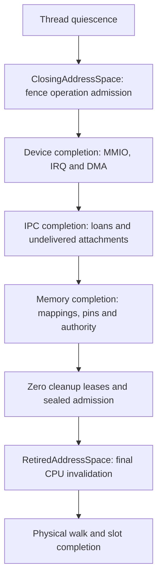

# Cleanup ownership and recovery strategy

Current owner-family map and acceptance gates, consolidated 2026-10-30. This
page describes operation ownership and supported continuation; it does not
record a new execution campaign or close SEC-07/18. Use the
[security engineering guide](../guides/security-engineering.md) for the learned
patterns and the [security ledger](security-remediation.md) for remaining
milestones and unresolved incidents.

The unit of design is a resource/operation category. Custody retains one exact
complete operation, possibly spanning several roots and objects. An IPC
cancellation's token, loans and roots cannot become independent retries.

## Common lifecycle

Every category must identify these boundaries, even when its representation
differs:

1. Admit resources and retirement storage before publication. Capture exact
   generations, sponsorship, root dependencies and any hardware identity.
2. Claim the operation and fence competing access under subsystem serialization.
   Detach authority or mappings only while a complete owner retains the work.
3. Leave serialization before waiting, invalidating, draining hardware, invoking
   notifications or releasing physical backing. Check the caller's outer guard
   and IRQ context as well as the callee's own guards.
4. Obtain category-specific completion evidence. CPU invalidation, DMA drain,
   scratch completion and thread quiescence are distinct proofs.
5. Consume physical ownership exactly once. Refund only confirmed released
   backing; retain original charges for uncertain or rejected release.
6. Publish completion and return slot/authority admission only where that
   category's proof permits it. Restart/reassignment is a separate policy step.

Three outcomes need different treatment before successful completion:

| Outcome | Permitted continuation |
| --- | --- |
| Unstarted admission rejection | Explicit rollback may restore the exact source and refund unused reservations. A new application operation may subsequently be attempted. |
| Pending or safely retryable work | Continue only with the returned/still-held complete owner and its recorded phase. Retaining backing alone is insufficient. |
| Uncertain cleanup, abandonment or partial physical release | Keep fences and original charges. No adoption from IDs, timeout-based refund, force-clear or replay of physical addresses. |

Quarantine is a safety outcome, not implemented recovery. The ability to call a
function twice is not proof of a valid retry contract.

## Composition order

The current final-root path composes earlier cleanup rather than repairing it:

An error before final detachment leaves the closing lifetime fenced. The
final-root registry cannot recover that earlier operation. Conversely, successful
root retry must not silently turn a supervisor's cached teardown failure into
restart permission. Each completed sub-operation must remain recorded when a
later phase fails; restarting the entire sequence can repeat irreversible work.

## Receipt coverage map

Each row names the complete owner and its continuation boundary. Detailed
subsystem contracts define the physical proof and disposal order. Keep this map
current; execution chronology belongs in [historical reports](../reports/README.md).

| Family | Owner / contract | Continuation and remaining qualification |
| --- | --- | --- |
| C01: live root retention | [`AddressSpaceOperation`](live-address-space-operations.md), exact `SlotLease` | Explicit completion releases the captured generation; abandonment retains it. A root lease needs containing backing/authority/scratch ownership. It cannot recover an abandoned count. |
| C02: staged domain close | [`ClosingAddressSpace`](address-space-retirement.md), closing slot and progress | Pending returns the same owner; terminal failure retains the fence/root. Device, IPC and memory receipts plus zero leases precede admission sealing. Final metadata joins the root owner; no general error-owner retry API exists. |
| C03: detached final root | [`RetiredAddressSpace` / recovery](root-recovery.md), detached namespace metadata and linear slot completion | Eight custody slots, two bounded invalidation retries and checked serials. Confirmed invalidation precedes metadata/backing/slot release. Physical rejection or abandonment is terminal. Supervisor reconciliation/operator policy remain G5/G6. |
| C04: detached kernel range | [`RetiredKernelRange`](kernel-frame-retirement.md) | [Owned-epoch invalidation](hardware-quiescence.md#cpu-completion) rechecks completion at the deadline and retains a concrete missing target on timeout. Failed invalidation may retry on the same receipt before physical release starts. Incomplete detach rejects; physical failure/interruption is terminal. Bounded extents and sixteen-frame release batches; no controller adapter. |
| C05: memory mapping retirement | [`MappingRetirementPin` / `RetiredObjectMappings`](memory-object-retirement.md), detached mapping nodes and peer leases | Retain backing through leaf detachment, invalidation and scratch completion. Last DMA/copy unpin cannot bypass the retirement pin. Explicit map/unmap failure diagnostics use the pin's captured generation/prefix and typed cause without registry reentry. Failure retains the complete dependency set; current consumed errors provide no retry owner. |
| C06: loan revocation | [`LoanRevocation` / `LeasedRevocation`](../../crates/catten/src/memory/object/revocation.rs) | Own both exact roots and borrower state through physical completion and authority removal. Unstarted receipts may roll back; uncertain cleanup retains the Revoking fence/pin. CPU invalidation cannot discharge DMA pins. |
| C07: reply completion | [`PreparedReply` / returned resources](../../crates/catten/src/ipc/reply.rs), `ReplyCompletion` and memory `PreparedTransfer` | Exclusive reply and source claims retain roots, loans and returned grants. Hidden outputs publish jointly after cleanup. Abandonment keeps uncertain claims/dependencies; ordinary rejection rolls back only unstarted work. |
| C08: call/reply cancellation | [`PreparedCancellation`](../../crates/catten/src/ipc/cancellation.rs), exact claim epoch and reply-CQ interest | Revoke outside IPC, then publish terminal results. Failed cleanup retains live authority and fences delivery. Waiting preserves the same transaction; rejection or wake cannot authorize replay. |
| C09: endpoint close | [`PreparedEndpointClose`](../../crates/catten/src/ipc/endpoint_close.rs), retained server lease and active call | Fence enqueue/receive/mint/resize; cancel one front at a time borrowing the server owner. No fresh lease beneath staged close. Final completion signals death; ordinary rejection re-signals productive work. Failure retains the claim. |
| C10: namespace IPC cleanup | [`namespace_close`](../../crates/catten/src/ipc/namespace_close.rs), closing root and per-token cancellation | Retain captured peers, including closing generations, before claiming. Cleanup runs outside lifecycle/IPC without snapshots; exact receipts precede drain/seal. Serialized raw adapters remain boot fixtures. |
| C11: namespace memory cleanup | [`PreparingNamespaceObject` / completion receipts](../../crates/catten/src/memory/object/namespace_close.rs) | Acquire mapped-peer leases before registry detachment; retain pin, mappings, scratch and closing root across failure. No lifecycle-under-registry acquisition, snapshot or implicit retry. |
| C12: namespace device cleanup | [`PreparedNamespaceDevices` / `NamespaceDevicesClosed`](../../crates/catten/src/device/retirement.rs) | Detach admitted records/routes under lifecycle/device guards, then release guards for MMIO/DMA cleanup. Authority and original node storage survive failure; exact completion precedes IPC cleanup. |
| C13: explicit device/MMIO close | [`PreparedClose`](../../crates/catten/src/device/close.rs), exact root/capability and reset-visible descriptor | Keep claimed payload/authority through invalidation, scratch or backend completion. Ordinary rejection restores only proven unstarted state. Failure retains the claim; consumed errors are not custody. |
| C14: DMA domain and requester retirement | [`Maintenance` / `DetachedDomain`](../../crates/catten/src/device/detached_domain.rs), complete domain/engine and original pin | Claim before unlocked maintenance; preserve requester fence and command state after uncertainty. Confirm DMA completion separately from CPU teardown. Physical partial release is terminal. Reset/reassignment requires its own hardware contract. |
| C15: IOMMU table backing | [`Tables` / `PreparingRegion`](iommu-table-admission.md) | Charge before allocation; retain ledger/backing through hardware reachability, weak or detached lifetime and failed release. Explicit private cancellation needs confirmed completion; no physical cleanup from abandonment. |
| C16: thread retirement and stack pair | [`ReapBatch`, complete thread and `Stacks`](cleanup-recovery-details.md#c16-thread-retirement-and-stack-pair) | Owner-LP IRQ-enabled reapers require exact thread quiescence, then one-shot pair release and explicit metadata disposal. Failed pairs remain terminal in their nodes. Wider caller/IRQ/implicit-drop qualification remains G1/G7. |
| C17: provisional CPU backing | [`PreparingUserBacking`](kernel-backing-preparation.md), table/frame/stack preparations | Retain exact borrowed account, backing and original reservation before publication. Ordinary unused cancellation is consuming and explicit. Failed/interrupted cleanup keeps the complete charge; address-based re-adoption is forbidden. |
| C18: publication rollback and detached memory | [Complete transfer, IPC, completion and service operations](cleanup-recovery-details.md#c18-publication-rollback-and-detached-memory) | Admit storage before mutation; retain source escrow, destination authority, pins, backing and original charges together. Bare preparation retention does not qualify active parent destructors. No error, timeout or retained allocation supplies physical replay authority. |

Generic slot leases, retirement nodes, reservations and escrow support these
families. Each remains inside its containing transaction; none independently
establishes payload quiescence or a recovery right.

### Formal coverage of ownership boundaries

| Projection | Checked policy boundary | Assumed or outside the projection |
| --- | --- | --- |
| [`CharlotteRootRetirement`](../tla/CharlotteRootRetirement.tla) | Exact leases, staged close, complete-owner invalidation retry, terminal retention and physical-once charges | Subsystem/thread/hardware completion, arbitrary outer contexts and interruption inside physical teardown |
| [`CharlotteCheckedWait`](../tla/CharlotteCheckedWait.tla) | Fixed deadline, admission/timeout retention, accepted-request fencing and readiness/result separation | The source's real notification contract and full implementation refinement |
| [`CharlotteIpcPublication`](../tla/CharlotteIpcPublication.tla) | Reservation/escrow rollback, hidden output and exact namespace replacement | Confirmed loan/payload retirement, physical release and outer-context safety |
| [`CharlotteDmaOperation`](../tla/CharlotteDmaOperation.tla) | Fixed-unit admission, pending pin/root retention and non-replayable started attempts | Genuine backend acknowledgements, physical release, grant cancellation and recovery |

Models and local controls cover their specified boundaries. They do not close
the call-chain inventory or integrated pressure gates.

### Entry boundaries and caller obligations

| Entry | Required composition | Remaining caller qualification |
| --- | --- | --- |
| Domain abort / cooperative runtime-page access | Retain exact executor/root before publication; validate fixed image mappings before access; complete root before executor | Force-request callers, exceptional paths and unrelated retained operations |
| Domain teardown / staged close | Enter without unrelated guards; retain the same closing owner and cached failure episode | Every deployment/node/device/loader caller and implicit field drop; completion reconciliation |
| Final-root recovery | Reject masked callers before claim; leave the registry for invalidation/release; disarm once before slot reuse | IRQ-enabled entry alone cannot establish absence of unrelated locks; operator authorization is separate |
| Memory/device map, unmap and close | Capture root/capability before subsystem claim; leave local guards for physical work; retain complete rollback/retirement metadata | Enclosing IPC/lifecycle/allocator masks, active transfer/scoped-pin destructors and hardware failure phases |
| Completion, observer and timer production/disposal | Prepare captures/storage before local publication; notify and dispose detached nodes/charges after guards leave | Active token/source/final-handle/parent destruction, callback contexts and aggregate allocation |
| Thread reaping / metadata disposal | Pinned owner-LP worker, exact stack quiescence, pair completion before metadata/node release | Ordinary constructor/syscall rollback and all enclosing masks/guards; serialized fixtures establish only their own scope |

### Coverage boundary

C01–C18 are an owner-family inventory. R18-1 still requires every production call
chain and implicit field drop, including scheduler/IRQ/observer/allocator paths,
supervisor preparation and service-local protocol owners. R7-1 separately needs
each allocation's bytes/count, sponsor, lifetime and rejection behavior.

Inherited boot roots/stacks and shared kernel/IOMMU unit backing are lifetime
exclusions from ordinary domain recovery; they still need locking and admission
review. Serialized fixture adapters cannot become production fallbacks. x86's
never-dispatched migration and ARM's switch handoff remain architecture-specific.
Physical qualification is R18-6; the immediate recovery milestone targets QEMU.

## Shared recovery controller contract

The following is the **required design**, not an implemented controller.
Share custody and policy machinery; keep physical operations and proofs typed.
Do not introduce an erased callback plus scalar object ID as a recovery owner.

| Shared responsibility | Required rule |
| --- | --- |
| Admission and custody | Fixed/admitted storage, original sponsor and a complete owner. Capacity rejection returns that owner after unlock. Never allocate an unbounded spill queue or reserve anew after failure. |
| Identity | Category-qualified, registry-qualified, nonwrapping ticket/serial; any external reference also binds the boot/node identity. A diagnostic ticket is not mutation authority. |
| Claim and attempt | One exclusive attempt, stable abandonment storage and finite per-category quota. Claim only after policy/context checks; unlock before adapter work. Busy/stale/masked/terminal rejection cannot change physical state. |
| Phase-aware outcome | Adapter returns the same complete owner only for a proven retryable phase, or a consuming completion proof. Fenced, exhausted, physical-partial and abandoned outcomes remain distinct terminal states. Do not invent a completion receipt from an error code. |
| Dependencies | Retain exact root/peer/loan/device owners as one operation until their completion rules allow release. Borrowed namespace receipts need a containing owned transaction, not lifetime erasure or a pointer to a dropped parent. |
| Drop and interruption | No wait, physical release, logger, arbitrary callback or lock acquisition in the custody/attempt Drop path. Disarm abandonment under serialization before publishing a reusable slot. Adapter and implicit field destructors need their own context proof. |
| Scheduling | Bounded attempts and work admission, no busy loop; a finite frame batch is not a latency guarantee. Establish a measured deadline and essential-service progress budget per adapter. Never enable IRQs under an unknown outer mask. |
| Diagnostics | Capability-scoped bounded snapshots distinguish waiting, running, exhausted, completed, quarantined and abandoned state, plus capacity loss. State counts and original-charge counts are not cumulative recovery/refund totals. Diagnostic addresses are never adoption inputs. |
| Mutation authorization | Separate authority from `SystemObserver`. Authorize target/category/action under authenticated node/operator identity, bind freshness and exact failure episode, limit submission and retain an auditable outcome. Remote mutation waits for SEC-08/10 transport/identity boundaries. |
| Supervisor reconciliation | Correlate completion to the exact teardown episode and its dependencies. Explicitly reconcile cached failure only after every required proof; independently authorize restart/reassignment. Root recovery alone does not acknowledge device reset or thread shutdown. |

The existing root registry supplies a working custody/claim example, not a
universal capacity or quota policy. Extract common storage/claim code only when
a second fully owned adapter demonstrates reuse. An enum of typed owners or a
generic custody container is acceptable then; a universal destructive `Drop`
or unconditional `retry` trait is not. Category budgets must include retained
quarantine and fit the node and eventual logical-principal ceilings (R7-3).

No controller may recover lost owners, clear Revoking/closing/in-flight fences,
force-decrement leases, refund uncertain backing or retry a partial physical
walk. A future stronger reset/reboot contract requires separate platform proof;
it is not a fallback transition in this controller.

## Named gaps and acceptance gates

These gates refine the [R7/R18 deliverables](security-remediation.md). Update
their current boundary in place when work changes it.

| Gap | Remaining acceptance |
| --- | --- |
| G1: destructor and outer-context qualification | Enumerate every relevant production caller and implicit field drop. Qualify enclosing locks/IRQ state, allocation, notification, callbacks and physical cleanup. Test rejection/abandonment under the relevant guards. Inner post-guard disposal alone is insufficient. |
| G2: recoverable owner boundaries | Classify phases as unstarted rollback, Pending, owner-preserving retry or terminal retention. Continue only with a complete typed owner and recorded dependencies; consumed error receipts cannot enter custody. Test no repeated detach, scratch completion or physical release. Keep unsupported categories terminal. |
| G3: backend phase separation | Across VT-d, AMD-Vi and SMMUv3, preserve the complete domain/unit/engine/pin claim while releasing serialization for maintenance, reset and physical work. Qualify all caller contexts and concurrency/timeout paths; distinguish retryable pre-release rejection from terminal physical failure. |
| G4: publication and metadata destruction | Complete allocation/destruction inventory below IPC/device/lifecycle guards. Prepared nodes and authority escrow must survive publication, rollback, retirement and real deallocation with original charges. Cover active parent destructors and remaining ledger/account/heap bookkeeping. |
| G5: supervisor completion correlation | Correlate exact teardown episode and dependencies with cached errors. Test stale tickets, concurrent observations and root completion with earlier cleanup still failed. Authorize restart separately; missing/reused ASIDs cannot clear errors. |
| G6: common custody and authorized policy | After a second complete eligible adapter is justified, share bounded custody/claim/diagnostic policy. Define authority, freshness, quotas and outcome admission; test competing/stale/unauthorized requests and terminal/exhausted states. External access depends on enrolled authenticated channels. |
| G7: integrated qualification | Combine R18-5 concurrency/fault cases with R7 pressure/progress on VT-d, AMD-Vi and SMMUv3. Include actual outstanding I/O, maintenance timeout, lost/stale acknowledgements, peer close, interrupted publication and partial release. Check exact charges, no early reuse and measured essential progress. |

### Implementation order and stopping criteria

1. Identify the affected owner family, exact reachable call path and required
   property. Qualify its enclosing context and allocation boundary first.
2. Preserve typed completion and all containing dependencies while moving unsafe
   work outside serialization. Add custody only for a complete eligible owner.
3. Validate success, unstarted rejection, cancellation/abandonment and terminal
   physical failure as applicable. Keep expected controls and unexpected failures
   separate; do not widen deadlines to convert an unexplained failure into a pass.
4. Run a predefined integrated matrix with real backing and essential-progress
   bounds. Local success does not close G7; QEMU does not close physical scope.

Update the existing family row and its linked contract when behavior changes.
Keep significant failure captures in dated reports and the current
[incident list](security-remediation.md#unresolved-incidents). Do not append each
implementation batch to this page. New object instances need no new family or
registry. A future general controller must not invent a retry owner from retained
backing, wake events or diagnostic IDs.
