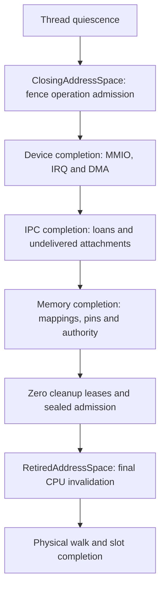

# Cleanup ownership and recovery strategy

Initial inventory reviewed 2026-10-08 against revision `ec8a5383`; summaries
reconciled 2026-10-15 through park/first-dispatch delivery at `1109d05a`.
This is the cross-category
coverage map and implementation plan for SEC-18, with SEC-07 accounting
dependencies. It documents current owners separately from required controller
behavior. It adds no recovery API and does not close either finding.

The unit of **design** is a resource/operation category. The unit of **custody**
is one exact owned operation, which may retain several objects and roots.
An IPC cancellation, for example, cannot be split into independent retries for
its token, loans and roots. They form one completion transaction.

## Common lifecycle

Every category must identify these boundaries, even when its representation
differs:

1. Admit resources and retirement storage before publication. Capture exact
   generations, sponsorship, root dependencies and any hardware identity.
2. Claim the operation and fence competing access under subsystem serialization.
   Detach authority or mappings only while a complete owner retains the work.
3. Leave serialization before waiting, invalidating, draining hardware, invoking
   notifications or releasing physical backing. Check the caller's outer guard
   and IRQ context as well as the callee's own guards.
4. Obtain category-specific completion evidence. CPU invalidation, DMA drain,
   scratch completion and thread quiescence are distinct proofs.
5. Consume physical ownership exactly once. Refund only confirmed released
   backing; retain original charges for uncertain or rejected release.
6. Publish completion and return slot/authority admission only where that
   category's proof permits it. Restart/reassignment is a separate policy step.

Three outcomes need different treatment before successful completion:

| Outcome | Permitted continuation |
| --- | --- |
| Unstarted admission rejection | Explicit rollback may restore the exact source and refund unused reservations. A new application operation may subsequently be attempted. |
| Pending or safely retryable work | Continue only with the returned/still-held complete owner and its recorded phase. Retaining backing alone is insufficient. |
| Uncertain cleanup, abandonment or partial physical release | Keep fences and original charges. No adoption from IDs, timeout-based refund, force-clear or replay of physical addresses. |

Quarantine is a safety outcome, not implemented recovery. The ability to call a
function twice is not proof of a valid retry contract.

## Composition order

The current final-root path composes earlier cleanup rather than repairing it:

An error before final detachment leaves the closing lifetime fenced. The
final-root registry cannot recover that earlier operation. Conversely, successful
root retry must not silently turn a supervisor's cached teardown failure into
restart permission. Each completed sub-operation must remain recorded when a
later phase fails; restarting the entire sequence can repeat irreversible work.

## Receipt coverage map

These 18 rows cover the identified CPU-memory, IPC, device and domain-teardown
owner families. They group composing types, not individual allocations. Each
row names its current continuation boundary and a concrete remaining gap.
Source links identify implementation anchors; category contracts contain the
existing regression evidence. **No row means that all its caller contexts have
been qualified.** G1–G7 below are the remaining shared work items.

| ID and category | Current owner / completion boundary | Current continuation and gap |
| --- | --- | --- |
| C01: live root retention | [`AddressSpaceOperation`](../../crates/catten/src/memory/operation.rs), backed by `SlotLease`; explicit `release` completes the exact generation's count. | A dependency, not a cleanup engine. Drop retains the count. Abandoned counts cannot be decremented by a controller. Caller must also own backing, authority and scratch. Whole-domain abort owns its exact executor before root admission; pending abort requests defer retirement/migration through root completion, then the final mask releases that executor. Abandonment retains both fences; broader kernel-operation contexts remain G1/G2/G7. The [driver grant batch](../reports/audits/2026-10-12-dma-startup-preparation.md) composes this existing exact-root lease with LoadedDomain in PreparedDriver through hardware preparation and consuming thread start. Its complete ManuallyDrop fallback retains the root/count and configuration identities without cleanup; no custody registry or retry owner is added. [DMA unit readiness](../reports/audits/2026-10-12-dma-unit-readiness.md) retains the original grant lease/count and authority reservation through scheduled admission waiting; only ordinary consuming completion releases it. Availability is not root or physical quiescence. The [grant cancellation readiness](../reports/audits/2026-10-12-dma-grant-cancellation-readiness.md) follow-up keeps that same root/count through one consuming rollback's pre-destruction admission, including staged close, without reacquisition or force-clear. |
| C02: staged domain close | [`ClosingAddressSpace`](../../crates/catten/src/memory/retirement.rs), `ClosingSlot`, `RetirementProgress` and `CloseProgress`. | Final heap sampling now borrows this same closing owner and verifies its exact status mapping before metadata detaches ([telemetry evidence](../reports/audits/2026-10-18-telemetry-snapshot-preparation.md)). Pending returns the same owner. Cleanup errors consume the request and leave its fence/root retained; no general error-owner retry API. Cleanup admission seals only after exact device/IPC/memory completion and zero leases. Final mailbox/queue/unified authority and exact-generation policy/usage/signed-authority node detachment, including any unused principal-history candidate, now stays in this owner through root extraction; fallback retains all fields. Complete admitted queue nodes now detach without destruction; queue charges now follow requested backing lifetime; metadata/principal budgets and other final bookkeeping remain G1/G4; G2/G5. The [weekly wait sweep](../reports/audits/2026-10-12-wait-readiness-sweep.md) records timer/yield polling of operation/domain drain without exact lease/pin/claim completion subscriptions; existing owners/fences remain required. S08a uses the same borrowed block-page pending owners while enforcing current store metadata before mount mutation. Unsupported/nonblank-invalid roots, incompatible layouts, owner-zero headers and dual invalid directory copies reject without formatting or public authority defaults. The shared codec owns no resource and adds no cleanup receipt, custody or physical retry proof; see the [format evidence](../reports/audits/2026-10-13-protocol-simplification-object-store.md). The [reply CQ follow-up](../reports/audits/2026-10-12-reply-cq-readiness.md) wakes default-CQ lifecycle interest only after exact-root request publication and local table-guard exit. It adds no cleanup/lease-drain notification or quiescence proof. The [pending-diagnostic follow-up](../reports/audits/2026-10-22-root-retirement-diagnostics.md) retains an inline Copy observation inside this same ClosingAddressSpace: exact preflight lease count/stage, selected IPC token/call/captured roots/epoch/flags/loan count, or memory object/authority/transfer/revocation/pin state. Counts are captured under the same checked preflight hold; memory fields at actual Pending; IPC selection precedes preparation and may become stale across a changed claim episode. Supervisor terminal observation logs the captured root/generation and last Pending before closing-owner abandonment, after local guards. Cached failure remains terminal. No new root/pin/registry/family/custody, allocation, callback, physical cleanup, release/replay authority or policy timeout is added. Existing root/namespace retention and post-proof destruction remain authoritative; outer caller contexts and unresolved historical timeout causality remain separate. The [namespace-selection correction](../reports/audits/2026-10-22-ipc-namespace-selection.md) rechecks an exact nonreused token after rejected preparation. A confirmed missing selection permits rescan through the same ClosingAddressSpace; every still-present token, including active or changed-epoch claims and other admission rejection, remains Pending. No authority is removed by that check, no physical operation is retried, and no new root/pin/registry/family/recovery owner or deadline is added. Fenced namespace admission/quiescent callers bound rescans to actual token removal. Native controls use real queued/delivered peer closes, preserve delivered moved backing and its original sponsor charge past caller retirement, and retain a different live claim until its owner finishes. The historical live timeout remains causally unresolved. The [principal backing ceiling](principal-backing-admission.md) follows these same heap/image owners through staged close, final invalidation and physical release. Logical exit and slot reuse do not refund it. Failed/abandoned cleanup retains its original aggregate share; no new custody or retry proof is added. |
| C03: detached final root | [`RetiredAddressSpace` and root registry](../../crates/catten/src/memory/retirement/recovery.rs), with `id_table::RetiredEntry` and linear slot completion. | Complete failed-invalidation owner has bounded explicit retry: eight slots, two attempts, checked serials. It now retains detached mailbox/complete admitted queue/unified authority metadata, policy/usage/signed-authority nodes, unused principal-history candidates and original record charges alongside the root. Confirmed invalidation releases metadata post-guard, then backing/slot once; rejected barrier retains all fields. Physical rejection/abandonment is terminal. The [execution-target validation](../reports/audits/2026-10-13-execution-targets.md) corrects the native post-guard fixture to observe current-LP mutex ownership: global try-lock contention cannot diagnose a local leaked guard. Root custody and retry policy are unchanged. Trusted kernel hook only; no operator controller or supervisor reconciliation; G5/G6. The [principal backing ceiling](principal-backing-admission.md) follows these same heap/image owners through staged close, final invalidation and physical release. Logical exit and slot reuse do not refund it. Failed/abandoned cleanup retains its original aggregate share; no new custody or retry proof is added. Private-table accounts now retain a shared principal owner, attached before signed root construction. Confirmed unpublished/root release refunds it; cached prefixes, failed walks and abandoned preparation retain it. Atomic identity binding verifies a prebound sponsor without a second charge. See [table/stack evidence](../reports/audits/2026-10-23-security-principal-structure.md). |
| C04: detached kernel range | [`RetiredKernelRange`](../../crates/catten/src/memory/allocators/memory.rs). | Same mutable receipt can retry failed invalidation before `release_started`. Incomplete detach rejects; physical failure/interruption is terminal. Inline 256-extent preparation, 16-frame release batches. Drop now only records atomic diagnostics; a guarded-drop fixture preserves backing. No retained-owner controller adapter; caller context/dependencies remain G1/G2. The [weekly wait sweep](../reports/audits/2026-10-12-wait-readiness-sweep.md) leaves x86 coordinator admission and epoch acknowledgement polling open; bounded polling does not qualify readiness notifications or change physical retry policy. |
| C05: memory mapping retirement | [`MappingRetirementPin` and `RetiredObjectMappings`](../../crates/catten/src/memory/object.rs). | Pin, detached mapping records and peer leases prevent early release. Consuming completion does not return a retry owner on detach/invalidation/scratch error. Metadata Drop can destroy mapping storage while pins/counts remain; G1/G2. The [transfer-close follow-up](../reports/audits/2026-10-12-memory-close-readiness.md) corrects the explicit source-escrow yield loop through C18. Ordinary DMA/copy/loan/mapping pins still reject close with LendingActive; namespace/lease/pin drains retain their separate notification gap. No custody or physical retry boundary changes. |
| C06: loan revocation | [`LoanRevocation` and `LeasedRevocation`](../../crates/catten/src/memory/object/revocation.rs). | `cancel_prepared` restores only unstarted admission. Started `finish` consumes the owner; error retains Revoking/pin, not a retry receipt. Direct ordinary error explicitly releases its root leases; abandonment retains them. Other adapters have their own lease policy; G2. |
| C07: reply completion | [`PreparedReply` and `ReturnedConnection`](../../crates/catten/src/ipc/reply.rs), loans, returned-connection claim and returned-memory `PreparedTransfer`. | Ordinary error restores unstarted receipts and unpublished returns, releases leases and leaves failed loan backing fenced. Abandonment retains the reply/source claim and lease counts. Successful publication jointly installs outputs before result visibility; polling visibility can precede final producer root-lease completion. The scheduled waiter fixture drains exact roots under a deadline on mutation-free busy-close rejection. Claim completion/rollback now closes its exact epoch source through producer-LP deferred notification/disposal for C08/C09 waiters; no failed-operation custody adapter or physical retry proof. See [claim readiness](../reports/audits/2026-10-12-ipc-close-readiness.md); G1/G2/G4/G7. Reply readiness can now wake an owned pending-call CQ interest without observing hidden returned grants; the [CQ evidence](../reports/audits/2026-10-12-reply-cq-readiness.md) retains both observation and exact queue-lifetime qualification. |
| C08: call/reply cancellation | [`PreparedCancellation`](../../crates/catten/src/ipc/cancellation.rs). | Queue/token remain claimed during unlocked revocation. Ordinary failure marks `cleanup_failed`, restores unstarted loans and releases admitted leases without publishing a terminal result. Abandonment retains claim/roots/pins. Consumed failed loan cannot be retried from token IDs; G2. Userspace platform publication now cancels its exact pending owner after a five-second observation deadline, without replay or authority inferred from timeout. Pending-call Drop still aborts the domain if close rejects; a timer is not a cleanup receipt. The [publication deadline evidence](../reports/audits/2026-10-12-security-publication-deadlines.md) tests a queued, unreceived delegation and complete queue-capacity recovery, not uncertain loan/physical cleanup. The [controller deadline follow-up](../reports/audits/2026-10-12-security-controller-deadlines.md) composes the same pending-call cancellation for scalar and moved deployment RPCs; a consumed request is not reconstructed on timeout. Accepted remote mutation remains uncertain; there is no replay or added physical retry/guard qualification. The [weekly wait sweep](../reports/audits/2026-10-12-wait-readiness-sweep.md) replaces client reply timer polling with owned readiness registration plus watchdog. Timeout and rejected waiter admission retain the same pending owner/borrow; application error still explicitly drops it through existing cancellation/abort policy. The [claim-readiness follow-up](../reports/audits/2026-10-12-ipc-close-readiness.md) replaces explicit close yield loops with exact-root, capability and claim-epoch subscriptions. Charged source/disposal preparation precedes IPC relinking; the existing producer-LP transport defers notification and source destruction. Completion, ordinary rollback and cleanup failure close the exact source; failure still publishes no terminal call result and admits no physical retry. Wait/source rejection leaves authority and loan fences intact; close/source fallback retains all fields. Closing a pending-call owner cancels its CQ subscription in the existing record; wait/interest rejection still retains the owner and Rust borrow. See [reply CQ evidence](../reports/audits/2026-10-12-reply-cq-readiness.md). Namespace/lease drains, broader metadata/Drop contexts and pressure qualification remain open; G1/G2/G4/G7. The [Raft persistence simplification](../reports/audits/2026-10-13-protocol-simplification-raft.md) replaces its scalar object-store connection and scratch cleanup with one shared owning Connection and PreparedWrite memory owners. PendingCall::wait consumes exact accepted requests; returned attachments use existing owned cleanup. Persistent object IDs are names and are never deleted by Drop. Admission/write/flush failure does not replay or repair an uncertain record; this adds no kernel cleanup receipt, custody or physical completion proof. The [persistence diagnostic follow-up](../reports/audits/2026-10-15-raft-persistence-diagnostics.md) preserves operation/object/stage and typed memory/IPC/service rejection through these same owners, with separate write-versus-flush fail-stop context. Returned preparation/submission owners retain existing runtime disposal; diagnostic scalars authorize no replay, refund or physical cleanup. The [catalog restore contract](../reports/audits/2026-10-13-protocol-simplification-catalog.md) rejects application snapshots before Raft log/membership publication; it changes no pending-call cancellation ownership and grants no physical cleanup or replay authority. The raw clusterctl verifier copies returned bytes through the existing bounded kernel snapshot boundary and explicitly closes its unique cap; it cannot use the user-root mapping API or infer a successful read from an empty vector. |
| C09: endpoint close | [`PreparedEndpointClose`](../../crates/catten/src/ipc/endpoint_close.rs). | Owns one server lease and processes existing queue storage one call at a time. Ordinary rejection clears the endpoint claim and releases the server lease, but failed call/loan fences remain. Abandonment retains claim/root. No whole-endpoint replay after partial progress; G2/G4. Userspace `Endpoint::close` now consumes confirmed close or returns the exact rejected owner; NIC shutdown retains any rejected/uncertain owner in its existing terminal park without retry. This is not a physical retry proof. See the [network publication follow-up](../reports/audits/2026-10-12-security-network-publication.md). The [claim-readiness follow-up](../reports/audits/2026-10-12-ipc-close-readiness.md) parks owned endpoint close on the exact claimed front, borrowing its existing server lease. Its transient interest is retained with that owner; ordinary completion/rejection disposes it after IPC. Competing explicit closes subscribe to the endpoint claim epoch. Success/rejection closes that source; failed call fences remain authoritative. No new custody registry, failed receipt retry or terminal result inference; G1/G4/G7. |
| C10: namespace IPC cleanup | [`namespace_close::close_with`](../../crates/catten/src/ipc/namespace_close.rs), borrowing the closing root and composing per-token cancellation. | Pending is resumed by C02. Physical error retains failed token/backing and prevents final-root progress. No separately movable namespace receipt; loan-free removal still uses IPC serialization and metadata destruction; G2/G4. |
| C11: namespace memory cleanup | [`PreparingNamespaceObject`, `PreparedNamespaceObject`, `NamespaceObjectClosed` and `NamespaceMemoryClosed`](../../crates/catten/src/memory/object/namespace_close.rs). | Admit mapped peers in existing records before moving mappings; cancel only unstarted admission. Pending preserves C02. Physical/scratch failure consumes the receipt and retains pins, affected peer counts and closing fence; no controller retry; G1/G2. |
| C12: namespace device cleanup | [`PreparedNamespaceDevices` and `NamespaceDevicesClosed`](../../crates/catten/src/device/retirement.rs). | Borrows C02; owns the detached admitted namespace `RetiredEntry` and its ordered capability nodes. Detachment only relinks existing nodes; confirmed post-guard completion carries current unified authority in its original charged retirement owner, then explicitly releases payload and authority nodes before the empty namespace node. Confirmed records are removed one at a time; error/abandonment retains unfinished records/authority. Outer lifecycle/device guards leave before finish, but backend guards are separate. Borrowed owner is not a static custody payload; G2/G3. |
| C13: explicit device/MMIO close | [`PreparedClose`](../../crates/catten/src/device/close.rs) and [`close_cap_with`](../../crates/catten/src/device/mod.rs), an operation lease and reset-visible MMIO descriptor claim. | Non-DMA close owns descriptor, exact root and both detached metadata owners together. Uncertain MMIO retains descriptor, scratch, root count and original authority charge after logical detachment; only confirmed completion disposes metadata and then releases the root. Guarded IRQ abandonment retains its detached payload/authority without touching a successor route. DMA close retains its original payload cell and authority under the shared in-flight claim through backend destruction; ordinary rejection completes its public claim without extracting/reinserting metadata, while abandonment retains the exact root/claim. Confirmed success revalidates the exact cap/domain, then consumes authority and payload once. Public DMA map/unmap/close retains an exact root/capability claim in [`DmaOperation`](../../crates/catten/src/device/mapping.rs); explicit close/namespace preparation rejects its busy claim before extraction. Ordinary completion releases it explicitly; abandonment retains root and authority. Endpoint reset claims also exclude overlapping BAR/ECAM MMIO close and namespace preparation before authority mutation. No uniform typed close receipt; IRQ route removal has a distinct serialized boundary. All three grant categories now prepare device namespace/payload nodes fallibly in shared `GrantAdmission` before local guards/hardware, with exact root/reservation ownership. Successful close detaches payload and unified authority nodes for post-guard disposal before root completion. Unified authority preparation now joins the grant before local guards, retaining captured generation and memory-budget admission checks. The [DMA unmap phase correction](../reports/audits/2026-10-12-dma-unmap-phases.md) preserves the actual domain/engine admission boundary through this public operation owner and the status ABI; only pre-work busy rejection authorizes another submission. It does not alter close completion, root retention or physical cleanup proofs. Other authority callers, broader backend ledger/heap metadata and wider context proof remain required; G1/G2/G3/G4. The [DMA-map failure ownership](../reports/audits/2026-10-12-dma-map-failure-ownership.md) follow-up preserves per-return public admission/backend/completion diagnostics in the same root/capability owner; diagnostics prove neither rollback nor replay permission. The [map-readiness follow-up](../reports/audits/2026-10-14-dma-map-readiness.md) retains this same exact-root/public claim with its original PendingPin and transient interest before actual backend admission. Unstarted rejection releases pin/interest outside backend/device guards, root last; abandonment retains all fields and cannot complete a claim while preparation remains. No close completion, custody or physical retry boundary changes. |
| C14: DMA domain and requester retirement | [`vt_d::destroy_domain`](../../crates/catten/src/device/vt_d.rs), [`amd_vi::destroy_domain`](../../crates/catten/src/device/amd_vi.rs), [`smmu::destroy_domain`](../../crates/catten/src/device/smmu.rs), [`Maintenance` / `DetachedDomain`](../../crates/catten/src/device/detached_domain.rs), [`Preparing`](../../crates/catten/src/device/domain_creation.rs), admitted domain slots and pins. | Explicit destruction moves the complete domain and actual command engine after descriptor detachment, before maintenance. Empty engine admission fences all ordinary backend mutation/reset with `OperationInFlight`; the empty domain cell and nonzero source remain. Configuration/drain waits run outside backend guards. Ordinary hardware rejection restores the actual engine state and exact retiring domain under one original hold; abandonment retains both and permanently fences the unit. Confirmed maintenance returns the engine before unlocked physical release; rejected physical release restores the frozen domain without allocation, and physical abandonment retains its domain claim. Creation rejection uses this same destruction path through C18 after local guards leave. Explicit DMA close now also carries C13's exact root and original claimed capability cell through maintenance/physical release, with no rejection reinsertion. Requester reset now retains an exact endpoint config/BAR/ECAM claim inside C18; config/device/lifecycle/backend holds leave polling through complete-unit creation ownership. Ordinary config/MSI and overlapping MMIO access reject it; activation follows exact busy-cap publication. Reset uncertainty/abandonment retains the complete grant without destructor writes. Private domain construction errors now travel in C18's complete grant; known-private backing/metadata cancellation leaves lifecycle/device/backend/config guards first. Boot unit initialization now claims its existing typed slot and leaves serialization before allocation, control, waits and private cancellation; uncertain control/publication or abandonment retains the complete unit and claim. Ordinary map/unmap and installed-prefix rollback move the complete domain, actual engine and pending pin into `MappingMaintenance`; walking/maintenance run unlocked, exact restoration precedes confirmed post-guard unpin. Failed unmap quarantines without allocating reinsertion; abandonment retains backend and public claims. Initial creation owns the complete installed unit in its existing claimed slot outside lifecycle/backend holds; reject absent engines or any detached domain cell before extraction, preserving physical finalization. Restore exact state on ordinary return; abandonment retains all fields and permanently fences the unit. Domain cells, requester fences and VT-d context metadata now use shared admitted nodes prepared inside the existing grant before reset/IDs/backing. The original cell/source claim survives all data unpins before domain-node detach and post-guard disposal; zero fences reuse their exact node. Shared mapping nodes now admit before data leaves, follow original pins through detach/typed maintenance and relink into quarantine without allocation; confirmed unpin/node disposal leaves backend guards. The [DMA unit readiness follow-up](../reports/audits/2026-10-12-dma-unit-readiness.md) adds a charged source in this same fixed slot: complete creation restoration and maintenance restoration close it only when the actual engine and every domain cell are present. Engine return during physical finalization does not signal; an abandoned unit/domain claim stays nonready. Deferred availability notifications grant no completion, requester reset or frozen-domain retry authority. The [DMA unmap phase correction](../reports/audits/2026-10-12-dma-unmap-phases.md) now carries typed Admission versus Completion errors through all three backends. Only pre-claim busy maps to device status 20; completion errors remain terminal status 14, even if their underlying cause looks busy. This preserves the original root/capability cell and uncertain pins without replay or physical refund. The [grant cancellation readiness](../reports/audits/2026-10-12-dma-grant-cancellation-readiness.md) follow-up now borrows the armed creation from its consuming grant through shared slot admission, then claims exact registered domain/engine under the same hold before one existing destruction. Missing or nonpublished/frozen backing rejects before descriptor/hardware mutation. No wait or replay follows maintenance/physical failure; the original grant remains terminally retained. Broader ledger/heap metadata and wider contexts remain G1/G4; custody/policy G6 and concurrency/physical evidence G7. Map/map-exclusive syscall preparation now borrows the same fixed source and rechecks before one domain/actual-engine/pin extraction under the backend hold. Creation and map restoration use the existing producer-LP deferred signal, requiring every domain cell as well as the engine. Serialized/raw fixtures keep rejecting admission; busy masked/nonscheduled callers reject without enabling IRQs. This is pre-work readiness, never map replay, unmap/close readiness or physical completion. See [map readiness](../reports/audits/2026-10-14-dma-map-readiness.md). |
| C15: IOMMU table backing | [`dma_tables::Tables` and `PreparingRegion`](../../crates/catten/src/device/dma_tables.rs). | Table/region fallback retains backing, original scope/charge and ledger storage without physical/heap allocator, pool, guards or logging, including reservation-only abandonment. Region interruption fences its exclusively borrowed parent. Ordinary private cancellation/prefix rollback is explicit across all three backends; successful release also disposes ledger metadata explicitly. Published backing still needs typed backend completion and `Frozen` forbids partial physical retry. Domain-private constructor errors now retain a typed `PrivateDomain` in the enclosing grant; physical/metadata cancellation occurs after local guards, and physical rejection retains the frozen private payload/root/authority. Boot unit preparation/cancellation now uses the existing slot's `Vacant`/`Claimed`/`Installed` fence and a complete typed owner outside serialization; started control or published failure is terminally retained; explicit domain destruction and C18's published creation rejection release backing/ledger storage outside it while retaining C14's complete owner/slot claim. Map/unmap walkers now borrow complete domain/engine/pending-pin ownership outside backend serialization; failed-unmap pin quarantine needs no exceptional reinsertion. Initial creation/reset, constructor allocation and registry preparation now run under complete-unit ownership outside local lifecycle/backend holds. Domain/source/context nodes are admitted before reset/backing, owned by the complete grant through rejection, and domain-node disposal follows table/pin completion outside guards; SMMU cache nodes now admit before branch linking, retain unused storage through partial walks, and dispose only after confirmed table cancellation/release. Broader ledger/heap metadata and wider contexts remain G1/G4; explicit destruction's maintenance is now also outside its backend guard. No generic table retry or custody. The [grant cancellation readiness](../reports/audits/2026-10-12-dma-grant-cancellation-readiness.md) path now checks that exact registered domain backing is published and unfrozen before its first descriptor mutation. Shared availability is not a table-release receipt, and consuming rollback remains one-shot through waiter or physical rejection. The [IPC readiness matrix](../reports/audits/2026-10-12-ipc-close-readiness.md) also retains a final-source Intel NIC startup DmaUnavailable panic, followed by an identical-artifact passing repeat. The historical cause remains unverified. The [startup preparation follow-up](../reports/audits/2026-10-12-dma-startup-preparation.md) now returns exact stream/backend/reset stages and causes with Confirmed or Retained consuming-cancellation outcomes. A real claimed-unit grant probe preserves OperationInFlight and its original authority accounting. Boot prepares all sibling grants before driver threads can own the shared unit/engine. The [DMA unit readiness](../reports/audits/2026-10-12-dma-unit-readiness.md) follow-up now parks scheduled driver grant admission on a charged source in the existing unit slot, retaining C18's exact root/reservation. Creation and maintenance restoration signal only with the actual engine present and no detached domain cells; abandoned claims do not wake. This is availability for fresh admission, never physical completion or permission to retry a frozen domain. Hardware waits, historical causality and broader pressure remain open; no hardware/physical retry or force-clear is authorized. |
| C16: thread retirement and stack pair | [`ReapBatch` / thread retirement](../../crates/catten/src/cpu/scheduler/threads/mod.rs), [`RetirementList`](../../crates/catten/src/klib/collections/retirement_list.rs), [`Stacks`](../../crates/catten/src/memory/thread_stack/stacks.rs) and [`StackSlot`](../../crates/catten/src/memory/thread_stack.rs). | Both architectures use pinned IRQ-enabled owner-LP reapers and defer active contexts. Physical pair release is explicit and one-shot; its kernel half now retains a non-copyable `KernelStack` with exact base/pages and a terminal release fence, replacing scalar teardown and the allocating guard map ([evidence](../reports/audits/2026-10-17-kernel-stack-ownership.md)). Failed pairs retain the entire thread/context in their existing node and subsequent scans never retry. Stack/context fallback has no physical cleanup; slot/root/charge fallback retains original admission. Ordinary constructor/publication/submission rejection explicitly releases after local guards. Complete `Thread` payload fallback now retains context, stack/root admission, waiter state, exit subscriptions, sponsors and unused retirement storage without callbacks, cancellation, usage refund or field destruction. Consuming metadata disposal requires confirmed pair release and retains its node through typed `release_with`; guarded kernel/user abandonment and post-guard success are qualified in the [metadata follow-up](../reports/audits/2026-10-12-thread-metadata-retention.md). The [first-dispatch correction](../reports/audits/2026-10-15-first-dispatch-delivery.md) completes requested-thread staging and existing deferred delivery on the incoming stack for fresh and resumed contexts, before register restoration. Its negative control and native passes do not establish historical IPC/persistence causality or physical-release qualification. The [automatic capture follow-up](../reports/audits/2026-10-15-automatic-failure-capture.md) retains all-LP stacks/registers, full declared diagnostic arrays and immutable input identity for timed ARM/x86 runs. Snapshot readiness, absence and debugger stop remain observations, never exact exit, quiescence or permission to release/retry. The [captured park-fixture follow-up](../reports/audits/2026-10-15-captured-park-fixture-panic.md) preserves a spontaneous ARM panic and forced-switch negative control: producer-LP delivery may correctly see its publisher Ready after preemption. The corrected fixture checks the exact generation, Ready/Running state, IRQ policy and before-registration delivery; four forced Ready cases retain exact peer exit watches. No production owner, retirement gate or historical timeout disposition changes. The [exit-watch preparation batch](../reports/audits/2026-10-15-thread-exit-watch-preparation.md) captures the exact thread generation/source before fallible list/entry preparation, then revalidates authority/generation and links without allocation under the thread table. The same preparation retains losing metadata/weak references/original charges until post-table disposal. Heap-held publication/rejection and forced TID reuse qualify this narrow C16 context; completion/observer outer callers, inner growth-walker contexts, heap/principal bounds and G1/G4/G7 remain open. No physical retirement proof or retry policy changes. Outer constructor/syscall masks and explicit callback contexts remain G1. The [stack-growth execution owner](../reports/audits/2026-10-15-stack-growth-execution-owner.md) shares the existing execution fence and retains the original complete thread/context/root/stack/charge through unlocked growth allocation, mapping and rollback. Exact lifetime/root/slot/prefix handback precedes fence completion; abandonment retains both fences. Inner walker and other outer contexts remain G1; no new physical retry/custody proof. The abort sweep owns its executor through mutual/remote requests, timer wake and peer scanning, then masks exact local self-request/root completion/executor release. Scheduled handoff now observes atomic current-LP mutex ownership rather than immediate global availability; deterministic local/remote ownership and IRQ-preservation probes qualify that narrow check. The [IPC readiness matrix](../reports/audits/2026-10-12-ipc-close-readiness.md) retains a failed remote lifecycle fixture separately: its handshake prepares the complete thread outside masking, then masks the observing LP before peer publication and uses bounded fixture-only spinning until acknowledgement, avoiding a local yielded/preempted task blocking on the held lifecycle lock. This changes no production wait or cleanup proof. The bootstrap catalogue selects a bounded 32 KiB verification stack through the existing per-domain admission account; signed deployment limits and retirement policy remain unchanged. See the [deployment ingress follow-up](../reports/audits/2026-10-11-security-deployment-ingress.md) for its guard-fault capture and validation. No failed-pair recovery adapter; historical timeouts and broader operation contexts remain unresolved; snapshots and global phase/shootdown counters are not completion proofs; G1/G2/G7. The [reaper readiness follow-up](../reports/audits/2026-10-12-reaper-readiness.md) replaces one-millisecond idle polling with owned event-only waits on the existing fixed LP heads. Staging detaches admitted waiters into the shared producer-LP transport; only that LP claims at post-switch/yield/idle boundaries after local guards leave. Short setup masks bind enqueue/claim to the captured LP, preserving outer IRQ state. Durable post-registration readiness rechecks preserve the original off-stack/Arm ownership and one-shot pair gates; failed/started pairs are nonready. Only recorded admission rejection uses a 10 ms backoff. This adds no custody or quiescence proof; broader admission-pressure progress and outer contexts remain G1/G7. The [timed completion outcomes](../reports/audits/2026-10-12-completion-wait-outcomes.md) follow-up qualifies exit-watch waiting through explicit admission/timeout outcomes and exact-generation failure observations; it changes no exit producer or physical retirement proof. The [Raft batch validation](../reports/audits/2026-10-13-protocol-simplification-raft.md) corrects the watchdog saturation fixture: the root-generation timer account is shared by kernel threads, so a local mask cannot isolate its counter. The still-unpublished driver gets a private trusted fixture sponsor before any event capture, preserving its original root/stack and normal node admission. Production sponsorship is unchanged; no live replacement or new retirement proof. The failed paired run is retained separately. The [scoped launch validation](../reports/audits/2026-10-13-protocol-simplification-launch.md) corrects a timer-event fixture that confused a 1 ms pre-admission timeout with admission rejection. Its dedicated worker prepares a private trusted sponsor before publication; exact-generation exit interest precedes dispatch. No live sponsor swap or polling flag remains. The bounded masked rejection probe changes no production wait outcome or cleanup authority.  S06 removes unchecked CQ waits and their one-wake watchdog path; source/watchdog cancellation now uses the existing exact-identity checked scheduler contract, with explicit admission rejection preserved through the runtime ABI. No exit, root, stack or physical completion proof changes; wider untimed allocation and outer IRQ contexts remain G1/G7. See the [checked-wait evidence](../reports/audits/2026-10-13-protocol-simplification-cq-wait.md).  The [park-boundary correction](../reports/audits/2026-10-14-park-deferred-delivery.md) flushes existing producer-LP readiness delivery before guard-free Blocked publication, preserving enclosing masks and absolute deadlines. It adds no physical proof or retry authority; historical exit/persistence attribution remains open. The [first-dispatch correction](../reports/audits/2026-10-15-first-dispatch-delivery.md) runs existing owner-LP staging and deferred metadata delivery on the incoming stack before register restore, including fresh kernel/user entry. IRQs stay masked, local guards leave before callbacks, and incoming FP/SIMD state restores afterward. Physical release remains on the same pinned reaper with unchanged complete owners, charges and terminal fences. A selected-generation dispatch fixture tests delivery before worker entry and still requires its exact exit watch; historical timeout/persistence attribution remains open. The [selection follow-up](../reports/audits/2026-10-15-scheduler-selection-storage.md) removes temporary load/candidate vectors and rejects started x86 migration until CPU ownership is qualified. Selection under held heap/LP/master guards does not qualify destination run-queue growth, aggregate metadata admission or historical timeout causation; G1/G4/G7 remain. The [inline-queue follow-up](../reports/audits/2026-10-15-inline-scheduler-run-queues.md) removes run-ring growth with exact membership in the existing complete thread payload. Migration rejects before source removal; owner-LP abort unlinks before extraction and linked stack/unstarted cleanup rejects without physical work. Queue abandonment retains membership/charges; no new registry or retry owner. Broader table/waiter/timer/heap contexts and G1/G4/G7 remain. The [wait-publication follow-up](../reports/audits/2026-10-15-scheduler-wait-publication.md) captures exact generation/state/sponsor before registration outside local LP/table guards, remembers early hints and qualifies source callbacks against the installed waker. Ready admission carries the complete old subscription through guard exit before cancellation; rejected/immediate-ready preparation disposes there too. Source/outer masks, registry initialization, timer and general heap contexts remain separately qualified. No root/physical proof, recovery owner or replay authority is added. The [source-preparation follow-up](../reports/audits/2026-10-15-waiter-source-preparation.md) additionally prepares lazy waiter lists outside their slot mutex and IPC/CQ entries outside registries. Exact original-list identity precedes readiness and allocation-free linking; losing/ready/rejected storage survives to post-guard disposal with its original charge. This qualifies subscription metadata only; source teardown and wider outer contexts remain open. The [completion callback/source follow-up](../reports/audits/2026-10-15-completion-callback-preparation.md) captures exact record/root/account before callback list/entry preparation outside registry/inner guards. Publication revalidates before terminal handling/linking; unused storage disposes before immediate delivery. Successful namespace/CQ replacement carries the entire detached payload beyond the registry before destruction, retaining original charges. Authority/staging errors, timer-specific producer cleanup and outer contexts remain separate; no physical or retry proof is added.  The [terminal observer-disposal follow-up](../reports/audits/2026-10-16-completion-terminal-disposal.md) retains detached event/worker subscriptions through terminal/CQ publication, then disposes after local registry/inner unlock. Installation carries replaced/rejected subscriptions across both guards; the terminal wake uses its captured CQ source even if disposal replaces that queue. Original record/watch charges and buffers remain owned; timer/staging/authority metadata and outer producer/IRQ qualification remain open. No physical receipt, new registry or replay owner.  The [CQ payload-preparation follow-up](../reports/audits/2026-10-16-cq-payload-preparation.md) moves CQ list/backlog/ring admission, allocation and partial-error disposal outside COMPLETIONS. Captured root/account/capacity and retirement revalidate before serialized alias checks, physical initialization and replacement. Whole private namespace preparation owns its CQ map node before publication. Original charges remain with rejected owners through unlock and public adapters dispose them as unstarted rollback; no public retry owner is exposed. Fresh registry-map nodes, unified authority, timer cleanup and outer callers remain open. No physical pin, custody or replay authority.  The [detached timer-disposal follow-up](../reports/audits/2026-10-16-detached-timer-disposal.md) moves the complete detached timer-bearing record beyond COMPLETIONS before observer/cancellation disposal and direct-result charge release. Only actual backlog retention consumes its original charge. Exact-source notification follows disposal; an active timer queue callback keeps its separate event charge. This is terminal logical disposal with no retry/custody or physical receipt. Map removal, backlog draining, construction/capability timer installation and outer queue/IRQ contexts remain open.  The [detached preparation follow-up](../reports/audits/2026-10-16-detached-submission-preparation.md) captures exact root/accounts/capacity/classification and CQ source before detached record/event admission and timer node/observer allocation outside COMPLETIONS. Borrowed publication rechecks retirement and namespace/source identity before moving the complete record; rejected owners dispose after unlock as unstarted rollback, without public retry authority. Accepted nodes enqueue once; teardown beforehand retains original event admission through cancelled insertion. The [operation-ID follow-up](../reports/audits/2026-10-16-operation-id-exhaustion.md) rejects permanently before new payload/authority reservation at checked boot-lifetime exhaustion, excluding zero and the syscall failure sentinel. It adds no cleanup/retry owner; existing operations remain usable and replacement cannot reset identities. The [capability-backed preparation follow-up](../reports/audits/2026-10-16-capability-completion-preparation.md) moves record/list/watch and authority storage, timer cancellation/node/producer construction and ordinary rejected-owner disposal outside COMPLETIONS. Hidden reservation and final borrowed batch publication revalidate exact root/accounts/capacity/retirement. One complete owner explicitly finishes after local guards; abandonment retains all fields without cleanup. Timers preserve their original absolute deadline and teardown-before-enqueue cancellation. This is unstarted rollback, not Pending, physical proof or public retry/custody. Map/backlog metadata, close/terminal cleanup and outer contexts remain open. The [timer identity follow-up](../reports/audits/2026-10-16-timer-cancellation-identity.md) removes the private wrapping cancellation selector. Eager removal borrows the retained state Arc and matches exact object identity; stale/fired/unpublished handles cannot remove successors. Original cancellation/backing charges and busy/remote policies remain; this is no completion receipt or physical release authority. The [backlog refund follow-up](../reports/audits/2026-10-16-completion-backlog-refunds.md) carries delivered charges past COMPLETIONS in two inline original-account/class owners, with checked post-guard refunds before parking/notification. Full FIFO mutation and slot updates stay serialized. It also replaces the IPC fixture's registration-implies-Blocked assertion with bounded exact-generation observation of both phases. A second Intel capture identifies a heap/registry cycle from a heap-held CQ waiter fixture after concurrent workers started; its controls now run in the serialized pre-scheduler phase. Both failed samples remain preserved separately. Production map allocation, wider queue/outer guards and historical exit-timeout attribution remain open. The [detached metadata follow-up](../reports/audits/2026-10-16-detached-completion-metadata.md) now prepares shared admitted nodes outside COMPLETIONS, relinks after exact root/account/CQ validation and detaches without allocation/free. Direct receipts and backlogs retain the same original node/charge; flush batches free nodes after unlock before checked class refunds. Complete namespace/preparation/terminal fallback retains every field; explicit ordinary close/replacement drains nodes after local guards. This is unstarted rollback or terminal retention, not retry custody, physical proof or a root pin. Capability/CQ/global map metadata, authority revocation and outer contexts remain open. The [capability completion metadata follow-up](../reports/audits/2026-10-16-capability-completion-metadata.md) prepares payload nodes before hidden authority reservation and relinks after joint validation/publication. Close, abort/event rollback and namespace teardown retain detached authority in the same payload node, then free both after local completion unlock while the charged Arc remains live. Shared authority release retains its exact charge through actual node deallocation. All three withdrawal paths remove their exact pending CQ row before returning a slot, correcting terminal-abort backlog accumulation. Complete fallback retains node/payload/authority/charges without cleanup; no new custody, root pin or physical proof. CQ/global maps and wider timer/observer/caller contexts remain open. The [CQ metadata follow-up](../reports/audits/2026-10-16-cq-metadata.md) prepares one admitted queue node with the complete payload before local registry guards. Publication relinks without allocation; replacement detaches node/source/ring/backlog/original charge together. Explicit post-guard finish frees metadata before payload backing and charge; whole namespace disposal drains these nodes too. Unpublished/retired fallback retains every field. This is unstarted rollback or terminal retention, never Pending, retry custody or physical authority. The global namespace map, aggregate admission and wider timer/observer/IRQ/caller contexts remain open. The [global completion namespace metadata follow-up](../reports/audits/2026-10-16-completion-namespace-metadata.md) prepares its admitted node and four accounts fallibly outside COMPLETIONS in the existing complete namespace owner. Publication relinks after captured validation and physical alias checks, with no later admission after ring initialization. Close/replacement returns the entire node/payload/source/authority/charge set; explicit finish frees global metadata before payload/account disposal after local unlock. Unpublished/retired fallback retains all fields. Runtime CQ setup returns typed allocation failure; mandatory kernel/demo/fixture setup shares the same preparation. Aggregate namespace/account bounds, wider timer/observer/IRQ/caller contexts and historical attribution remain open; this adds no root pin, physical receipt, Pending/retry owner or custody. The [timer queue-disposal follow-up](../reports/audits/2026-10-16-timer-queue-disposal.md) returns complete original event nodes and one inline keyed payload in a retaining receipt on filtering, cancellation, purge, expiry and rejected enqueue. Scheduler, idle, enqueue/cancel and both IRQ adapters leave the local queue borrow before explicit iterative disposal; node backing frees before its outside admission. Receipt/queue abandonment retains every remaining field without cleanup. Exact cancellation identity, comparator/diagnostic updates, callback timing and enclosing IRQ policy remain. This qualifies local disposal only: signal callbacks/waiter notification and temporary-reference disposal remain under the queue; outer scheduler/producer guards, IRQ execution and unpublished preparation remain G1/G4/G7. One private negative receipt retains one event charge without counter resets. No physical proof, Pending/retry custody or historical attribution. The [timer callback-delivery follow-up](../reports/audits/2026-10-16-timer-callback-delivery.md) captures a bounded due prefix into one non-Send/non-Sync PendingDelivery retaining selected and purged original owners. After comparator reconciliation and queue unlock, signal callbacks, waiter notification, temporary observer destruction and disposal run on the captured LP with IRQs masked. One inline queue claim fences nested drains; reentrant enqueue waits for the next pass, and selected cancellation rechecks shared state before signal. Explicit handback reconciles the current queue. Abandonment retains all fields and its fence; private guarded controls retain two event charges without abandoning a live LP claim. IRQ execution, unrelated outer guards, unpublished preparation, final handles and pressure/progress remain G1/G4/G7. No physical proof, Pending/retry custody or historical attribution. The [unpublished timer owner](../reports/audits/2026-10-16-timer-unpublished-ownership.md) now retains a completed private node on abandonment and explicitly consumes unused preparation after local publication/registry guards leave. Sleep prepares before its own park mask; timed-wait rejection/deadline and completion submission finish paths explicitly dispose unused nodes. The initial ARM/Intel IRQ-policy panic samples exposed a newly introduced match-temporary guard crossing local mask release; a statement-bound registration result corrects that ordering, with failed evidence preserved in the linked report. Final handles, partial construction, waiter preparation and outer contexts remain separate; no physical proof, replay or custody. The [timer cancellation handback](../reports/audits/2026-10-16-timer-cancellation-handback.md) retains the exact handle plus removed node/source through enclosing queue/registry exit; explicit finish disposes payloads before final reference release. Bare-handle and handback abandonment retain their original charges without cleanup, flag fabrication or replay. Ordinary unused watchdog handles release explicitly. Raw Arc/Weak finalization, partial construction, completion containing destructors and outer contexts remain separate. The [timer node constructor](../reports/audits/2026-10-16-timer-node-construction.md) captures the already charged event/source and outside admission before allocating empty storage. Rejection retains payload through allocator return; explicit unused cancellation frees empty backing before event and admission. Inert phase abandonment retains every field. Completion initializes the same layout/allocation once into PreparedEvent; raw event/admission construction, raw references and enclosing contexts remain separate. The [event/holder construction follow-up](../reports/audits/2026-10-16-timer-event-construction.md) captures original source/callback before reservation and retains parent admission through shared holder/cancellation preparation. Owning holder rejection cancels after callback return; borrowed rejection retains exact charge for payload-first disposal. Complete phase fallback retains all fields without refund or notification. Completed raw events, published resource-bearing Arc payload destruction and broader outer contexts remain separate. The [shared Arc payload follow-up](../reports/audits/2026-10-16-charged-arc-payload-construction.md) retains the complete value, empty backing and original admission across allocation; rejection disposes explicitly after callback return, private initialization is once-only, and phase abandonment is inert. Outer factories and published/containing destructors remain separate. The [record-construction follow-up](../reports/audits/2026-10-16-completion-record-construction.md) captures buffer, operation and original charge before holder/list allocation. Rejection explicitly disposes payload before admission; all three phase fallbacks retain every field. Shared Arc transfer preserves the original buffer/identity. Outer factories and published/containing destruction remain separate. The [initial completion admission follow-up](../reports/audits/2026-10-16-completion-initial-admission.md) captures the original buffer/target before ID and record/watch admission, retains any early record charge, and borrows the complete transaction through record factories. Pre-record rollback disposes buffer before admission; captured/record/watch abandonment retains all fields. No new family, custody or physical proof. The [shared observer-entry construction follow-up](../reports/audits/2026-10-16-observer-entry-construction.md) captures the exact weak observer and original waiter/watch charge before empty Box allocation; rejection cancels explicitly after allocator return, initialization is once-only, and both partial phase fallbacks retain all fields. Completed entry/token/source and wider containing contexts remain separate. The [completion callback-owner follow-up](../reports/audits/2026-10-16-completion-callback-ownership.md) captures exact target/weak observer before watch/list/entry admission, borrows entry factories and explicitly finishes ordinary construction/publication outcomes before ready notification. All four phase fallbacks retain the complete captured record and original fields; wider observation/token/source destruction remains separate. The [exit-watch ownership follow-up](../reports/audits/2026-10-16-thread-exit-watch-ownership.md) retains captured candidate source, weak callback and original watch charge before list/entry allocation in one inert owner. The scheduler hook borrows it; ordinary outcomes explicitly finish after local guards, candidate source last. Four phase fallbacks retain every field. Initial capture/admission, generic published/source/token destruction and wider contexts remain separate; no target/root lease, physical proof or retry custody. The [waiter preparation ownership follow-up](../reports/audits/2026-10-16-waiter-preparation-ownership.md) captures exact source/sponsor/weak observer before waiter admission in one inert owner. Ordinary preparation and publication outcomes explicitly finish after local guards; transient entry/admission releases before source and sponsor last. Three phase fallbacks retain every field through source closure and sponsor retirement. Initial source capture, generic completed entry, published token/source/batch destruction and wider contexts remain separate; no root/thread lease, physical proof or recovery custody. The [completed observer-entry follow-up](../reports/audits/2026-10-16-completed-observer-entry-ownership.md) makes shared completed private preparation inert on abandonment and requires consuming finish from direct registration and callback/exit-watch/waiter containing owners after local guards. Publication transfers the same entry once; emptied finish cannot refund it. Active linked-entry/token/batch/source destruction and wider contexts remain separate; no physical proof or recovery custody. The [lazy-source owner follow-up](../reports/audits/2026-10-16-lazy-waiter-source-ownership.md) captures original sponsor/weak callback before candidate preparation in one inert transaction, retaining selected winner and shared waiter child. Losing release stays post-slot and before admission; ordinary results explicitly finish. Six handoff-stage fallbacks retain complete fields, while published tokens keep their own entry authority. Inner list factory, active source/token/batch destruction and wider contexts remain separate; no root lease, physical proof or recovery custody. The same stack reservation now owns the signed principal share for maximum user-plus-kernel capacity. Its fallback is inert; only unused cancellation or confirmed complete pair cleanup refunds it. Growth pays no second data charge. The exact root lease, original classification and all started-release fences are unchanged; no new recovery family or custody is added. See [table/stack evidence](../reports/audits/2026-10-23-security-principal-structure.md). |
| C17: provisional CPU backing | [`PreparingUserBacking`](../../crates/catten/src/memory/preparation.rs), [`PreparingTable`](../../crates/catten/src/memory/translation.rs), [`PreparingUserFrame`](../../crates/catten/src/memory/mod.rs), `PreparingKernelFrame` in C04, and `PreparingStackPage` / `Growth` in C16. | Joint heap/image, raw-frame and private/shared-table Drop now only retain captured backing/admission, including reservation-only abandonment, without locks/free/logging. Shared charge fallback uses an atomic diagnostic. Ordinary errors cancel/rollback explicitly, including Arm hardware-tag rejection; physical rollback still borrows the table/account. Initial/growth stack fallback and implicit slot destruction now also retain without cleanup; ordinary constructor/growth rejection cancels explicitly. Published stack-pair physical release is now explicit in C16; outer ordinary rollback contexts remain work. Borrowed account/table context prevents simply moving these owners to a global registry; G1/G2. Private-table accounts now retain a shared principal owner, attached before signed root construction. Confirmed unpublished/root release refunds it; cached prefixes, failed walks and abandoned preparation retain it. Atomic identity binding verifies a prebound sponsor without a second charge. See [table/stack evidence](../reports/audits/2026-10-23-security-principal-structure.md). |
| C18: publication rollback and detached memory | [`PreparedTransfer`, `PreparedSource`, `ChargedFrames` and `RetiredMemory`](../../crates/catten/src/memory/object.rs), [`PreparedCall` / `PreparedConnection`](../../crates/catten/src/ipc/mod.rs), [`MemoryAttachments`](../../crates/catten/src/ipc/attachments.rs), [`PreparingDomain`](../../crates/catten/src/service/loader.rs), `PreparingNamespace` in [`capability`](../../crates/catten/src/capability.rs), [`PreparingRecord` / `RetiredRecord`](../../crates/catten/src/capability/record.rs), [`PreparingMailbox` / `RetiredMailbox`](../../crates/catten/src/syscall/mailbox_publication.rs), word-queue `Operation` in [`mailbox_queue`](../../crates/catten/src/syscall/mailbox_queue.rs), and `PreparedDmaDomain` in C13.  Bounded plain-value telemetry scratch in [`statistics`](../../crates/catten/src/syscall/statistics.rs). | Telemetry scratch prepares fallibly outside thread/usage guards under one 1 MiB request limit. Source growth rejects before output allocation; no prefix is published. Heap reads retain the exact live root, and C02 final sampling borrows its closing owner. Aggregate heap/principal and outer contexts remain open ([evidence](../reports/audits/2026-10-18-telemetry-snapshot-preparation.md)). `PreparingMetadata` now prepares a principal-history candidate with the same unpublished root. Signed identity installation links one combined stack/heap record for a new principal; duplicates keep their unused candidate in the exact authority slot. C02/C03 retain that candidate through failed invalidation and release it explicitly after confirmed invalidation and local guard exit. Published history stays boot-owned; retirement updates existing counters without allocation. General heap/principal limits and snapshot/context work remain open ([evidence](../reports/audits/2026-10-18-principal-history-preparation.md)). `PreparingMetadata` now also prepares the signed-authority slot, initially empty and granting no identity. Signed-loader installation mutates only the captured generation, with no allocating insertion. C02/C03 retain the populated principal/roles/digest through failed invalidation and release its node post-guard ([evidence](../reports/audits/2026-10-18-root-authority-preparation.md)); no new custody or trust authority. `PreparingMetadata` now adds fallible launch-limit/usage nodes to the same registration owner before local publication guards; exact-generation insertion only relinks shared admitted nodes. Sealed cleanup retains both nodes through C02/C03 final invalidation and explicit post-guard release ([evidence](../reports/audits/2026-10-18-root-policy-preparation.md)); snapshot allocation remains separate; principal history preparation is covered above. Memory-budget `PreparingAccount` and containing `PreparingRegistration` now retain fallible node/sponsor metadata with the unpublished root/capability namespace before local publication guards; exact-generation publication is allocation-free for that account, and last-charge/final-close node disposal follows ledger unlock ([evidence](../reports/audits/2026-10-18-memory-sponsor-preparation.md)). Outer guards, aggregate heap/principal admission and policy/telemetry registries remain separate. Prepared source rollback is exact; hidden destinations are not externally usable. Unified `PreparingNamespace` now retains its fallible node/account; user preparation precedes lifecycle/table/ASID publication, ordinary unused storage cancels post-guard, and Drop retains both allocations. Complete namespace detachment retains entries/original charges until explicit disposal outside `CAPABILITIES`; authority records now use the same fallibly prepared nodes. Preparation owns its original charge through rejection; detached record nodes retain charges until explicit post-capability-unlock disposal. Batch moves keep source retirement in the exact escrow/transfer through payload completion and memory-registry unlock. New preparation/retirement Drop is inert. Mailbox `PreparingMailbox` now joins exact-root, shared preparation, budget and payload nodes before local publication guards; explicit `RetiredMailbox` retains both charged nodes until post-guard release/root completion. Both fallbacks retain all fields. Word-queue operations capture the exact root before registry access, prepare admitted nodes/backing outside guards, retain losing preparation through post-guard completion and fence stale/retired/staged identities. Queue preparation now shares the exact mailbox family account and reserves set/requested byte dimensions before fallible fixed-ring allocation; original classification/charge survives deallocation or retaining fallback. Final mailbox/queue/authority metadata now stays in C02/C03 through confirmed invalidation and post-guard release; queue/account metadata and principal admission, completion/accounting teardown, other active token Drop and outer contexts remain G1/G4. Detached `RetiredMemory` Drop quarantines; its consuming release has no physical retry. All MMIO/IRQ/DMA grants share retaining `GrantAdmission` for exact-root/reservation, fallibly prepared namespace/payload nodes and unified `PreparedReservation` storage before local guards. Captured generation/closing/memory-budget admission checks precede reservation; DMA retains its typed backend obligation beside it. Publication only relinks admitted device storage, and unused-node/reservation disposal leaves local guards. DMA grant preparation retains every dependency without implicit field destruction. Backends borrow its `DmaCreation` and record the admitted domain before reachable descriptor publication, including errors. Publication or published-creation rejection uses one-shot explicit rollback outside local lifecycle/device guards; failure retains all three. Creation releases lifecycle after exact admission and rechecks captured generation/closing state under lifecycle before publication; its complete-unit claim leaves backend holds through reset/construction/configuration. The same containing grant now retains its exact endpoint reset claim before writes, through busy capability publication; activation/cancellation are explicit and hardware uncertainty/abandonment retains every dependency. Confirmed backend cleanup precedes reset cancellation. Other preparation destructors can acquire registries, release backing or invoke whole-domain teardown. Private domain roots/CD/MSI prefixes and metadata now stay in `DmaCreation` through rejection; one-shot private release/disposal precedes grant refund/root completion outside local guards. Unit boot preparation now owns its existing slot claim and complete payload through unlocked cancellation or terminal retention; complete-unit creation now releases local lifecycle/backend holds through domain construction and initial creation/reset waits; typed backend registry preparation now retains partial admitted nodes in that same grant before reset/IDs/backing, with explicit post-guard disposal only after confirmed rollback or publication; unused/detached mapping nodes now stay with the exact pending pin in that same maintenance owner, and SMMU unused cache storage stays in its domain until table completion. Broader ledger/heap metadata and inner fallback remain separate; copy submission outside IPC and this scoped grant correction are not universal destructor/context proofs; G1/G4. Userspace TCP/IP receive/status now retains a caller-supplied buffer, received request and transient mapping in `PendingReceive`; mapping disposal precedes reply/loan cancellation, and existing returned-memory transfer retains the original charge. Missing/oversized/read-only rejection, explicit cancellation and retained-sponsor lifetime have targeted evidence in the [caller-buffer follow-up](../reports/audits/2026-10-10-security-tcpip-caller-buffers.md); this does not qualify new outer kernel guards or add custody. The same userspace `OwnedSocket` now retains its active HTTP listener through queue-full accept rejection and bounds close-admission retries before request publication; accepted close is not replayed by that loop. Explicit close reporting and best-effort fallback remain, with no general release guarantee under indefinite saturation. See the [HTTP progress follow-up](../reports/audits/2026-10-10-security-http-progress.md) for failed captures and passing pressure evidence. The [deployment ingress follow-up](../reports/audits/2026-10-11-security-deployment-ingress.md) extends this same userspace protocol-owner boundary: shared borrowed listener setup consumes request backing, and fallible `RequestBuffer` retains/reuses one local request allocation. Rejection drops that owner before a static error response. Shared identity initialization now owns its object-store connection and moved memory requests, borrows launch authority, and treats only successful creation as permission to write; losing creators retain no foreign write authority. Read-only publication observation owns a transient receive/mapping/close-watch completion and returns scalar metadata after their cleanup; the registry connection is borrowed at its existing ABI adapter. Scoped lifecycle ownership stays in the agent; observation adds neither a root lease nor scoped close-watch custody. Physical heap backing still follows the existing root account. No new custody or kernel guard qualification. The same userspace publication boundary now borrows the exact NIC/router endpoint through bounded queue-full delegated-call admission and one observation. Rejection creates no pending owner; accepted calls are not replayed and returned attachments retain typed cleanup. Existing DMA/IRQ backing and broader guard/field-destructor contexts remain separate; no new custody. See the [network publication follow-up](../reports/audits/2026-10-12-security-network-publication.md). The [deadline follow-up](../reports/audits/2026-10-12-security-publication-deadlines.md) extends the same endpoint-borrowing transaction to TCP/IP, time, cluster control, reliable messaging and discovery. The latter two now retain typed endpoint owners through their legacy borrowed reactors. Accepted calls have bounded observation and cancel through C08 on timeout; remote publication is uncertain, so there is no replay. Endpoint Drop and outer shutdown/IRQ contexts keep their existing qualification limits. Deployment HTTP now shares `clusterctl_client` for seven controller RPCs, retaining the exact pending owner until result or deadline cancellation. Admission failure disposes the returned moved request through its owner; accepted result attachments remain owned through decode or rejection. [Controller deadline evidence](../reports/audits/2026-10-12-security-controller-deadlines.md) checks exact one-page original-sponsor recovery at saturation after rejection, unreceived cancellation and returned-page disposal, plus complete queue recovery. This adds no registry, custody family or uncertain physical completion proof. The [object-store readiness/mount follow-up](../reports/audits/2026-10-12-security-object-store-readiness.md) preserves the same typed block connection, borrowed-page pending call and transient mapping through metadata observation. Unreadable superblocks abort mount before formatting; no accepted I/O is retried or reconstructed from diagnostics. Invalid returned attachments receive their existing typed cleanup. Serving publication and first-failure records add no root/physical custody; broader guard/Drop qualification stays unchanged. The [reply CQ follow-up](../reports/audits/2026-10-12-reply-cq-readiness.md) prepares observer/subscription storage outside IPC and revalidates the exact call before installing it in that admitted record. Captured CQ list identity rejects successor wakes; no result/attachment publication occurs at readiness. Broader implicit metadata field destruction under IPC remains G1/G4. The [transfer-close follow-up](../reports/audits/2026-10-12-memory-close-readiness.md) now leases the exact prepared source root and parks on a charged transfer interest instead of yielding. Fallible source/list-disposal storage precedes registry publication, with exact object/fence revalidation and closed-source recheck. Source completion queues admitted notifications and the owning list node in shared producer-LP metadata transport; another LP cannot consume it beneath the producer IPC guard. Source/close fallback retains complete fields, ordinary completion releases the close lease, and wait rejection returns ResourceLimit without authority mutation. The same transport delivers C16 readiness; it owns no backing/root transaction or retry authority. Pin/loan rejection and namespace drains remain separate; G1/G4/G7. The [driver startup preparation](../reports/audits/2026-10-12-dma-startup-preparation.md) retains each loaded driver root and lease in its existing launch/publication family until all boot hardware grants prepare and thread start consumes it. Start finishes the lease after publication; fallback retains fields. Typed creation diagnostics retain the original cause across confirmed or failed cancellation; an error is not a replay owner. The boot ordering excludes sibling-driven unit contention before grant admission, without adding waits, registries or physical completion proofs. The [DMA unit readiness](../reports/audits/2026-10-12-dma-unit-readiness.md) follow-up adds an explicit scheduled grant path that owns its transient interest beside this same preparation, prepares charged source/disposal nodes before backend serialization, parks without a timer, and rechecks before complete-unit extraction. Masked/nonscheduled and admission-rejected waits return a typed error through ordinary unarmed cancellation; fallback retains every field. Fresh availability never replays armed creation, retries uncertain cleanup or force-clears an abandoned slot. The [DMA unmap phase correction](../reports/audits/2026-10-12-dma-unmap-phases.md) records userspace unmap progress before kernel entry in the existing `DmaTransfer`/`SharedDmaMemory` owners. Explicit pre-work busy rejection permits another submission; ambiguous failure retains its status and memory owner without another `finish`/Drop DMA call. Confirmed DMA completion survives later CPU-unmap failure. Existing best-effort local cleanup cannot discharge the kernel's uncertain pin/backing owner. No new custody or completion proof is added. The [grant cancellation readiness](../reports/audits/2026-10-12-dma-grant-cancellation-readiness.md) follow-up composes creation and pre-destruction availability through one shared admission helper and the same complete grant. Rollback-started stays set through its wait and one actual claim; waiter failure, interruption and hardware/physical rejection return the entire nonretryable owner. Closed-source observation cannot refund its root/reservation or reconstruct a domain. The existing failed-grant fixture now covers rejected admission and retained transient interest without adding an abandoned root; ready-path real staged-close cancellation completes its original root. Broader preparation/Drop contexts and map/unmap/close contention policy remain open. The [DMA-map failure ownership](../reports/audits/2026-10-12-dma-map-failure-ownership.md) follow-up retains failed shared-DMA CPU mappings behind a restricted runtime owner without slices/pointers; explicit CPU unmap and best-effort Drop cannot discharge uncertain kernel pins or original backing charges. The [timed completion outcomes](../reports/audits/2026-10-12-completion-wait-outcomes.md) follow-up retains the same completion/buffer through checked admission rejection and unrelated wakes, with a shared absolute deadline and no result consumption before terminal readiness. The [scoped launch receipt](../reports/audits/2026-10-13-protocol-simplification-launch.md) now supplies the kernel-verified principal directly to the existing `DeployedArtifact` owner. Its explicit completion and best-effort force fallback keep that identity; zero cannot select a lone registry entry. Input transfer and kernel/root cleanup obligations are unchanged, with no new physical retry authority. The execution-target kernel fixture's `call`/`call_with_memory` adapters now consume unused observed reply caps and complete their calls outside IPC; this qualifies only its moved-memory, no-loan ABI adapter, with existing original-charge/retention policy unchanged. S04b2a removes the descriptor-less launch branch rather than weakening its rollback requirements. Controller status/rollout and unknown-operation rejection adopt unique request/reply attachments at the raw receive boundary, use consuming owned moves, and retain returned memory through validation; raw fixture reply cleanup remains outside IPC. Other receive handlers and their enclosing contexts remain separate qualification work; no new custody or physical retry authority. S04b2b removes replicated diagnostics while preserving the same owned request/result and exact variant pins. Its initial x86 NIC startup returned backend OPERATION_IN_FLIGHT during DMA mapping and never reached router readiness; the existing retaining map-failure policy remains; the passing guest repeat does not qualify public DMA-map readiness or identify the contending owner. See the [record-batch evidence](../reports/audits/2026-10-13-protocol-simplification-records.md).  S06 ordinary service reactors and timer-backed admission pauses abort on checked wait/timer rejection instead of spinning or advancing protocol time; pending transactions and borrowed buffers remain governed by the existing domain-retirement owners. Sitas sleep/reactor budgets retain their original monotonic deadlines; its shared-CQ parker backstop remains explicitly unqualified as per-waiter readiness. No new custody, cleanup receipt or retry authority; see the [checked-wait evidence](../reports/audits/2026-10-13-protocol-simplification-cq-wait.md). S08b1 removes the S3 manifest fallback and duplicate validator while retaining the existing read-only launch-profile borrow and zeroizing secret owner. Registration metadata now carries its generation explicitly; readiness/activation and attachment ownership are unchanged. This adds no custody, cleanup receipt or physical retry authority; see [registration/profile evidence](../reports/audits/2026-10-13-protocol-simplification-registration-profiles.md). S08b2a replaces Kafka authentication sections with fixed borrowed credential fields, removing the temporary secret-bearing allocation while retaining the same zeroizing final launch buffer, read-only profile mapping and connector secret owners. Rejection creates no broker transport; no new custody, cleanup receipt or physical retry authority. See [Kafka profile evidence](../reports/audits/2026-10-13-protocol-simplification-kafka-profile.md). S08b2b consumes catalog requests once at the raw receive boundary into IncomingMessage before the scalar attachment guard. CatalogReply contains the existing ReplyToken, encoded bytes and typed OwnedMemory/mapping state for complete bounded output through allocation, mapping, unmap and consuming move; rejected moves return their owner to existing Drop. Request rejection releases unique attachments; no scalar catalog cleanup ladder remains. Catalog encoding borrows the existing userspace registries and prepares one fallible buffer, without cloned-entry snapshots; their mutex context is unchanged. HTTP resolves one fresh owned DNS connection per requested node/cluster observation and keeps its existing pending reply/mapping through exact-length and whole-set validation, with no clamped prefix or invented empty table. Existing runtime fallbacks and broader guard/physical qualifications remain; no custody or retry authority. See [catalog observation evidence](../reports/audits/2026-10-13-protocol-simplification-dns-catalog.md). S08b2c1 makes correlated-query identity copies/output preparation fallible and exact, before existing pending-query publication. The original name moves into that same pending record after byte preparation, with its deadline captured beforehand. No accepted invocation is replayed, no closeable authority is created by the codec, and rejected reply preparation leaves the original caller query/deadline intact. Existing raw reactor reply/attachment contexts, metadata publication/destruction and readiness subscriptions remain separately qualified. No custody, registry, cleanup receipt or physical retry authority. See [query-relay evidence](../reports/audits/2026-10-14-protocol-simplification-dns-query-relay.md). S08b2c2 retains a fallibly prepared fixed invocation reply buffer in the same remote local-call destination before admission. Ordinary rejection returns the entire destination; terminal progress consumes its original buffer without result-time codec allocation. Direct request preparation precedes in-flight publication with the captured deadline; query-routed invocation retains its original query deadline and rejects expired routing before admission. The scalar local lookup now rejects unrepresentable names before submission instead of truncating; its full-name owning replacement remains pending. Source/session/peer/generation and dedup ACK fences remain unchanged. Transport/dedup metadata, raw completion/connection/attachment cleanup and broader guard/Drop contexts remain separate; no custody, registry, physical completion or retry authority. Both S08b2c2 final-source linked pairs failed during x86 NIC startup with backend DMA-map OPERATION_IN_FLIGHT; their failed captures remain separately recorded. The map-readiness follow-up now verifies unchanged final DNS bytes in two passing linked pairs, including real ordinary/exclusive map contention controls. Exact contention ownership and public map readiness are unqualified; diagnostics permit no replay. See [invocation-relay evidence](../reports/audits/2026-10-14-protocol-simplification-dns-invocation-relay.md). The [DMA-map readiness follow-up](../reports/audits/2026-10-14-dma-map-readiness.md) extends the existing public DmaOperation: original pin, captured root classification and transient interest stay inside it before source preparation outside local guards. Shared admission passes that same owner to its once-only backend claim, returning complete MappingMaintenance before guard exit. Ordinary unused preparation releases explicitly; pre-claim Drop retains root/claim/pin/interest without locks, allocation, callbacks or physical cleanup. Syscalls opt into qualified scheduled admission while serialized kernel adapters remain rejecting. Wider IRQ/metadata contexts, masked SVC progress, unmap/close and historical contention attribution remain open; no new custody/registry or replay authority. S08b2c3 keeps registration connections and reply authority in the existing Prepare/Activate/RemoteRegister phases as Connection/ReplyToken owners, transferring connections into LocalPublication without raw re-adoption. Preparation rejection and deferred abort drop the same owners; full-name owned lookup/registration retains returned resources through CallResult disposal. Follower request and pending storage prepare before transport publication; the leader retains a prepared terminal reply through both Raft phases. Replies match captured peer/session/nonreused request, while retraction still carries exact owner/generation. Watch completions, transport/catalog allocation, other raw adapters and wider Drop/IRQ contexts remain separate. The second linked run exposed an unresolved scheduled IPC endpoint-close exact-exit timeout, followed by Raft persistence errors. The probe now captures exact-generation live/staged state on timeout without widening its budget or permitting cleanup; passing HTTP repeats do not establish its cause. The [IPC exit investigation](../reports/audits/2026-10-14-ipc-close-exit-investigation.md) adds bounded repeated same/cross-LP real close episodes and retains the exact admitted claim Interest through exit observation for source/phase diagnosis. Eight rounds across up to four LPs require the original exact watch and busy-root rejection; 192 close/exit episodes passed across two mixed pairs. Those initial passes did not reproduce the timeout; the subsequent NS generation batch reproduced it on both architectures. Later park/first-dispatch controls establish distinct ordering corrections, not historical attribution or physical stack/backing release. No new custody, registry, wait source, physical proof or retry authority; see [registration-relay evidence](../reports/audits/2026-10-14-protocol-simplification-dns-registration-relay.md). The [owned local DNS invocation](dns-local-invocation.md) replaces scalar lookup/invoke stages with `LocalInvocation`, typed client reply authority and unique incoming attachment ownership. Both accepted RPC phases bind readiness to the same CQ and retain the original kernel-monotonic deadline; post-accept binding rejection/timeout is uncertain, never replayable. Original pending/connection owners survive until confirmed observation or runtime cancellation/close policy; this grants no physical or custody proof. Raw receive/transport/watch contexts and broader metadata admission remain gaps. The [NS generation replacement](name-service-generations.md) now carries exact full names and zero/positive generations in one mandatory record. NS consumes unique incoming attachments and retains registrar/manager checks; DNS cleanup owns CQ-bound pending calls and one original deadline, without replay. Storage/preparation/submission rejection fails closed with the containing transaction; binding rejection retains the accepted owner through abort. Explicit observation rejects before catalog mutation on admission/wait failure. Best-effort NS connection close remains logical teardown only; raw registry/watch/transport contexts and physical proof remain separate.  The [park-boundary correction](../reports/audits/2026-10-14-park-deferred-delivery.md) flushes existing producer-LP readiness delivery before guard-free Blocked publication, preserving enclosing masks and absolute deadlines. It adds no physical proof or retry authority; historical exit/persistence attribution remains open.  The [NS endpoint-death producer](../reports/audits/2026-10-14-ns-endpoint-death.md) retains each source connection and persistent watch in one publication, admits before mutation, and logically retires only on its confirmed exact close result. Shared-CQ intake is event-only and preserves principal/generation checks. Watch cancellation precedes source disposal; this is no physical cleanup proof or retry owner.  The [NS bearer removal](../reports/audits/2026-10-15-ns-bearer-removal.md) rejects retired/unknown opcodes through one owning incoming transaction instead of scalar attachment cleanup; no body/key fallback or authority is retained. Public policy denial and exact publication/watch owners remain. The [NS status replacement](name-service-status.md) extends C18 through one incoming/status reply owner, retaining bytes, memory/mapping and reply authority through complete bounded preparation and consuming publication. Ordinary preparation/move rejection uses existing runtime disposal without replay; no new physical proof, custody or outer-context qualification. See [execution evidence](../reports/audits/2026-10-15-ns-status-snapshot.md). Shared record/list/timer charge-holder construction now retains original admission outside empty Arc storage, initializes privately once and cancels ordinary rejection after allocator return; inert phase fallback retains all fields. This qualifies that primitive, not containing publication/destructor contexts or physical cleanup; see the [event/holder report](../reports/audits/2026-10-16-timer-event-construction.md). The [shared Arc payload follow-up](../reports/audits/2026-10-16-charged-arc-payload-construction.md) retains the complete value, empty backing and original admission across allocation; rejection disposes explicitly after callback return, private initialization is once-only, and phase abandonment is inert. Outer factories and published/containing destructors remain separate. The [record-construction follow-up](../reports/audits/2026-10-16-completion-record-construction.md) captures buffer, operation and original charge before holder/list allocation. Rejection explicitly disposes payload before admission; all three phase fallbacks retain every field. Shared Arc transfer preserves the original buffer/identity. Outer factories and published/containing destruction remain separate. The [initial completion admission follow-up](../reports/audits/2026-10-16-completion-initial-admission.md) captures the original buffer/target before ID and record/watch admission, retains any early record charge, and borrows the complete transaction through record factories. Pre-record rollback disposes buffer before admission; captured/record/watch abandonment retains all fields. No new family, custody or physical proof. The [shared observer-entry construction follow-up](../reports/audits/2026-10-16-observer-entry-construction.md) captures the exact weak observer and original waiter/watch charge before empty Box allocation; rejection cancels explicitly after allocator return, initialization is once-only, and both partial phase fallbacks retain all fields. Completed entry/token/source and wider containing contexts remain separate. The [completion callback-owner follow-up](../reports/audits/2026-10-16-completion-callback-ownership.md) captures exact target/weak observer before watch/list/entry admission, borrows entry factories and explicitly finishes ordinary construction/publication outcomes before ready notification. All four phase fallbacks retain the complete captured record and original fields; wider observation/token/source destruction remains separate. The [exit-watch ownership follow-up](../reports/audits/2026-10-16-thread-exit-watch-ownership.md) retains captured candidate source, weak callback and original watch charge before list/entry allocation in one inert owner. The scheduler hook borrows it; ordinary outcomes explicitly finish after local guards, candidate source last. Four phase fallbacks retain every field. Initial capture/admission, generic published/source/token destruction and wider contexts remain separate; no target/root lease, physical proof or retry custody. The [waiter preparation ownership follow-up](../reports/audits/2026-10-16-waiter-preparation-ownership.md) captures exact source/sponsor/weak observer before waiter admission in one inert owner. Ordinary preparation and publication outcomes explicitly finish after local guards; transient entry/admission releases before source and sponsor last. Three phase fallbacks retain every field through source closure and sponsor retirement. Initial source capture, generic completed entry, published token/source/batch destruction and wider contexts remain separate; no root/thread lease, physical proof or recovery custody. The [completed observer-entry follow-up](../reports/audits/2026-10-16-completed-observer-entry-ownership.md) makes shared completed private preparation inert on abandonment and requires consuming finish from direct registration and callback/exit-watch/waiter containing owners after local guards. Publication transfers the same entry once; emptied finish cannot refund it. Active linked-entry/token/batch/source destruction and wider contexts remain separate; no physical proof or recovery custody. The [lazy-source owner follow-up](../reports/audits/2026-10-16-lazy-waiter-source-ownership.md) captures original sponsor/weak callback before candidate preparation in one inert transaction, retaining selected winner and shared waiter child. Losing release stays post-slot and before admission; ordinary results explicitly finish. Six handoff-stage fallbacks retain complete fields, while published tokens keep their own entry authority. Inner list factory, active source/token/batch destruction and wider contexts remain separate; no root lease, physical proof or recovery custody. The [coherent-DMA remap fence](../reports/audits/2026-10-18-coherent-dma-remap-fence.md) blocks fresh read-only and writable CPU mappings until the last DMA pin is removed. Consuming restricted CPU teardown does not discharge a retained pin or original charge; existing coherent mappings precede pinning. The [NS publication model and generation correction](../reports/audits/2026-10-18-name-publication-model.md) projects candidate/watch ownership, protected public issuance, exact death retirement and watch-before-source disposal. Policy publication rejects beyond the positive signed NS generation range before mutation, leaving the existing binding/tombstone and unused candidate owner intact. Kernel producer provenance, trusted watch-budget preparation, actual metadata/Drop/outer contexts and physical completion remain separate. The [per-read fence follow-up](../reports/audits/2026-10-19-raft-read-fences.md) retains the query fence, original deadline and typed reply destination in one bounded DNS operation. Timeout/drop abandons the read without rolling back its no-op or admitting a business invocation. Placement lookup returns no local capability authority; remote metadata uses an owned moved-memory reply. Subsequent invocation retains its existing owned NS lookup/call phases on the shared CQ, with original deadlines and fail-closed binding/cancellation policy. This extends C18 without a new custody registry or physical completion claim; raw transport and wider allocation/readiness contexts remain separate. The [Raft stream correction](../reports/audits/2026-10-19-raft-snapshot-streams.md) keeps partial bytes with their captured leader/RPC term and boundary; election/term change discards that local buffer. This releases only core heap storage in the serialized userspace reactor, with no capability, kernel root, physical proof or retry authority. General heap admission and raw transport contexts remain separate. The [early artifact-authority follow-up](../reports/audits/2026-10-19-security-platform-artifact-authority.md) retains the zeroizing boot preparation in the existing slot before platform loading. Composition takes that owner once while public authority stays immutable; rejected selection/publication returns the complete unused owner after unlock. Final publication requires the selected policy/digest. This adds no capability/root cleanup, recovery custody or physical proof; protected installation/custody remains separate. The [SEC-15 hash-state follow-up](../reports/audits/2026-10-19-security-hash-state-erasure.md) extends the bounded local scratch inventory: SHA Drop erases named state/buffer/counters, compression owns its schedule/working words, and shared HMAC plus SCRAM PBKDF2 transfer zeroizing result owners. This is infallible local erasure without guards, allocation, capability release or recovery custody. Scalar/compiler/library copies, abort-without-Drop and physical teardown remain separate; no physical proof or replay authority is added. The [SCRAM phase follow-up](../reports/audits/2026-10-19-security-scram-phases.md) consumes the initial password/transcript owner during challenge handling and retains proof plus expected signature in one final owner. Every terminal verification result consumes that phase, including early rejection. Implicit Drop erases/frees its existing local buffers in ordinary userspace authentication context; no capability syscall, new registry, physical proof or replay permission is added. Configured credentials, third-party/caller copies, forced termination and broader allocator/outer contexts remain separate.  The [HPKE erasure follow-up](../reports/audits/2026-10-19-security-hpke-erasure.md) requires erasing X25519 private/shared dependency owners and returns generated private bytes in their existing zeroizing owner. Authentication rejection explicitly zeroizes the attempted plaintext prefix. These local destructors add no locks, allocation, capability cleanup or recovery custody; library scratch, forced termination and physical release remain separate.  The [Base64 scratch follow-up](../reports/audits/2026-10-19-security-base64-scratch.md) constructs SCRAM helper output owners before writing, reserves the full decode bound and erases partial output on rejection. Quantum digits/words have local zeroizing owners. Their infallible Drop erases/frees ordinary userspace scratch without guards, capability calls, custody or physical completion. Frame/transport copies and forced termination remain separate.  The [SASL frame follow-up](../reports/audits/2026-10-19-security-sasl-frames.md) validates full request size before copying into a reserved erasing encoder and transfers that buffer directly. Reply parsing consumes the complete zeroizing frame and lends a validated range, eliminating the independent authentication copy through late rejection. Scoped first-exchange buffers drop before the final exchange. These local byte owners perform no capability/physical cleanup, guard acquisition or custody work; transport copies and forced termination remain separate.  The [receive-owner follow-up](../reports/audits/2026-10-19-security-receive-owners.md) puts Kafka partial frames and cached chunks in one existing transport owner. Header validation admits one frame reservation; completed owners transfer without growth/split copies. Error/unwind fences reads until stream discard/reset. TLS/plain chunks and adapted S3 buffers erase through local Drop; consumed ranges wipe explicitly. No capability/root release, guards, allocator custody or replay proof is added. S3 growth, library records, socket backing and forced termination remain separate.  The [S3 response-buffer follow-up](../reports/audits/2026-10-19-security-s3-response-buffers.md) reserves the same local header/body owners before copying and erases framing scratch after consumption/Drop. Failed parsing fences that episode; service rejection removes the containing operation. Local byte Drop adds no capability, guard, recovery-custody or physical replay authority.  The [S3 request-owner follow-up](../reports/audits/2026-10-19-security-s3-request-owners.md) retains signature/authorization text and the reserved serialized header in local erasing owners through send/rejection. Field validation precedes output allocation; normal byte Drop introduces no capability release, guard acquisition, custody or physical/replay proof.  The [canonical-signing follow-up](../reports/audits/2026-10-20-security-s3-canonical-owners.md) reserves and owns canonical URI/query/header copies, scope/hash text and returned request/transcript/name fields before writing. Invalid header shapes reject before normalization; source inputs retain their own lifetimes. Ordinary byte Drop adds no capability, guard, custody, physical or replay authority.  The [response-metadata follow-up](../reports/audits/2026-10-20-security-s3-metadata-owners.md) consumes the existing header buffer into ResponseHead and lends validated metadata ranges through encoding. Rejection/Drop erases that whole owner; replacement retains superseded bytes until Drop. Exported IPC/client copies keep their own lifetime. No independent metadata allocation, resource registry, guard, custody or physical/replay authority is added.  The [request-key/raw-path follow-up](../reports/audits/2026-10-20-security-s3-path-owners.md) retains an independently owned erasing key snapshot after the existing IPC mapping boundary, and reserves the complete erasing raw path. Rejection/abandonment drops local byte owners without capability or guard work. Validated profile fields still determine bucket/prefix; no new registry, custody or physical/replay authority is added.  The [S3 profile-owner follow-up](../reports/audits/2026-10-20-security-s3-profile-owners.md) retains the complete validated service-local profile in one immutable erasing frame, lends fields without copies and reserves erasing HTTP authority text. Ordinary byte Drop performs no capability calls, guard acquisition, waits, remote teardown or recovery-custody work. Original launch memory, logging/provisioning copies and physical release remain separate; no new registry, retry or cleanup authority is added.  The [S3 profile-encoding follow-up](../reports/audits/2026-10-20-security-s3-profile-encoding.md) returns the existing single encoded frame under an erasing owner before credential writes. The kernel caller's former immediate wrapper is removed; its containing launch scope, byte-buffer release and borrowed launch-memory preparation remain unchanged. Ordinary byte Drop adds no guards, waits, capability/root cleanup, custody or physical/replay authority. Caller inputs and launch-memory backing retain separate policies.  The [Kafka profile-encoding follow-up](../reports/audits/2026-10-20-security-kafka-profile-encoding.md) returns the existing single frame under an erasing owner before credential writes. The kernel's immediate wrapper is removed while its containing launch scope and byte-buffer release context stay the same. Ordinary byte Drop adds no guards, waits, capability/root cleanup, remote teardown, recovery custody or physical/replay proof. Source credentials, connector-local copies and launch backing keep separate policies.  The [SCRAM initial-owner follow-up](../reports/audits/2026-10-20-security-scram-initial-owners.md) keeps nonce, password and directly escaped transcript in the existing initial phase, removing one scratch allocation. Consuming success/rejection and ordinary Drop erase/release that local state before final-phase use. No capability calls, guards, waits, remote teardown, new registry, custody or physical/replay authority are added; original inputs and configured credentials retain separate policies.  The [host key-file follow-up](../reports/audits/2026-10-20-security-host-key-encoding.md) reserves one erasing hex-plus-newline owner before copying generated key bytes. The existing host file writer borrows it through success/rejection; its prior final-buffer erasure and filesystem rollback contexts remain unchanged. Ordinary byte Drop adds no Charlotte capability/root cleanup, guards, waits, new registry, custody or physical/replay proof. Source keys and OS/file buffers retain separate policies. The [host profile-input follow-up](../reports/audits/2026-10-20-security-host-profile-input.md) retains one complete initialized erasing byte destination before reads, including partial failure and unreported dirty tails. Ordinary byte Drop adds no capability/root work, guards, waits, remote teardown, custody or physical/replay authority. Source files and OS buffers retain separate policies. The [public-key input follow-up](../reports/audits/2026-10-21-security-public-key-input.md) shares the existing bounded host file reader and returns public key buffers through the existing local byte-owner scope. Ordinary release adds no capability calls, guards, waits, new registry, recovery custody or physical/replay proof; public file checks grant no key-provisioning authority. The [operational-input follow-up](../reports/audits/2026-10-21-security-operational-input.md) shares that host reader for bounded ciphertext and release references, checking binding count before referenced reads. Rejection drops existing public byte owners before output/network publication. No new capability/root cleanup, guards, waits, registry, custody or physical/replay authority is added. The [control-input follow-up](../reports/audits/2026-10-21-security-control-input.md) extends the same local host reader/byte-owner scope to structured control records and release references. Rejection precedes notification/apply connection; release count admission precedes referenced reads. Existing apply preparation order remains. No new capability/root cleanup, guard, wait, registry, custody or physical/replay proof is added. The [artifact-input follow-up](../reports/audits/2026-10-21-security-artifact-input.md) shares captured-descriptor admission for bounded ELF reads and streaming hash input. Note output sizing and variant count reject before their respective allocations/reads; the hash loop owns one erasing 16 KiB array plus existing SHA state. Ordinary host byte/descriptor Drop adds no Charlotte capability/root cleanup, guard, wait, custody or physical/replay authority. The artifact-edit follow-up below addresses write redirection; atomicity and other copies remain separate. The [artifact-edit follow-up](../reports/audits/2026-10-21-security-artifact-edit.md) retains the exact host read/write File and prepared ELF bytes in ArtifactEdit until consuming commit returns. Borrowed shared admission/reads keep that descriptor live. Drop before commit closes/releases local fields without writing; commit error consumes the owner with no retry/rollback or durable-completion proof. No path reopening, registry, Charlotte root/capability cleanup, guards, waits or physical/replay authority is added. Rename/unlink changes names without changing the selected file; pathname continuity, concurrent writers and partial writes remain separate. The [control-output follow-up](../reports/audits/2026-10-21-security-control-output.md) reuses the existing exclusive host writer for deployment/release/shutdown records. Rejection at creation leaves existing paths untouched and releases prepared public byte owners; ordinary success closes the local file. Fresh private fixture directories retain each run's signed records. No Charlotte capability/root cleanup, guard, wait, registry, recovery custody or physical/replay authority is added. The output-retention follow-up below removes failed-write pathname unlink and key-pair rollback; exclusive admission supplies no atomic/durable publication proof. The [output-retention follow-up](../reports/audits/2026-10-21-security-output-retention.md) closes the existing host File on write error without pathname deletion. One shared pair writer retains a completed private file when public output fails and reports incomplete generation. Per-file erasing text still releases before the next encoding; source key owners retain their existing lifetime. Retained filesystem content is operator-inspection state, never a retry owner or completed-pair proof. No new guards, waits, Charlotte capability/root cleanup, registry, custody or physical/replay authority is added; namespace continuity, disk erasure and atomic/durable publication remain separate. The [fixture-publication follow-up](../reports/audits/2026-10-21-security-fixture-publication.md) retains the local bundle's staging file in the existing private run directory. An exclusive Python file owner closes before one named replacement; staging/write/close failure leaves prior output alone, and tested replacement rejection retains complete staging. Failure cleanup performs no pathname deletion or implicit retry. Success publishes a new file and preserves earlier open readers; retained filesystem artifacts are inspection state, never a retry owner, capability/root completion or custody proof. No guards, waits, registry or recovery family is added. Namespace integrity, output metadata, concurrent writers, fsync/durability and ambiguous filesystem errors remain separate. The [deployment-generation follow-up](../reports/audits/2026-10-21-security-deployment-generation.md) reserves host observation storage before descriptor notification and borrows captured names from the retained prepared byte set. Each successful acknowledgement supplies its own generation; ordinary terminal success/error drops public byte/string/vector fields and closes existing host sockets. Malformed or superseded observation grants no rollback, completion of remote work or authority to replay accepted notification. No Charlotte capability/root cleanup, guards, waits, new registry/family, recovery custody or physical proof is added. The [release-generation follow-up](../reports/audits/2026-10-21-security-release-generation.md) prepares local reply authority plus mapped output before Raft admission or relay, and bounded remote terminal bytes before submission. Existing pending owners retain these through commit, term change, redirection and timeout. Incoming transactions transfer once before scalar guards; consuming completion moves the same output memory. Clusterctl/deployd retain request and returned-memory owners across their existing guard-free service calls. Ordinary preparation rejection drops local owners before mutation; accepted ambiguity is terminal and grants no replay or rollback authority. Host observation storage reserves before POST and borrows retained component names. No kernel root, pin, charge, physical proof, custody registry or new family is added. Live allocator/map/wait-rejection injection and wider destructor contexts remain unqualified. The [host deadline follow-up](../reports/audits/2026-10-21-security-ingress-deadline.md) carries one checked monotonic deadline through prepared inputs, all notifications and observation. Its shared transport owns one host socket across connect, partial writes and response reads; every step consumes remaining budget, and ordinary error/timeout closes that socket without replay or remote rollback. Numeric endpoints reject DNS fallback; no worker thread, registry, Charlotte capability or new cleanup family is added. Unstarted expiry opens no socket. The [named-status follow-up](../reports/audits/2026-10-21-security-named-status.md) validates complete read-only observations and preserves the complete status body for all apply/status callers. Malformed HTTP-200 data terminates observation without another request; invalid names admit no socket or wait. Existing public response strings and host socket scopes dispose normally. No owner, cleanup/retry policy, remote mutation, capability/root, registry or family is added; a valid current-name observation supplies no admission, retirement or cleanup authority. The [response-reader follow-up](../reports/audits/2026-10-21-security-ingress-response.md) applies complete-body extraction and current scalar/receipt/policy codecs in the same host socket/public-string scopes. Malformed acknowledgement is terminal uncertainty with no POST replay; malformed read-only policy observations reject before output. No owner, root, capability, retry/custody policy, registry or family changes. Valid structure grants no local UTC or peer-authentication authority. Host blocking file I/O/stdout, OS return latency, polling and peer authentication remain separate. The [private-key input review](../reports/audits/2026-10-21-security-private-key-input.md) keeps the existing host file, bounded erasing input and decoded-key scope; normalization now returns its erasing text owner directly. Ordinary byte Drop performs no Charlotte capability/root cleanup, guards, waits, remote teardown or custody work. The existing caller already erased its normalization result; no input leak, retry authority, physical proof, registry or new family is claimed. Files/OS copies and forced termination remain separate. The [AES dependency follow-up](../reports/audits/2026-10-21-security-aes-erasure.md) enables local round-key wiping in the existing record cipher's Drop and requires its AES-128 owner traits. No Charlotte capability/root cleanup, allocation, guard, wait, remote teardown, registry, custody or physical/retry authority is added. Cipher-local erasure is not complete TLS traffic-secret/HKDF/GCM-state erasure. The [GCM feature follow-up](../reports/audits/2026-10-22-security-gcm-erasure.md) enables existing constructor-scratch wiping and software POLYVAL state Drop in the same record-cipher owner. Local field erasure performs no capability/root cleanup, allocation, guard, wait or remote teardown and adds no registry, custody or physical/retry authority. The AArch64 destructor-presence gate rejects unqualified backend changes; x86 dispatch, optional PMULL and enclosing TLS traffic-key/IV/HKDF state remain gaps. The [deployment input isolation follow-up](../reports/audits/2026-10-22-security-deployment-input.md) composes the existing userspace transaction family into four bounded listening/receiving positions with `Input` and `Accepting` owners. Spare listeners are preposted before accept observation. Accepted pending calls precede socket fields; ordinary completion, EOF, framing/allocation rejection and original-deadline expiry dispose that call before returning the socket for existing explicit close. TCP/IP retains the full authenticated accept request beside its existing receive transaction and completes it from actual state/close events. Accepted-call CQ binding or wait admission rejection aborts with the whole pool live, without replay or fabricated completion. No kernel root/pin, physical proof, custody registry or retry authority is added. Caller mapping failures release their owned returned memory normally; synchronous controller/send/close and their outer failure contexts remain separate qualification work. The [controller reactor follow-up](../reports/audits/2026-10-22-security-deployment-control.md) retains each accepted controller call, socket, receipt envelope, original deadline and active request reservation in one `Operation`. The same four positions cover listening, input and control phases; rounded moved pages and retained envelope capacity share input admission. Observe/cancel the pending call before returning its socket for existing response/close policy. Accepted binding or CQ wait rejection retains the complete pool through abort. Local timeout is terminal uncertainty without replay; the receiver still owns delivered memory and its original kernel charge. Dropping a logical reservation is no physical release or charge-refund proof. No custody registry, retry owner, root or family is added. Synchronous preparation/render/send/setup/close and controller-server internals remain separate contexts. The [output reactor follow-up](../reports/audits/2026-10-22-security-deployment-output.md) extends the same C18 owners with complete bounded response backing, socket, original deadline and pending moved send page. Observe/cancel pending before socket release. TCP/IP retains the complete authenticated request and read-only mapping through handshake/buffer pressure; consuming reply ends mapping before authority. Only confirmed positive prefixes advance; timeout/observation failure remains terminal uncertainty without replay. Mapping/submission failure disposes unstarted owners; binding/wait rejection retains the pool through abort. Existing synchronous socket close and its implicit fallback remain separate contexts; no kernel root/pin, original charge refund, physical completion, retry custody, registry or family is added. Native success/rejection covers normal sends and moved-frame cleanup; real map/bind rejection and saturated buffers remain unqualified. The [logical-close follow-up](../reports/audits/2026-10-22-security-deployment-close.md) consumes each finished/rejected client into a `ClosingSocket` holding the accepted pending call before its exact socket. The same four-position pool retains one original admission/observation deadline. Queue-full rejection alone permits bounded admission backoff; no accepted replay. Checked Started/Unavailable scalar receipt disarms the socket before owner disposal and returns its position, without physical/backing/charge proof. Other rejection, malformed/uncertain observation, deadline or incomplete Drop aborts with the complete scope live and no second remote teardown. Existing closes drain against original budgets at lifecycle shutdown while other owners remain live. Other phases' implicit `OwnedSocket` destructors and partial setup remain separate blocking contexts. The older synchronous helper could still restore an ID after accepted-call error at that milestone; the synchronous follow-up below removes that path. Unavailable concerns only an absent full ID below the nonreused reservation watermark in the same endpoint lifetime; it proves no former owner or cleanup. Foreign live/unreserved targets reject. Opaque unpublished serial reservation is consumed by publication, burns on failed publication and rejects exhaustion before backend allocation. No new root/pin, custody, retry owner, registry or family is added. Host adapters check retained ownership at abort; native ordinary and already-reaped close are qualified, real admission/observation fault injection and whole-shutdown latency are not. The [synchronous-close follow-up](../reports/audits/2026-10-22-security-synchronous-close.md) moves one private `SocketLease` (selector plus original connection incarnation) between OwnedSocket and ClosingSocket. Explicit close and ordinary Drop enter the same owning Blocking transaction once; no scalar reconstruction or second destructor submission. One five-second deadline covers admission/one checked wait; queue-full-only 50 ms backoff stops after the original first second. Final unstarted rejection returns its actual IPC error and forgets the complete driver without field destruction; any TCP/IP record and original charge remain, with no retry custody, rollback or refund proof. This unsubmitted driver owns no request memory, loan or accepted kernel grant. Accepted timeout, rejected wait admission or invalid/service/observation outcome retains the close transaction through domain abort. Terminal runtime observation may already consume its pending kernel grant; no ID is restored. Confirmed logical receipt closes the pending owner before consuming the lease, without physical release proof. Shared observation disposes unexpected returned owners under existing runtime policy. These are guard-free userspace calls; ordinary Drop can block, containing fields may already have disposed independent resources, and broader parent destructors/latency remain unqualified. No new root/pin, registry, family or recovery owner is added. Host adapters check no replay/reentry and owner retention; native shared success is exercised, actual failure injection is not. The [immediate-send follow-up](../reports/audits/2026-10-22-security-immediate-send.md) removes scalar packed-ID decoding and raw memory cleanup from OP_TRY_SEND. Both send forms retain the same PendingSend complete incoming transaction, caller-sponsored backing, read-only mapping, reply authority and once-only enqueue state. Immediate TCP/UDP attempts once and never installs a retained send waiter. Malformed/retired frames reject before enqueue; exact full-ID owner-generation lookup cannot select a low-half alias. Submission and local mapping failures use existing returned owners; server rejection disposes mapping/backing before consuming reply authority. No physical proof, original-charge refund before actual release, new root/pin/registry/family or recovery custody is added. These are the existing guard-free service-loop contexts; broader containing destructor, cancellation and pressure qualification remain open. Native malformed/missing/extended/high-half controls and normal UDP/TCP paths qualify shared cleanup success, without injected map/submission/reply failure or kernel cancellation proof. The [listener setup follow-up](../reports/audits/2026-10-22-security-deployment-listener.md) extends this same four-position family through creation/listen/accept. OpeningSocket retains its accepted pending request and original connection borrow until checked scalar creation receipt; no socket ID is reconstructed. Known socket, moved listen page/pending call and one original setup deadline remain in the containing listener owner. Queue-full submission rejection alone retries a phase; confirmed negative creation owns no socket, while unstarted preparation or confirmed later rejection moves the known socket into the existing close pool. Binding, malformed/uncertain observation, expiry or incomplete owner destruction aborts before field release, without accepted replay or synchronous socket fallback. These are guard-free userspace contexts; returned attachments follow existing runtime disposal, without a new physical release/charge-refund proof, root/pin, custody, registry or owner family. Shutdown retains accepted creation/listen until observation, then moves known sockets to close; idle accept cancellation disposes its pending owner before moving the socket, with no remote rollback proof. Other parent destructors/syscall latency remain unqualified. Host adapters cover admission, mapping rejection, delayed phases, no replay, retained abort and shutdown; native IPC adapters exercise moved setup and held creation, while native HTTP qualifies ordinary TCP success. Real map/bind faults, saturated admission/backends and complete shutdown pressure remain open. The [controller-server relay follow-up](../reports/audits/2026-10-22-security-controller-relay.md) extends this same service transaction family through the original IncomingMessage, read-only source mapping, one accepted DNS PendingCall and checked returned result. Eight server positions reserve original backing plus a copied DNS request before preparation; one server deadline spans preflight/mutation without renewing the caller's separate deadline. Only checked absence/older-record evidence advances to submission; malformed/failed/foreign records never authorize it. Cancellation/timeout ends pending DNS before source mapping and upstream reply/loan authority; consuming result publication moves its returned memory once. Binding/wait rejection retains the complete pool through abort. Shutdown uses the same pending-before-mapping-before-incoming disposal. These are guard-free userspace contexts, without a new root/pin, registry, family or recovery custody. Logical pool release does not refund a DNS-retained copy or original kernel charge. Returned records/decoder allocations and historical completed-phase copies remain outside this logical byte reservation. Native adapters cover returned memory, unexpected returned connection, incoming mapping timeout and receiver-retained DNS copy; actual map/bind faults and full shutdown/pressure remain unqualified. Legacy upload/join/key handlers and broader parent/destructor/physical cleanup contexts remain separate. The [host startup follow-up](../reports/audits/2026-10-23-security-release-startup.md) retains the exact envelope, existing socket scope and original deadline in one command. Only failure before HTTP writes or a complete checked target rejection permits a new admission attempt. Uncertain submission or accepted rollout failure ends the command; both boot workers invoke it once after the listener and initial DNS leader markers. Socket disposal supplies no remote cancellation, rollback, physical completion or new retry custody. No owner family or kernel release order changes. Aggregate principal shares now accompany the same memory-object generation account and joint heap/image preparation. Copies charge their caller; moves and retained receiver backing keep the source principal. Abandonment merges existing shares without counter locks; confirmed rollback/physical release alone refunds them. Shared signed-history storage supplies no new registry or owner family. See [principal backing evidence](../reports/audits/2026-10-23-security-principal-backing.md). |

Generic `id_table` retirement/lease tokens and `retirement_list` nodes underpin
several rows; they do not establish the payload's quiescence. `FrameRelease`
governs root account refund, not controller authority. Capability reservations
and escrow govern publication rollback, not hardware recovery. None should be
wrapped as an independently retryable object while its containing operation owns
the physical progress.

Existing contracts and evidence: [live operations](live-address-space-operations.md),
[final roots](address-space-retirement.md), [root retry](root-recovery.md),
[kernel ranges](kernel-frame-retirement.md), [memory/IPC](memory-object-retirement.md),
[thread retirement](thread-retirement.md), [stacks](stack-admission.md),
[translation](translation-admission.md), [IOMMU admission](iommu-table-admission.md)
and [hardware quiescence](hardware-quiescence.md).

### Formal coverage of ownership boundaries

The [18 October model synchronization](../reports/audits/2026-10-18-security-model-sync.md)
adds a bounded projection of C01–C03 in
[`CharlotteRootRetirement`](../tla/CharlotteRootRetirement.tla): exact leases,
staged close, complete-owner invalidation retry, terminal abandonment and
once-only physical release with retained charges. Subsystem completion,
thread quiescence and genuine hardware acknowledgement are inputs. It does
not qualify the outer contexts, interruption inside physical teardown or the
other owner families in this table.
[`CharlotteCheckedWait`](../tla/CharlotteCheckedWait.tla) separately checks
retention through wait admission rejection and timeout, a fixed deadline,
readiness/result separation and accepted-request fencing. It assumes the
source's notification contract; remaining G1–G7 work and SEC-07/18 status are
unchanged.

The [IPC publication model](../reports/audits/2026-10-18-ipc-publication-model.md)
adds a projection of C18's reservation/escrow rollback and detached authority
charges, together with the hidden output boundaries used by C07–C11. It checks
receive failure, unobserved cancellation, first observation and exact namespace
replacement isolation. It assumes confirmed payload retirement and supplies no
loan, physical release or outer-context proof for those owner families.

The [DMA operation model](../reports/audits/2026-10-18-dma-operation-model.md)
adds selected C13/C14/C18 admission and failure-ownership boundaries: fixed-unit
availability, pending pin/root retention, non-replayable started attempts,
confirmed DMA versus CPU teardown and original backing charges. It assumes
genuine backend acknowledgement and confirmed physical release. Hardware
completion, grant cancellation, physical recovery and outer contexts remain
separate qualification work.

### Entry boundaries checked in this review

| Entry | Observed local boundary | Qualification still needed |
| --- | --- | --- |
| `DomainAbortSweep::begin` / `run` / rejection | Exact executor admission precedes root admission; short LP/thread guards leave before lifecycle. Scheduling, wake and reaping use the same retirement-ready predicate. Root completion precedes executor release under the final mask. Drop retains inline executor ownership without cleanup. | This category does not protect arbitrary kernel operations. Abandoned/terminal callers retain their root/stack/fences permanently; no recovery controller exists. Force-request callback outer contexts and general scheduler metadata remain G1/G2/G7. |
| `DomainTeardown::poll` → `ClosingAddressSpace::poll` | Supervisor documents guard-free entry; Pending retains one owner, terminal error is cached. Close prepares under lifecycle/table and finishes device, loan and mapping work after leaving its own guards. | Every deployment/node/device/loader caller and exceptional field drop; cached-error correlation; backend inner guards. |
| `recovery::retry` → final root release | IRQ-enabled check precedes claim. Registry guard leaves before invalidation/physical walk and completion disarms abandonment before reuse. | Absence of unrelated nonmasking guards is a caller obligation, not enforced by the IRQ check. Operator policy is absent. |
| `PreparedClose` / `mapping::close_with` → MMIO/IRQ/DMA cleanup | Exact root admission precedes lifecycle/device claim. MMIO authority detaches; DMA retains its original payload/authority under the shared busy claim. Local guards leave before physical work. DMA ordinary rejection clears the exact claim without extracting/reinserting metadata, then completes its root lease. Confirmed backend success precedes exact cap/domain revalidation and authority/payload consumption; abandonment retains the root/claim. | Heap-held synthetic rejection proves lookup-only error completion; real QEMU rejected-drain and pre/post-maintenance probes qualify the public claim. Device payload and unified authority nodes now detach into their containing close owner for explicit post-guard destruction before root completion. MMIO charge follows invalidation/scratch uncertainty; IRQ abandonment retains both metadata owners. Namespace cleanup carries original admitted nodes plus current authority retirement. Other capability-table callers, broader backend ledger/heap metadata, every outer caller and cross-LP interruption remain G1/G4/G7. |
| `PreparedDmaDomain` / `DmaCreation` → creation/publication rejection / fallback | Root operation precedes lifecycle/subsystems; reservation is borrowed through publication and retained with the registered backend domain's rollback obligation, recorded before any reachable descriptor. Published creation errors return with that obligation armed. Ordinary rejection explicitly destroys after local lifecycle/device guards leave, then refunds and finishes the root. Rejection/abandonment retains reservation metadata and root count; no destructor invokes hardware, registry, allocator or logging. | Fake-backend fixtures qualify adapter ordering and guarded implicit field retention; real NVMe fixtures qualify success and injected creation rejection after real configuration, including config availability and disabled bus mastering during actual maintenance/physical cleanup. Endpoint reset claims now retain config/BAR/ECAM exclusion through busy-cap publication; config/device guards leave polling and no reset destructor touches hardware. Explicit activation/cancellation and uncertain reset retain the containing grant. RAM config plus complete-grant guarded fixtures retain two additional roots/reservations, with no new table/data charge. Complete-unit creation now releases local lifecycle/backend holds through reset, construction and configuration; root close can stage Pending and rejects publication before activation. Backend node preparation/disposal now stays in this grant outside local guards; node rejection precedes reset/IDs/backing. Guarded metadata-only abandonment retains one extra exact root/reservation and unused nodes without new IOMMU table/data charge. Unrelated enclosing masks/guards, inner provisional fallback and broader ledger/heap metadata remain G1/G4. No publication retry/custody interface. |
| `PreparingRecord` / `RetiredRecord` → authority publication/detach/disposal | Fallible storage precedes `CAPABILITIES`; prepared insertion, escrow/restoration and detach do not allocate or destroy nodes. Original charges remain with the node through explicit release. Batch move source retirement stays in its exact transfer until payload completion and memory unlock. New owner fallback retains all fields without locks or heap work. | Captured admission can hold lifecycle/subsystem guards; ordinary remove and active token Drop leave only their local capability guard before disposal. Per-operation probes preserve already masked entry state; they do not qualify every outer caller. Guarded abandonment retains two original ordinary charges after root reuse. Device and mailbox complete owners now prepare before local guards and retain authority through explicit post-guard disposal/root completion; final-root metadata now stays in C02/C03 through post-guard release. Word-queue nodes/backing now prepare fallibly outside guards with the same captured family account and original set/byte charge; metadata/principal admission, completion/accounting teardown and other callers remain separate. No retry/custody; G1/G4/G7. |
| `PreparedReply` / `PreparedCancellation` → `LoanRevocation::finish` | Root admission precedes IPC; claim persists while IPC/lifecycle/registry/table guards leave for loan finish. | Outer caller masks, metadata/implicit field destruction, and custody of consumed failures. Ordinary error and abandonment have different lease policies. |
| `PreparedNamespaceObject::finish` | Peer leases precede record detachment; fixed frame batches avoid registry/table nesting. Completion releases peers only after scratch/backing success. | Exceptional mapping-storage destruction and outer context; per-phase retry ownership is absent. |
| `PreparingUserBacking::new` / `map_with` / Drop | Production heap first-touch and image loader retain the exact table borrow. Ordinary tracking/allocation rejection refunds explicitly; mapper rejection explicitly rolls back. Fallback Drop only mutates captured account counts and disarms tokens; probes hold the table, allocator and original pool simultaneously. | Ordinary physical rollback still occurs under the known table guard. Outer ordinary rollback callers remain unqualified; this scoped fallback change does not close C17/G1. |
| `PreparingTable::allocate` / `publish` / Drop | x86 root/intermediate and Arm intermediate publication follow zeroing without further fallible work. Arm lazy-root tag rejection explicitly cancels. Fallback and implicit shared charge Drop use only the captured account/atomic state; probes hold both table guards, allocator and private/shared pools. | Explicit cancellation/constructor refunds still borrow the table/account; no global custody owner exists for those borrows. Simulated interruption does not qualify all architecture caller contexts or stack wrappers. |
| `PreparingStackPage` / `Growth` / implicit `StackSlot` destruction | Fallback performs no allocator, table/pool/root lookup, callback or logger. Initial cancellation follows local mapper unlock. Production growth retains its exact executing thread with the shared `ThreadExecution` fence, captures/fences the original stack under the thread table, then runs allocation, mapping and rejected-map physical rollback outside that table. A completed exact root/slot/capacity/prefix handback publishes progress before execution release. | Actual EL0 success/deferred-abort/foreign-leaf rollback, unfinished/foreign handback rejection, guarded abandonment and completed physical-rejection handback qualify this scope; see [growth evidence](../reports/audits/2026-10-15-stack-growth-execution-owner.md). Inner address-space walker, heap/image, constructor and other caller contexts remain G1. Unknown publication/abandonment retains original slot/root/reservation and execution fences; completed rollback rejection keeps the slot uncertain. No complete retry owner survives abandoned provisional cleanup. |
| `PreparingRegion` / `Tables` fallback → implicit ledger destruction | Region fallback only fences its captured parent; table fallback forgets its ledger storage to avoid implicit heap deallocation. Guarded probes hold backend registries, lifecycle, both CPU table guards, heap/physical allocators and original pool simultaneously. Ordinary metadata/allocator rejection explicitly refunds the unused region; private prefix preparation explicitly cancels. | Domain-private constructor rollback now retains the complete grant and typed payload until unlocked cancellation; unit boot initialization similarly retains its typed payload and slot claim through unlocked preparation/cancellation. Domain allocation/ledger preparation now runs under a complete installed-unit claim outside backend/lifecycle holds; internal field destruction and general metadata admission remain separately qualified. Explicit domain destruction now disposes its ledger outside that guard through C14's complete owner. Partial physical failure/unknown handoff is terminal, not an admitted retry owner. Started control/published-unit failure retains the complete payload and claim but has no recovery adapter; G1/G3/G4 remain. |
| backend `destroy_domain` → maintenance → `Tables::release` | The registry marks retiring, publishes a rejecting descriptor, then moves the complete domain and actual command engine into `Maintenance`. Empty engine admission fences ordinary backend mutation/reset. Maintenance executes outside the guard; exact engine state and rejected domain restore together without allocation. After confirmed completion the engine returns and `DetachedDomain` owns unlocked table/ledger/pin cleanup. Physical finalization uses a registered-state hold even if another domain owns the engine. | Real QEMU pre-maintenance/post-drain probes verify backend/lifecycle/device/physical/heap guard availability, caller IRQ state and competing create/map/unmap/destroy/reset exclusion. Private RAM register/ring tests cover stale epochs, timeout producers, ring pressure and Intel busy-command preservation. Map/unmap/prefix maintenance now also extracts complete domain/engine/pending-pin ownership, with an exact public root/capability claim and post-restoration unpin. Creation now claims the complete installed unit outside backend/lifecycle holds and rejects any detached cell, including physical finalization; domain/source/context nodes now admit fallibly before reset/backing, and domain-node disposal follows all data unpins outside the backend guard; broader ledger/heap metadata and full enclosing contexts remain G4/G1; reentrant probes are not cross-LP stress. |
| `DomainAbortSweep::run` → exact executing self-request → root-operation completion | Caller TID/generation is captured in a short local mask, then deferred during peer requests. Final local request qualifies LP handle, generation and root with no peer scan, IPI, staging or allocation. Its short mask survives scheduler guard release through scalar root-lease completion and preserves enclosing IRQ state. | A scheduled two-thread EL0 fixture rejects stale identity/root, requests the peer and yields eight times before self-request; masked completion retains the outgoing handle/Arm CPU ownership, and normal teardown closes the exact root. Concurrent sweeps/unrelated remote aborts may interrupt earlier; outer resource/drop contexts and historical timeout causation remain G1/G2/G7. |
| Scheduler `prepare_wait` / `publish_wait` / wake admission | Capture generation/state/sponsor under a short table borrow, then fallible registration outside local LP/table guards. Publication revalidates before scalar queue/state changes; remembered early hints and exact installed-waker callbacks close the race. Wake moves the complete old subscription out through the caller's LP scope before cancellation/destruction, including a later error. | The outer system read/park masks remain, as do allocations under source registry or initialization guards. Explicit generation-only condition/watchdog admission remains a separate hint. General metadata/principal accounting, overload progress and full cross-LP interruption qualification remain G1/G4/G7. No operation completion, root quiescence or physical/replay authority follows. |
| Lazy `WaiterSource` / IPC and CQ waiter publication | Lazy source registration now captures original sponsor/weak observer before list work in one inert transaction, retaining candidate, first winner and shared waiter child. Losing release remains post-slot and before entry admission; ordinary results finish explicitly and all six handoff-stage fallbacks retain complete fields. Published tokens retain their own authority. Shared completed private entry preparation now retains its complete entry without cleanup on abandonment. Direct registration and all three containing owner families consume explicit child finish after local guards; emptied finish does not refund published entries. Active linked/token/batch/source disposal remains separate. Shared waiter preparation now captures exact source/sponsor/weak observer before admission in one inert owner. Its entry factory borrows that owner; ordinary outcomes explicitly finish transient entry/admission before source and sponsor disposal after local guards. Three phase fallbacks retain all fields through source closure and sponsor retirement. Shared entry preparation retains its exact weak observer, original entry charge and any empty Box through allocation; rejection disposes backing/weak before admission after callback return, private initialization is allocation-free, and partial fallback is inert. Candidate list admission/allocation leaves its slot mutex. Shared holder and Arc payload construction retain their complete value/reservation while allocating empty storage; ordinary rejection cancels after callback return and abandonment retains every field. IPC/CQ capture an owning list reference, prepare the charged entry outside registries, then revalidate exact identity and readiness before borrowed publication. Losing and rejected preparation is released after local guards. | Source destruction, callback/watch/record allocation, broader metadata/principal budgeting and outer caller masks remain G1/G4/G7. Concurrent first-use candidates consume bounded transient admission; a drained generic source still needs its caller's durable condition recheck. No root lease, physical proof or replay authority. |
| Completion callback and exit-watch preparation / namespace-CQ and terminal subscription disposal | Exit-watch preparation now retains captured candidate source, weak observer and already-admitted watch charge before list/entry allocation. Its scheduler hook borrows the owner; ordinary outcomes explicitly finish transient entry/admission before candidate source disposal after local guards. Four phase fallbacks retain all fields, without a target/root lease. Callback preparation now captures exact record/account/source and weak observer before watch/list/entry admission in one inert owner. Entry factories borrow it; ordinary error and successful/ready publication explicitly finish transient fields before releasing the captured target, then notify readiness. All four phase fallbacks retain complete fields without cleanup. Captured operation, root/account and original source survive fallible preparation outside registry/inner guards. Borrowed publication revalidates retirement and terminal state; losing/ready/rejected preparation releases after unlock. Successful namespace close/replacement and CQ replacement return their complete old payload before source/field destruction. Terminal event/worker transitions and installation return detached/rejected owners for post-registry/inner disposal; wakes retain the exact published CQ source. CQ payload list/backlog/ring preparation and partial rejection now run outside the registry; captured namespace revalidation precedes physical initialization and replacement. Detached terminal posting returns its complete timer-bearing record and exact CQ source for post-registry disposal; direct-result charges leave with it, backlog charges remain retained. Detached record/event admission and node/observer preparation now run outside the registry; exact namespace/CQ revalidation precedes borrowed publication and once-only post-guard enqueue. CQ metadata now prepares fallibly with that same owner; replacement carries the complete admitted node through explicit post-guard release, with node deallocation before payload/charge disposal. Fallback retains every field. | Aggregate namespace/account admission, authority close/disposal, terminal timer cleanup, backlog reconciliation and outer caller/queue/IRQ contexts remain G1/G4/G7; capability-backed construction is qualified in the next row. Consumer/root quiescence is still required; no physical receipt, custody registry or operation replay owner. |
| Capability-backed plain/watch/timer preparation → hidden reservation → joint publication | Captured root/accounts/capacity/classification and original buffer precede operation-ID and record/watch admission. Early quota rejection retains any record charge with the buffer, and record factories borrow this complete owner. Explicit pre-record rollback disposes buffer before admission; all three early phase fallbacks retain every field. Record/list/watch and authority preparation stays outside COMPLETIONS. Hidden reservation revalidates the captured namespace before relinking prepared metadata. Timer cancellation/node/producer construction leaves the registry; final borrowed batch publication rechecks identity/retirement before installing the payload. Ordinary success/error explicitly finishes the complete owner after local guards; abandonment retains all fields. Timers preserve one absolute deadline and teardown-before-enqueue cancellation. | Aggregate metadata admission, backlog reconciliation, authority close, terminal timer disposal and arbitrary enclosing guards/IRQ contexts remain G1/G4/G7. No physical root lease, quiescence receipt, custody or public retry owner. |
| Timer queue mutation / due-prefix capture → complete delivery and disposal | Shared cancellation Arc payload preparation retains its value and original admission outside empty allocation, with post-allocator explicit cancellation and inert fallback. Raw event preparation now retains source/callback and original admission through shared holder/cancellation construction, with explicit payload-before-uninstalled-charge rejection cleanup and inert phase abandonment. Partial node construction captures the already charged event/source and outside admission before fallible empty storage allocation; abandonment retains either phase, while completion initializes once and rejection cancels after allocator return. Completed private preparation retains its complete node on abandonment; consuming unused disposal shares the existing retirement owner after local guards. Sleep node preparation precedes its own publication mask; timed waits and both submission owners explicitly consume unused nodes. Exact cancellation retains its state Arc in a complete CancelledTimer handback with any removed node/source until post-guard finish; bare handles use explicit reference release and inert abandonment. Filter/rejection returns complete retirement owners. Due processing captures one cutoff, preserves anonymous FIFO/quantum-first ties and rearms before queue unlock. Non-Send/non-Sync PendingDelivery retains selected/purged payloads and original admission through post-queue callback/waiter delivery, temporary observer destruction and iterative disposal on the same masked LP. Inline claim fences recursion; callback enqueue waits for the next pass, selected cancellation rechecks state before signal, and handback reconciles current comparator state. | Preparation/cancellation handback abandonment retains complete fields; delivery abandonment also retains its claim. Fixtures abandon no real LP delivery claim. Queue absence/fired counters are no notification, completion or physical proof. IRQ execution, unrelated outer guards, completed raw event/payload destruction, waiter preparation, raw cancellation references and arbitrary blocking callbacks remain G1/G4/G7. No root release, replay or recovery custody. |
| CQ backlog drain → delivered-record refund | Ring publication/slot updates remain serialized; admitted nodes relink into the shared retirement list and original charges into at most two inline class-separated owners. No allocation/free/refund under COMPLETIONS. After unlock, node release precedes charge refunds; CQ waits finish before parking and producers before notification. Failed writes retain entry/node/charge. | Aggregate namespace/account admission, timer callback and arbitrary enclosing guard/IRQ contexts remain G1/G4/G7. Logical delivery/refund supplies no physical proof, root release or retry owner. |
| Completion global/detached maps / namespace payload → explicit disposal | PreparedEntry storage and complete record/timer preparation leave COMPLETIONS. Publication validates exact root/accounts/source; removal transfers the node to direct/backlog/refund ownership. Global namespace nodes and all four accounts now prepare fallibly outside the registry too. Namespace close/replacement detaches the complete global node, then explicitly frees it before draining all live/backlogged/CQ nodes and original accounts after local unlock. Namespace/preparation/terminal fallback retains complete payload, original charges and sources; constructor/publication rejection finishes explicitly. | Whole namespace fallback is terminal retention, never recovery custody or a physical root lease. Aggregate namespace/account bounds, authority revocation and wider queue/IRQ/producer guards remain open. |
| Capability completion retirement → payload/authority disposal | Completion record preparation now captures buffer/operation/original charge before holder and list allocation; explicit early rejection frees buffer and unused list before admission, and all three phase fallbacks retain complete fields. Success hands the same payload to shared holder/Arc preparation with post-allocator rejection cleanup, payload before backing and refund. Payload node storage joins the existing charged preparation before hidden authority. Shared admitted-map publication/removal allocates/frees nothing under COMPLETIONS. Detached authority stays in that same node through explicit post-guard release; a charged completion Arc outlives both node frees. Namespace close drains complete nodes. Shared RetiredRecord refund follows actual node deallocation. Close/abort/event rollback remove exact retained CQ rows before releasing slots. | Inert retired-node fallback retains every field and original charge. Aggregate namespace/account admission, other authority consumers' outer guards, timer/observer destruction and wider IRQ/caller contexts remain open. Logical revocation is no physical receipt, recovery custody or replay permission. |
| `reap_dead_threads` → explicit pair release → `RetiredEntry::release_with` | Production rejects a masked caller before claiming nodes. Both architectures run pinned IRQ-enabled workers; Arm IRQ-tail yield no longer reaps. Exact node remains owned across metadata notification and stack release outside staging/table guards. Only confirmed pair completion destroys it; failure requeues the same terminal owner. | Boot fixtures use a private never-admitted-context adapter. Complete thread fallback now retains every field with only an atomic diagnostic. Selected-generation success checks staging/thread/root/allocator guard availability before consuming metadata disposal; guarded kernel/user abandonment checks no callback, waiter cancellation, usage/frame refund and exact-root busy close. General ordinary metadata deallocation and every constructor/syscall caller's outer masks/guards still need qualification. This is terminal retention, not retry custody. |

This table records source observations, not a proof that all entries are safe.
In particular, no universal destructor safety claim follows from the common
lifecycle above. Existing physical-release destructors need explicit context
qualification or replacement under G1.

### Coverage boundary

The [scheduler selection follow-up](../reports/audits/2026-10-15-scheduler-selection-storage.md)
inventories rebalance callers and removes temporary load/candidate allocation.
Yield tails enter with IRQs masked after their local switch guards leave,
then take the system scheduler, LP pair and master table in that order.
At that checkpoint destination queue growth remained open. The subsequent
[inline-queue follow-up](../reports/audits/2026-10-15-inline-scheduler-run-queues.md)
qualifies that splice and unlink-before-retirement using the existing complete
thread owner. The [wait-publication follow-up](../reports/audits/2026-10-15-scheduler-wait-publication.md)
then moves scheduler waiter preparation/cancellation outside local LP/table
guards, retaining early hints and exact installed-wait identity. Wider table,
source/outer-guard, timer and heap contexts remain R7/R18 work. x86 only
permits never-dispatched migration; Arm retains its assembly handoff.

The [stack-growth execution-owner follow-up](../reports/audits/2026-10-15-stack-growth-execution-owner.md)
subsequently qualifies growth outside the master thread-table guard through the
shared execution fence. Earlier per-batch notes below retain their historical
context; inner walker and other outer cleanup contexts remain separate gaps.

The [2026-10-15 process review](../reports/audits/2026-10-15-audit-process-review.md)
separates corrected ordering/fixture defects from unexplained incidents. The
IPC exact-exit timeout reproduced on both architectures after its initial
192 passing episodes. Later park/first-dispatch corrections have failing
negative controls and passing suites, but do not establish historical causality
or complete C16/C18/G1/G7. Read earlier per-batch observations in that sequence.

This is an owner-family inventory, **not completion of R18-1's full call-chain
audit**. It does not yet enumerate every outer lock, interrupt state, allocation
or implicit field destructor at every production call site. CQ/completion/timer/
waiter/watch cancellation, scheduler migration storage, IRQ infrastructure,
kernel heap/arena metadata, supervisor upgrade/observer preparation and service
local/protocol owners must be included in that wider audit. Their existing
admission contracts do not automatically qualify their exceptional destructors.
R7-1's byte/principal allocation inventory is also still separate work.

Inherited boot roots/stacks and runtime shared kernel/IOMMU unit backing are
explicit lifetime exclusions from *ordinary domain recovery*, not exclusions
from locking or admission review. Boot-fixture serialized adapters are evidence
fixtures and cannot become production recovery fallbacks. Physical platform
qualification remains R18-6; this plan targets QEMU first.

## Shared recovery controller contract

The following is the **required design**, not an implemented controller.
Share custody and policy machinery; keep physical operations and proofs typed.
Do not introduce an erased callback plus scalar object ID as a recovery owner.

| Shared responsibility | Required rule |
| --- | --- |
| Admission and custody | Fixed/admitted storage, original sponsor and a complete owner. Capacity rejection returns that owner after unlock. Never allocate an unbounded spill queue or reserve anew after failure. |
| Identity | Category-qualified, registry-qualified, nonwrapping ticket/serial; any external reference also binds the boot/node identity. A diagnostic ticket is not mutation authority. |
| Claim and attempt | One exclusive attempt, stable abandonment storage and finite per-category quota. Claim only after policy/context checks; unlock before adapter work. Busy/stale/masked/terminal rejection cannot change physical state. |
| Phase-aware outcome | Adapter returns the same complete owner only for a proven retryable phase, or a consuming completion proof. Fenced, exhausted, physical-partial and abandoned outcomes remain distinct terminal states. Do not invent a completion receipt from an error code. |
| Dependencies | Retain exact root/peer/loan/device owners as one operation until their completion rules allow release. Borrowed namespace receipts need a containing owned transaction, not lifetime erasure or a pointer to a dropped parent. |
| Drop and interruption | No wait, physical release, logger, arbitrary callback or lock acquisition in the custody/attempt Drop path. Disarm abandonment under serialization before publishing a reusable slot. Adapter and implicit field destructors need their own context proof. |
| Scheduling | Bounded attempts and work admission, no busy loop; a finite frame batch is not a latency guarantee. Establish a measured deadline and essential-service progress budget per adapter. Never enable IRQs under an unknown outer mask. |
| Diagnostics | Capability-scoped bounded snapshots distinguish waiting, running, exhausted, completed, quarantined and abandoned state, plus capacity loss. State counts and original-charge counts are not cumulative recovery/refund totals. Diagnostic addresses are never adoption inputs. |
| Mutation authorization | Separate authority from `SystemObserver`. Authorize target/category/action under authenticated node/operator identity, bind freshness and exact failure episode, limit submission and retain an auditable outcome. Remote mutation waits for SEC-08/10 transport/identity boundaries. |
| Supervisor reconciliation | Correlate completion to the exact teardown episode and its dependencies. Explicitly reconcile cached failure only after every required proof; independently authorize restart/reassignment. Root recovery alone does not acknowledge device reset or thread shutdown. |

The existing root registry supplies a working custody/claim example, not a
universal capacity or quota policy. Extract common storage/claim code only when
a second fully owned adapter demonstrates reuse. An enum of typed owners or a
generic custody container is acceptable then; a universal destructive `Drop`
or unconditional `retry` trait is not. Category budgets must include retained
quarantine and fit the node and eventual logical-principal ceilings (R7-3).

No controller may recover lost owners, clear Revoking/closing/in-flight fences,
force-decrement leases, refund uncertain backing or retry a partial physical
walk. A future stronger reset/reboot contract requires separate platform proof;
it is not a fallback transition in this controller.

## Named gaps and acceptance gates

These work items replace adding registries category by category without a
coverage decision. They refine existing R18/R7 deliverables; they add no new SEC
finding numbers or closure claims.

| Gap | Required change and acceptance evidence |
| --- | --- |
| G1: destructor and outer-context qualification | Inventory all production callers/implicit field drops for C01–C18 and the wider coverage boundary. Start with remaining C16/C17/C15/C18 destructors; joint heap/image, raw-frame/table and initial/growth stack/slot fallback plus C04 logging are corrected in the scoped evidence below. Published stack physical destruction is now explicit, and IOMMU table/region fallback also retains ledger storage; complete thread metadata fallback is also corrected through C16, while outer ordinary rollback and explicit callback contexts remain separate. Move unsafe cleanup to explicit admitted owners or prove the specific context; abandonment must retain state without cleanup. Test rejection/abandonment while the relevant guards are held. Keep Arm worker qualification distinct from masked boot-fixture adapters. Complete R18-1 only when the call-site inventory has no unexplained entry. |
| G2: recoverable owner boundaries | For each row, classify every phase as unstarted rollback, Pending, owner-preserving retry or terminal retention. Consumed failed receipts in C02/C05–C12/C16 cannot enter custody today. Where retry is justified, return/retain the complete typed transaction with recorded progress and dependencies; otherwise document permanent fencing. Test no repeated detach/scratch completion/physical release and no stale-generation access. Do not make every category retryable. |
| G3: backend phase separation | In all three IOMMU backends, own/fence the domain and command completion state before releasing backend serialization for maintenance and table teardown. Preserve command queues after timeout and requester fences through reset. Explicit destruction now moves its actual engine and domain before unlocked maintenance, restoring exact state on ordinary rejection. Published creation rejection now composes that same unlocked boundary through its enclosing C18 preparation, recorded before hardware publication. Domain-private constructor rollback now also composes C18's exact root/reservation and typed payload before unlocked private release. Boot unit initialization now claims its existing typed slot and performs preparation, control, waits and private rollback outside serialization; started hardware uncertainty and abandonment retain the whole unit and claim without replay. Ordinary map/unmap and installed-prefix cleanup now move the complete domain/engine/pending pin before unlocked walking and maintenance, retaining an exact public root/capability claim. Restore exact state before confirmed post-guard unpin; rejected unmap quarantines without allocating reinsertion. Endpoint reset now uses a logical config/BAR/ECAM claim in C18 through explicit post-publication activation or confirmed post-guard cancellation; config/device holds leave polling and uncertainty/abandonment never invokes hardware from Drop. Complete-unit creation now also claims its existing slot and releases lifecycle/backend serialization through reset/construction/configuration. Reject absent command engines and detached cells before extraction, restore exact state on ordinary return, and revalidate the captured closing root before publication. General metadata admission and full caller contexts remain open. Prove concurrent create/map/unmap/destroy/reset cannot steal the claim; allocator/backend guards must be available at cleanup boundaries. Separate physical table rejection from retryable maintenance rejection. |
| G4: publication and metadata destruction | Enumerate allocation/destruction below IPC/device/lifecycle guards, including prepared transfers, calls, attachments, observer metadata and device registry storage. Explicit DMA close rejection preserves its original cell without extraction/reinsertion. Device payload/namespace nodes now prepare fallibly before local guards and detach into post-guard owning disposal; unified namespace nodes now also prepare fallibly and detach through the same shared `AdmittedMap`. Unified authority records now prepare fallibly before capability serialization and detach owning nodes for post-capability-unlock disposal. Batch source retirement survives in its containing transfer until payload completion and memory unlock. Device unified preparation/retirement now joins its complete grant/close owner outside local guards, including exact memory-budget policy and original charge retention. Backend domain/source/context nodes now prepare fallibly in the existing complete grant before reset/IDs/backing, and domain-node disposal follows table/pin completion outside backend guards. Mapping nodes now prepare before data leaves and retain exact pins/pages through detached completion or allocation-free quarantine. SMMU cache nodes prepare before branch links and dispose only after table completion. Mailbox publication now prepares shared authority and payload nodes in its exact-root owner before local guards; explicit close releases charged nodes post-guard and root last. Guarded abandonment retains complete preparations/retirements. Final mailbox/queue/unified authority metadata now stays in C02/C03 through confirmed final invalidation, post-guard release and root/slot completion. Word-queue nodes/backing now prepare fallibly before local guards and detach whole; shared set/requested byte admission retains original charges through final-root completion. Metadata/principal admission, completion/accounting teardown, other active reservation/escrow Drop, outer namespace/subsystem callers and broader ledger/heap metadata remain separate. Admit storage before mutation and move destruction outside serialization where required; preserve source escrow and hidden delivery. Validate success and ordinary rollback plus abandonment. Coordinate with R7-1/2 rather than declaring logical admission a general heap bound. |
| G5: supervisor completion correlation | Preserve exact teardown episode/dependency state through custody and cached errors. Add an explicit completion reconciliation path with tests for stale tickets, concurrent polls, a completed root with failed earlier cleanup, and recovery without authorized restart. Never clear a cached error solely because an ASID is absent or reusable. |
| G6: common custody and authorized policy | After G1–G3 establish a second eligible complete owner, reuse bounded custody/claim/diagnostic primitives instead of creating another unrelated registry. Define target authority, freshness, quotas and outcome admission before exposing mutation. Test capacity/serial exhaustion, competing claims, unauthorized/stale requests and terminal rejection. SEC-08/10 remains a dependency for external operator access. |
| G7: integrated qualification | Run the R18-5 concurrency matrix with R7 pressure/progress constraints on VT-d, AMD-Vi and SMMUv3. Include actual outstanding I/O for R18-4, maintenance timeout, lost/stale CPU acknowledgement, peer close, interrupted publication and partial release. Assert exact charges, no early reuse and measured essential progress; per-category isolated successes are insufficient. |

### Implementation order and stopping criteria

The [2026-10-12 thread metadata follow-up](../reports/audits/2026-10-12-thread-metadata-retention.md)
removes exit/wait/usage cleanup and implicit field destruction from `Thread`
fallback. Its complete payload stays retained; explicit consuming disposal
follows confirmed stack-pair release and precedes retirement-node destruction.
This updates C16/G1 without a new registry, physical retry or SEC-18 closure.

Scoped progress: the [2026-10-09 abandonment change](../reports/audits/2026-10-09-security-preparation-abandonment.md)
separates ordinary rollback from `PreparingUserBacking` fallback. The fallback
retains frames and exact original charges without pool/allocator/table access,
even before allocation; ordinary constructor errors refund unused reservation
and explicit cancellation reports physical failure. `RetiredKernelRange` fallback
no longer logs. These update C17/C04 under G1 without adding any custody registry.

The [table/raw-frame abandonment change](../reports/audits/2026-10-09-security-table-abandonment.md)
extends that fallback contract to private/shared table preparation and raw
frames, with explicit normal cancellation and Arm hardware-tag rejection.
Guarded probes retain eight physical frames and eight table charges, including
two reservation-only charges. User-stack phase counters and fixture timeout
snapshots improve evidence for C16 without changing its cleanup owner boundary.

The [stack preparation correction](../reports/audits/2026-10-09-security-stack-preparation-abandonment.md)
extends the same retention rule to initial/growth page preparation and implicit
slot/lease/charge destruction. Explicit cancellation preserves normal allocation
and mapping rejection, including ordinary growth allocation failure. Guarded
probes retain sixteen original roots/slots and 272 reservation pages, with ten
provisional frames; successful committed-prefix cleanup cannot refund abandoned
growth admission. No extra registry or retry authority is introduced. Published
stack retirement was the next boundary; the correction below makes physical
release explicit. Outer constructor callers and growth's enclosing master
thread-table guard remain C16/C17/G1/G2 work.

The [published stack-pair correction](../reports/audits/2026-10-09-security-published-stack-retirement.md)
removes physical cleanup from stack/context field destruction. Both architectures
use IRQ-enabled pinned workers, retaining failed complete pairs in their existing
nodes with a one-shot phase fence. Ordinary rejection explicitly cleans up after
local serialization; thread-context allocation precedes generation/backing.
Guarded pair abandonment retains two roots/slots and 34 reservation/data pages;
a rejected kernel pair stays in its original node through repeated scans.
Metadata fallback, outer ordinary caller contexts and growth's enclosing guard
remain G1; no new custody registry or retry claim is introduced.

The [IOMMU preparation correction](../reports/audits/2026-10-09-security-iommu-preparation-abandonment.md)
extends fallback retention to both table ledgers and exclusively borrowed regions.
Ordinary metadata/allocator rejection and private construction-prefix failures
cancel explicitly across VT-d, AMD-Vi and SMMUv3. Guarded probes retain fourteen
original charges (seven domain), ten frames and their ledger storage without
entering either allocator, the pool or a backend. Confirmed completion disposes
ledger storage explicitly, avoiding a metadata leak on ordinary success. This
updates C15/G1; ordinary rollback and hardware waits still need backend phase
separation under G3. Explicit destruction's published physical release is now
separated as recorded below. No new custody registry or retry claim is introduced.

The [detached DMA-domain correction](../reports/audits/2026-10-09-security-iommu-detached-release.md)
updates C14/C15/G3 across VT-d, AMD-Vi and SMMUv3. Confirmed maintenance precedes
extraction of the complete owner; the original admitted slot and requester fence
remain. Physical release and successful ledger disposal occur outside backend
serialization. Partial rejection restores the frozen owner without allocation;
abandonment retains all metadata and pins, leaving an empty permanently fenced
slot. Guarded private probes retain three additional domain charges/two frames.
No command queue is copied or reset. Creation/map/unmap/initialization waits and
private rollback remain serialized; explicit destroy maintenance is addressed
below. Full G3 and common recovery custody remain open.

The [command-engine correction](../reports/audits/2026-10-09-security-iommu-command-maintenance.md)
extends C14/G3 to explicit destruction's hardware maintenance. The containing
owner moves the actual engine, not a queue/tail/epoch snapshot, and fences all
ordinary backend mutation while it is absent. Timeout restores the exact engine
and retiring domain without allocation. Abandonment retains both and the unit
fence; no automatic engine restoration runs in Drop. Confirmed maintenance
restores the engine before unlocked physical cleanup, whose finalization remains
available during another domain's maintenance. Intel additionally rejects
submission while an older invalidation register is busy. Private RAM timeout
probes restore all their charges/backing; the existing guarded complete-owner
probe now retains command metadata too, without adding frames/charges. Creation,
map/unmap, initialization and private rollback remain serialized G3 work.

The [DMA grant rollback correction](../reports/audits/2026-10-09-security-dma-grant-rollback.md)
updates C18/G1 without adding a family or custody registry. The publication owner
now retains its exact user-root operation, capability reservation (including its
implicit namespace Arc destruction) and registered backend rollback obligation.
Normal rejection releases the grant's local lifecycle/device guards before
one-shot explicit destruction. Only confirmed destruction refunds the staged
authority and completes the root. Failed/abandoned cleanup retains the complete
preparation; the owner rejects another rollback attempt. Guarded fake-backend
fixtures retain four original roots/reservations and prove successor isolation.
Real QEMU NVMe paths still exercise normal grant/retirement/reset. The
backend-error handoff is extended by the creation correction below. Private
construction/reset contexts, payload metadata admission and every unrelated
outer caller context remain separate work.

The [published-creation rollback correction](../reports/audits/2026-10-09-security-dma-creation-rollback.md)
extends C18/C14/C15/G3. All three backends borrow the enclosing creation owner
and record the admitted domain before a reachable descriptor. Creation failure
marks retiring/publishes abort, then returns without rollback waits, table release
or logging beneath the backend. Explicit grant cancellation uses C14's unlocked
maintenance/physical phase only after lifecycle/device/config guards leave.
Failed cancellation retains the original root/reservation and registered retiring
domain; confirmed completion refunds/closes normally. Armed owner reuse rejects
before initialization/reset/allocation. Fake failed cleanup retains one additional
root/reservation (five total grant fixtures); actual QEMU NVMe configuration
followed by injected rejection confirms real drain, disabled bus mastering,
config/registry availability, charge refund and root close. Initial creation/reset
waits and private construction rollback remain serialized; this adds no custody
registry, owner-family row or generic retry authority.

The earlier Intel user-stack timeout reproduced in the initial IOMMU follow-up
execution: ASID 90, root generation 6 remained leased after a null-read fault,
with 14 tests passed and one failed. User-half aggregate starts/releases each
advanced by seven without additional recorded rejection; that does not identify
a particular pair or prove kernel/admission completion. The first failed
execution and this recurrence remain evidence for C16/G1/G2/G7. Exact staged-node
snapshots now retain the thread generation, captured root, LP, started fence and
reported pair failure (kernel validation/detach/physical/unconfirmed classified
separately). Global x86 shootdown outcomes are independent atomic observations,
not correlated completion receipts. Missing snapshots can mean an in-flight
batch. These diagnostics never retry, extend a deadline, clear a lease or imply
that fresh-run success resolves the cause.

The [published-creation follow-up](../reports/audits/2026-10-09-security-dma-creation-rollback.md)
also records a fresh AMD recurrence: ASID 95, generation three remained leased
after divide-by-zero; 14 tests passed and one failed. User-retirement starts and
releases again advanced together, with no new recorded rejection or staged-node
snapshot. An unchanged-artifact AMD repeat passed all fifteen tests; both results
remain evidence. `OperationsInFlight` can denote any retained root operation,
so the fixture's stack-lease label does not identify the owner.

The [abort-sweep self-handoff correction](../reports/audits/2026-10-09-security-abort-handoff.md)
addresses the identified source window: the caller is deferred while peers are
requested, then its exact local self-request and root-operation completion share
one short IRQ-state-preserving mask. A real EL0 fault with a spinning peer forces
eight pre-handoff scheduler boundaries; stale-generation/wrong-root requests
reject, the caller remains live, and normal thread/root teardown completes.
This changes neither retry nor deadline/count policy and adds no family or custody
registry. It qualifies this self-request boundary, not earlier unrelated remote
interruption or concurrent sweeps. The original intermittent captures remain
unresolved; successful executions do not establish historical causation.

The [mutex-context probe follow-up](../reports/audits/2026-10-10-security-object-store-follow-up.md) adds atomic LP ownership observations to the existing mutexes. The scheduled handoff rejects its own enclosing lifecycle/publication/table holds while permitting legitimate remote contention. A bounded two-LP fixture forces that contention and checks local lock/try-lock detection, unlock clearing and exact IRQ-state preservation. This extends C16/G1 evidence without changing cleanup, retry, custody or physical-release policy. The original intermittent AMD holder and historical stack-timeout causes remain unknown.

The [concurrent abort-executor correction](../reports/audits/2026-10-09-security-abort-executor.md)
extends C01/C16 to an explicit executing-lifetime owner acquired before the root
lease. Mutual or unrelated abort requests remain pending while that owner is
live. Run-queue selection, exact wakes and retirement share a retirement-ready
predicate; migration/placement preserve its captured LP. The root completes
before the final mask releases the executor. Ordinary root/publication rejection
releases the executor explicitly; abandonment retains it with the root and stack,
without a destructor or force-cleared count. Two real faulting executors request
each other, wait on timers and yield eight times each before completing and
closing the exact root. This qualifies abort-sweep progress for that episode;
broader retained kernel operations and historical timeout causation remain open.
An additional AMD run stopped before these scheduled checks when a device
creation rollback's single heap `try_lock` rejected. The capture identifies
contention, not the holder. Callback probes now bound global lock availability
without yielding or changing entry IRQ state; a caller-retained lock still fails.
This improves C14/G1/G3 evidence without claiming full outer-context safety.
A later Intel run passed the executor/fault checks but rejected immediate server
root close in an asynchronous IPC waiter fixture. C07 publishes reply visibility
before its final lease releases; that fixture now retains exact roots and drains
mutation-free busy-close rejection under a shared five-second deadline. The
captured individual operation remains unidentified; no count/fence is cleared.

The [private-domain construction correction](../reports/audits/2026-10-09-security-dma-private-rollback.md)
extends the same C18/C14/C15 owner boundary to never hardware-published roots,
CDs, MSI prefixes and metadata. Constructor errors return complete typed payloads;
VT-d context-table rejection retains that private payload too. `DmaCreation`
keeps it beside the original root operation and authority reservation until
post-guard cancellation. Physical failure/abandonment retains all of them and
cannot retry. This is unstarted rollback, not hardware maintenance/recovery or
new custody. Real QEMU prefix/complete-preparation rejection checks exact refund
and root close, while guarded complete-payload retention and partial-release
fixtures preserve their charges. At that checkpoint unit initialization still
needed separation; the correction below replaces it. Domain allocation/reservation
preparation, initial waits/reset fallback and full outer contexts remain
G1/G3/G4/G7; the eighteen-family/seven-gate map is unchanged.

The [unit-initialization correction](../reports/audits/2026-10-09-security-iommu-unit-initialization.md)
removes lazy initialization below ordinary DMA callers. Boot claims each existing
typed backend slot, then allocates/prepares the complete unit and waits outside
its registry. Known-private errors cancel backing/metadata before clearing that
claim. A started hardware control write, published failure, partial release or
abandonment retains the complete unit and claim; even unpublished tables cannot
authorize control replay. No new registry, recovery controller or family row is
added. Real boot prefixes/complete preparation and successful hardware waits
are qualified on QEMU; synthetic guarded/partial/uncertain retention adds five
unit charges/four frames. Domain creation/reset, map/unmap and metadata/context
work remained G1/G3/G4/G7 at that checkpoint; neither finding nor the historical intermittent episodes
are closed.

The [mapping-maintenance correction](../reports/audits/2026-10-09-security-dma-mapping-maintenance.md)
extends C13/C14/C15 without a new row or registry. Public `DmaOperation` retains
exact root/capability admission while `MappingMaintenance` owns the complete
domain, actual engine and detached pending pin. Walkers and hardware waits leave
backend serialization; one original hold restores exact domain/engine before
confirmed unpin. Failed unmap quarantines without exceptional allocating
reinsertion, and abandonment retains every field and claim without cleanup.
Real map/unmap/prefix probes and rejected-unmap/actual-retirement evidence qualify
these boundaries on QEMU. A synthetic containing owner adds one domain-table
charge/frame and two separately charged data frames, plus their exact root and
authority. Initial creation/reset, constructor allocation/registry metadata,
outer contexts, concurrency/outstanding I/O and custody remain G1/G3/G4/G6/G7;
SEC-18 and the eighteen-family/seven-gate inventory remain open and unchanged.

The [PCI reset-claim correction](../reports/audits/2026-10-09-security-pci-reset-claim.md)
composes C13/C14/C18's exact grant/root/reservation with the endpoint's existing
config cell. Captured BAR/ECAM exclusion survives released config/device guards,
uncertain reset and abandonment. Ordinary config/MSI and overlapping MMIO access
reject it. Explicit activation follows busy-cap publication; confirmed backend
cleanup precedes unstarted/confirmed-reset cancellation. No destructor touches
hardware or clears a claim. Real QEMU staged exclusion, reset wait and final
publication probes qualify this scope; RAM-backed guarded grants retain two
additional roots/reservations without new table/data charges. Wider lifecycle/
backend creation/reset holds remained open at that checkpoint and are addressed
below; preparation metadata, concurrency/outstanding I/O and custody remain open. No row, registry, recovery controller or finding closure
is added; the eighteen-family/seven-gate strategy remains unchanged.

The [complete-unit creation correction](../reports/audits/2026-10-09-security-dma-creation-phases.md)
extends C14/C15/C18 without a new row or registry. The existing installed-unit
slot stays claimed through unlocked reset, construction and initial configuration;
the retaining owner carries the actual engine, tables, registries and existing
pins. Admission rejects absent engines and any detached domain cell, preserving
an older domain's physical-finalization access. Ordinary return restores the same
unit; abandonment retains it and the complete grant. Lifecycle leaves after exact
root/reservation admission and rechecks captured generation/closing state before
publication. Real boundaries and staged-close rejection qualify this scope;
synthetic guarded retention adds two table charges/frames, two independently
charged data frames and an exact root/reservation. General metadata admission,
inner fallback, wider contexts, concurrency/outstanding I/O and custody remain
G1/G2/G4/G6/G7. SEC-18 and the eighteen-family/seven-gate map remain unchanged.

The [DMA close-claim correction](../reports/audits/2026-10-09-security-dma-close-claim.md)
extends C13/C14 through the existing shared `DmaOperation` owner. The original
capability record remains claimed through backend destruction; no failure path
extracts or reinserts its metadata. Ordinary rejection preserves authority and
clears only the exact public claim after backend restoration/retention. Confirmed
success consumes authority/payload before root completion. Abandonment retains
root/claim; no new receipt, registry or owner family is introduced. Heap-held
synthetic rejection, staged root-close completion and real maintenance/physical
boundaries qualify this scope. General grant admission, successful metadata
removal, wider contexts and cross-LP/physical evidence remain G1/G4/G7. No extra
fixture table/data/root retention is added, and SEC-18 remains partial.

The [prepared device-registry correction](../reports/audits/2026-10-09-security-device-registry-storage.md)
extends C12/C13/C18 and G4 through the existing retirement-list node machinery.
All three grant categories retain their exact root, original reservation and
prepared namespace/capability nodes in shared `GrantAdmission`; DMA preserves
its typed reset/private/registered obligation alongside them. Publication and
detachment only relink nodes. Successful close and namespace completion dispose
owning nodes after local guards; failure/abandonment retains the original nodes.
Host allocation/deallocation tracing and guest rejection/relink/disposal probes
qualify this scope. No new family or registry is introduced. Unified capability
metadata, backend registry storage, byte/principal admission, wider contexts and
pressure/progress evidence remain open; SEC-07/18 and the eighteen/seven map are
unchanged.

The [unified namespace-storage correction](../reports/audits/2026-10-09-security-capability-namespace-storage.md)
extends C18/G4 with the same shared `AdmittedMap`. User namespace node/account
preparation precedes local lifecycle/table guards and ASID publication; inert
fallback retains both allocations, while ordinary unused storage cancels
explicitly. Final namespace removal owns its complete detached node and original
account through post-`CAPABILITIES` destruction. Real generation namespaces
cannot be recreated by captured admission, and late tokens retain their original
account identity. Host tracing and heap-held guest publication/detachment plus
preparation rejection and guarded abandonment qualify this scope. At that checkpoint individual authority records remained open; the next correction
below addresses their local storage boundary. Containing outer guards, backend
metadata and byte/progress admission remain open; the eighteen/seven map and SEC-07/18 counts are unchanged.

The [authority-record storage correction](../reports/audits/2026-10-09-security-capability-record-storage.md)
extends C18/G4 with the same admitted nodes for all six kinds. Fallible storage
preparation precedes capability serialization and charge/serial mutation. Both
preparation and detached retirement retain original charges on abandonment,
including root teardown/reuse. Batch move publication carries source retirement
in the exact escrow until the containing transfer completes payload work and
leaves the memory registry. Ordinary release follows capability unlock; active
token Drop and wider lifecycle/IPC/device callers still require qualification.
Six-kind rejection, heap-held admission/publication/detach, mixed-batch rejection,
late cancellation and guarded retention probes plus real NVMe boundary probes
qualify that scope. No additional family or registry is introduced; backend
storage, byte/progress admission and finding counts remain unchanged.

The [device authority-context correction](../reports/audits/2026-10-09-security-device-authority-context.md)
extends C12/C13/C18/G4 through those existing owners. Shared `PreparedReservation`
retains all fallible authority storage before local grant guards, and captured
memory-budget policy is still checked under lifecycle. Device close carries its
unified retirement node/charge through payload completion and post-guard disposal,
finishing the exact root last. Non-DMA claim/cleanup phases now live in one inert
owner; uncertain MMIO and IRQ abandonment retains the complete operation. Five
terminal probes retain five roots/authority charges and four scratch pages, while
ordinary success and staged close complete explicitly. Heap-held grant admission/
close detach, allocation rejection and real NVMe context probes qualify local
boundaries. Wider callers, backend metadata and byte/progress/custody work remain
open; the eighteen-family/seven-gate map and finding counts are unchanged.

The [backend registry-storage correction](../reports/audits/2026-10-09-security-backend-registry-storage.md)
extends C14/C15/C18/G4 with shared admitted nodes for domain cells, requester
fences and VT-d context metadata. Typed preparation stays in the original grant
before reset, ID mutation or physical backing. Publication relinks; exact zero
fences reuse their original node. The cell/source claim stays through table
release and all data unpins before post-guard domain-node disposal. Real node
rejection and allocation/disposal entry probes plus heap-held linkage qualify
this scope. Guarded metadata-only abandonment retains one extra exact root/
reservation and unused nodes, without new IOMMU table/data charge. Per-domain
mapping/walker metadata, other authority callers, byte/principal/progress admission,
wider contexts, concurrency and custody remain G1/G4/G6/G7. No new family,
registry, custody interface or finding closure changes the eighteen/seven map.

The [mapping/cache metadata correction](../reports/audits/2026-10-10-security-dma-metadata-storage.md)
extends C14/C15/C18/G4 with shared admitted mapping nodes. Exact pending pins
retain unused or detached storage through maintenance; failed unmap relinks its
original node and failed prefix consumes its pre-leaf node into quarantine.
SMMU cache misses prepare before branch links and retain unused storage across
partial walks. Confirmed table completion permits explicit cache disposal;
no implicit fallback frees nodes. Heap-held relink/retirement adapters, real
mapping/walker rejection and local context probes qualify this scope. Existing
guarded complete-owner retention includes those metadata nodes without adding
root/table/data charges. Ledger/heap admission, other authority callers, wider
contexts, concurrency and custody remain G1/G4/G6/G7; no new family/registry or
finding closure changes the eighteen/seven map.

The [mailbox publication-context correction](../reports/audits/2026-10-10-security-mailbox-publication.md) extends C18/G4 with the
same admitted nodes and shared `PreparedReservation`. `PreparingMailbox` retains
its exact root and all fallible storage before local lifecycle/mailbox guards;
publication revalidates generation/retirement/closing policy. Receiver reuse is
lookup-only. Explicit `RetiredMailbox` keeps both charged nodes through post-guard
release and completes the root last. Ordinary unstarted rollback refunds;
abandonment is terminal retention, preserving two roots, two mailbox and two
shared charges in guarded probes. Staged root close rejects publication and
finishes after ordinary operation completion. The follow-ups below qualify
final-root metadata release and queue nodes/backing; metadata/principal admission, other
authority callers, heap/principal bounds and wider contexts remain G1/G4/G7. No new owner family,
registry or retry authority; SEC-07/18 remain partial.

The [final-root metadata correction](../reports/audits/2026-10-10-security-root-metadata-retirement.md) extends C02/C03/C18/G4 inside the
existing closing and retired-root owners. Mailbox payload/queue backing and the
complete unified authority namespace retain original charges through detachment
and failed final invalidation. Confirmed invalidation releases them outside local
guards before the existing one-shot root walk and slot completion. The existing
bounded root custody owns all fields; no new registry/ticket or generic retry.
Guarded actual-attempt abandonment retains one additional complete root/slot,
two mailbox and three shared charges, one heap page plus CPU tables/queue backing.
Physical-rejection coverage extends its existing fixture without adding another
retained root/frame episode. Queue/account metadata and principal admission,
completion/bookkeeping,
other authority callers and wider contexts remain G1/G4/G7. Eighteen families,
seven gates and partial SEC-07/18 remain unchanged.

The [word-queue storage correction](../reports/audits/2026-10-10-security-mailbox-queue-storage.md) continues C02/C03/C18/G4 with the same admitted-node machinery.
Operations retain the exact generation before registry access, prepare nodes and
queue backing outside local guards, and revalidate before relinking. Losing
creators dispose unused storage after guards and release the root last; final
teardown retains the complete admitted queue node with the existing root receipt.
Node rejection, FIFO/backpressure/wrap, heap-held publication/final detach,
retired/staged/stale roots and guarded complete-owner abandonment qualify this
boundary. Abandonment retains one additional root/CPU tables, unused node and
256-word queue per LP, with no data frames or record charges. The backing
follow-up below adds original queue charges to those same retained fields.
Metadata/principal/heap budgets, completion/bookkeeping, other authority callers
and enclosing contexts remain G1/G4/G7. No new family,
registry or retry authority; eighteen families, seven gates and partial SEC-07/18
remain unchanged.

The [word-ring backing correction](../reports/audits/2026-10-10-security-mailbox-backing-admission.md) continues C02/C03/C18/G4 using the existing mailbox family account.
Legacy/capability callers and competing creators share its exact captured
identity. Fallible account/node preparation precedes local guards; backing
admission reserves queue sets and requested bytes with original classification
before a fallible fixed-ring allocation. Short IRQ-state-preserving per-LP holds
leave before notification. Ordinary losing/rejected preparation disposes backing
then its charge post-guard; root completion stays last. Final invalidation retry
retains the same queue charge, while confirmed root metadata completion refunds
after ring deallocation. Terminal fallback retains charge/backing together.
Backing rejection, overflow, shared domain ceilings, isolated node byte/set
saturation/progress reserve, old/successor charge separation, guarded abandonment
and real custody retry/physical rejection qualify this scope without additional
retained roots/frames. Namespace/account metadata, principal/aggregate heap
budgets and other teardown contexts remain G1/G4/G7. No new family or custody;
eighteen families, seven gates and partial SEC-07/18 remain unchanged.

1. **Complete the context inventory and owner classification (G1/G2).** Record
   every known family and wider call-site exclusion. Prioritize stack reaping,
   provisional backing and hardware preparation, which still contain unqualified metadata fallback or ordinary physical
   rollback contexts. This checkpoint is reached only when each production entry has its
   outer guards/IRQ state, phase result and destructor behavior accounted for.
2. **Separate backend work and qualify one further complete receipt (G3).**
   C04 kernel ranges are a candidate for shared custody, but only when their
   caller retains the enclosing stack/admission dependencies where applicable
   and their Drop/context issues are resolved. Do not register a range alone
   and thereby lose its stack reservation/root. Backend recovery remains typed.
3. **Consolidate custody and reconciliation (G5/G6), with G4 storage admission.**
   Reuse the tested claim/serial/terminal-state protocol. Implement trusted local
   policy first; external authenticated control is a separate security milestone.
   No checkpoint authorizes a general quarantine reclamation operation.
4. **Execute combined QEMU pressure/recovery evidence (G7).** Keep physical
   qualification explicitly open. SEC-18 closure still requires all its original
   deliverables, including R18-6; this map does not reduce their acceptance bar.

Every subsequent cleanup/recovery change must update its row, named gap and
evidence. Add a row only for a newly introduced owner family or a genuinely
different completion contract. A new object instance is not a new work item.

The [DMA unit readiness follow-up](../reports/audits/2026-10-12-dma-unit-readiness.md)
extends C01/C14/C15/C18 and G1/G3/G4/G7 using the same fixed installed-unit slots
and complete grant preparations. First-wait source admission captures the exact
root's classification before backend serialization. Charged observer/disposal
storage is prepared outside guards and relinked only after slot revalidation.
Registration touches only the independent list beneath scheduler serialization;
producer-LP deferred transport carries detached notifications and source disposal.
The wait retains the original root/count and reservation, and rechecks current
availability before one complete-unit claim and one hardware creation attempt.
An engine returned before a detached domain's physical finalization is nonready.
Closed-source late registration and a competing claim do not transfer ownership.
Unarmed ordinary rejection completes admission explicitly; source/interest and
complete-unit abandonment retain their fields without cleanup or synthetic wake.
No new owner family, recovery registry, deadline, custody or physical retry is
introduced. Hardware polling and public DMA map/unmap/close rejection, uncertain
rollback contention, indefinite retained claims and broader outer contexts stay
separate. Scheduled evidence uses a private fixture slot and the production
publication owner; it does not prove arbitrary live-hardware concurrent progress.

The [DMA unmap phase correction](../reports/audits/2026-10-12-dma-unmap-phases.md)
continues C13/C14/C18 and G2/G3/G7. Actual backend claim establishes the
admission/completion boundary; register status preserves pre-work busy rejection
without treating later errors as permission to repeat cleanup. Existing safe
runtime owners record terminal progress before kernel entry, retain memory on
ambiguous failure, and skip repeated DMA work on subsequent finish/Drop. Success
requires actual backend completion and existing pin release. CPU mapping cleanup
and capability-close fallback remain best-effort, with uncertain kernel pins
and original charges retained. This adds no wait, registry, custody or physical
retry; public-operation readiness and broader CPU/MMIO cleanup remain separate.

The [grant cancellation readiness follow-up](../reports/audits/2026-10-12-dma-grant-cancellation-readiness.md)
extends C01/C14/C15/C18 and G1/G2/G3/G4/G7 through the same fixed unit slots,
charged sources and complete preparations. Shared admission calls its claim once
and carries the extracted retaining owner past backend guard exit before unused
interest disposal. Fresh creation still rejects an armed owner; consuming grant
cancellation borrows that owner only before first descriptor detachment. Missing
or nonpublished/frozen backing rejects before hardware. Original rollback-started,
root/reservation/reset and partial metadata survive wait failure, interruption
and backend rejection; no successful readiness signal refunds them or permits
retry. The unchanged detached retirement body supplies actual completion before
metadata/reset/root release. Public map/unmap/close, whole-domain device cleanup,
indefinite claims and broad outer contexts keep their separate qualification.
No new registry, coverage row, custody, physical retry or polling path is added. The follow-up also retains a failed AMD boot separately: net rejected a three-page DMA mapping, then its router verifier timed out with net failed and HTTP/DHCP pending. The identical-artifact repeat passed; the map ABI loses the precise cause, so public DMA progress and historical causality remain unresolved.

The [DMA-map failure ownership follow-up](../reports/audits/2026-10-12-dma-map-failure-ownership.md)
continues C13/C18 and G2/G3/G7. Existing `DmaOperation` retains the exact root
and capability claim through backend work. The map ABI preserves per-return
status and original backend rejection instead of discarding it as zero; backend
stage includes admission and maintenance and grants no replay permission. A
late public-completion rejection exposes no IOVA. Safe shared-DMA setup errors
now retain their CPU mapping in a restricted wrapper with no Rust slices or
pointers, including after rejected CPU unmap. Kernel quarantine still owns
uncertain pins and charges until existing confirmed domain retirement; local
cleanup is not a DMA completion proof. No wait, new kernel owner family,
registry, custody or physical retry is added. Public readiness/IRQ qualification
and the historical AMD failure's exact cause remain unresolved. A first Intel
scheduled-close/ingress failure is preserved separately from its exact-artifact
passing repeat; its cause remains open. The old ABI cannot retroactively recover
that lost cause.

The [timed completion outcome correction](../reports/audits/2026-10-12-completion-wait-outcomes.md)
continues C16/C18 and G2/G7. Kernel completion waiting no longer collapses
admission failure into timeout; the syscall shares the same retained completion
and absolute-deadline loop rather than returning after one unrelated wake.
Fallible preparation precedes the helper's park-publication mask with the exact
sponsor/generation; full watchdog rejection precedes observer allocation and
remaining budget is recomputed after preparation. Any caller mask remains
unchanged. Neither rejection nor deadline expiry consumes the pending
operation/buffer. Existing runtime owners preserve their cancel/terminal-wait/close policy. Exact
worker-generation, return-phase and staged-retirement observations strengthen
failed scheduled memory-close diagnostics without claiming source, exit or
physical completion. No source producer, root count, stack ownership, cleanup
receipt, registry, custody or physical retry changes. Historical Intel
scheduled-close/ingress causality and broader IRQ/callback qualification remain
open; this correction does not establish the old failure's cause.

The [owned DNS invocation batch](../reports/audits/2026-10-14-protocol-simplification-dns-local-invocation.md)
continues C18 without a new family or registry. Its seven state-machine controls
exercise success, rejection, cancellation/drop, returned-capability cleanup and
unchanged deadlines with owning fake resources. Three strict codec controls cover
full identities and retired client framing. Native short-name echo uses the
full-name memory path; it does not qualify native long-name retraction or kernel
allocator/physical failures. Runtime fallback may abort the domain when cleanup
cannot safely release ownership. Existing unregister/watch/receive/transport
adapters and outer contexts remain separate qualification work.

The [NS generation batch](../reports/audits/2026-10-14-protocol-simplification-name-generations.md)
continues C18 with the existing pending list and runtime ownership. Its codec,
authorization and fake-owner controls qualify exact identity/generation framing,
principal decisions, CQ binding, retained admission failure, deadlines and Drop.
The linked long-name fixture observes producer cleanup without performing it.
Fail-closed domain retention is not a custody/retry owner; typed successful
logical removal is not hardware/physical completion. Wider registry, watch,
receive/transport and outer-context work remains open.

The first long-name linked control assumed DNS could retire echo's independently
published NS binding and failed its 30-second local observation. Registrar/manager
denial is retained; the final fixture explicitly delegates a separate alias to
DNS so it owns that publication. At that batch, dead third-party bindings still
needed their own NS producer/delegation contract; the later endpoint-death
follow-up below supplies it. The existing publication claim is shared by
Raft-commit and scan cleanup, preventing duplicate accepted RPCs. Failed and
passing artifacts remain separate in the batch report.

The fully signed NS generation runs now reproduce the historical C16/C18 exact
exit-watch failure on x86 and ARM. The [batch evidence](../reports/audits/2026-10-14-protocol-simplification-name-generations.md)
retains source closed/registration counts, stage/return markers and exact live
or staged snapshots with kernel/service hashes. Successful new DNS controls and
x86 20/0/0 do not close G1/G7 or authorize physical release from those snapshots.

The [park-boundary correction](../reports/audits/2026-10-14-park-deferred-delivery.md)
continues C16/C18 in the existing producer-LP transport. Guard-free wait setup
flushes pending delivery before publishing Blocked, so IRQ restoration cannot
strand a dependent worker wake behind its parked producer. Timed readiness
retains its original absolute budget after callbacks; event-only, sleep and
untimed completion paths preserve the same ordering and caller masks. The
negative control detects omitted delivery before registration without physical
cleanup, saturation or a replacement wake. Historical exact-exit and subsequent
persistence failures remain distinct, with no retrospective causal conclusion.

The corrected park-boundary pair and its unchanged-payload fresh-store repeat
both completed ARM **22/0/0** and x86 **20/0/0**, with all **256** exact-generation
IPC close/exit episodes passing. The bounded omitted-drain negative control
failed before event-only registration with delivery count 0 instead of 1.
Results/hashes and qualification limits are inline in the correction report;
these passing repeats do not retrospectively attribute historical failures.

The [NS endpoint-death producer](../reports/audits/2026-10-14-ns-endpoint-death.md)
continues C18 using the existing registry and kernel endpoint-watch/CQ contract.
A publication owns its connection and completion; watch submission precedes
policy mutation, and replacement or logical retirement disposes the watch
before the source. Only an exact owned endpoint-close result unpublishes the
current name/generation. A CQ hint, error, cancellation or absent entry supplies
no death/physical proof; uncertainty and rejected CQ waits retain the complete
registry through terminal abort. The trusted NS constructor prepares its
bounded 65-operation account before threads/events; ordinary launch budgets,
captured platform classification and node admission remain. No new custody
registry, authority delegation or physical retry boundary is introduced. Raw
receive/reply adapters, broader metadata admission and physical close proofs
remain separate G1/G2/G4/G7 contexts.

NS endpoint-death execution completed two unchanged-signed-payload fresh-store
pairs: ARM **22/0/0**, x86 **20/0/0** each time, with **256** exact IPC close/exit
episodes and old-endpoint replacement survival passing. The leader observed
both DNS-owned and third-party Echo-owned bindings absent through read-only
lookups; no fixture removal supplied the result. The host suite passed 479 tests
with zero failures and four ignored tests. Exact hashes, diagnostics and scoped
qualification limits are retained in the NS producer report; neither these
passes nor watch death establish physical completion or historical causality.

The [NS bearer removal](../reports/audits/2026-10-15-ns-bearer-removal.md)
continues C18 through the existing IncomingMessage owner at unsupported-request
rejection. It removes key fields, the permissive decoder and scalar cleanup
branches; all attachments/reply authority transfer once at the receive boundary.
The retired opcodes cannot enter publication or public lookup. ARM and x86
opt-in security suites exercise copied connection/memory attachments, current
metadata before/after endpoint death, retired-shape rejection and denial of
protected services through every active public lookup. This supplies no physical
cleanup proof, retry owner or broader raw-adapter/metadata qualification.

The [NS status batch](../reports/audits/2026-10-15-ns-status-snapshot.md)
extends the same C18 userspace transaction family. The complete incoming request
is consumed before scalar fallback; its status owner retains output backing and
reply authority through fallible allocation/mapping, explicit unmap and consuming
move. Ordinary rejection disposes existing owners without retry; abandonment
uses the runtime policy with backing before unused reply authority. HTTP validates
all records before rendering. Native invalid-attachment and multi-page controls
supply logical disposal/observation evidence, not physical quiescence, custody or
wider kernel IRQ/Drop qualification.

The [root policy/telemetry preparation follow-up](../reports/audits/2026-10-18-root-policy-preparation.md)
continues C02/C03/C18 and G1/G4 through existing owners and shared admitted nodes.
Limit/usage storage prepares fallibly with the unpublished root, namespace and
sponsor account. Ordinary unused metadata finishes after local publication guards;
partial/complete fallback retains all fields. Both exact-generation nodes detach
only after admission seals and join the closing/final-root receipt. Failed final
invalidation retains the complete receipt; confirmed invalidation disposes these
nodes outside local guards before backing/slot completion. Physical failure and
abandonment remain terminal, and existing bounded invalidation retry is unchanged.
Principal high-water/snapshot allocations, aggregate metadata
budgets, linear-list hold-time pressure and outer caller contexts remain open.

The [signed-authority slot follow-up](../reports/audits/2026-10-18-root-authority-preparation.md)
extends C02/C03/C18 and G1/G4 within the same metadata preparation/root receipt.
The third node prepares fallibly before local publication guards and initially
grants no identity. The signed loader fills only the assigned generation's slot,
without allocation or replacing a previous principal. Cleanup samples principal
usage after dropping its local authority borrow, then detaches the whole slot.
Failed final invalidation retains even its populated identity/descriptor binding;
confirmed invalidation disposes the node post-guard before backing/slot completion.
Partial/complete and final-root abandonment retain every field. General budgets,
principal high-water/snapshot allocation and wider contexts remain open. This
introduces no recovery registry, replay permission or platform trust enrollment.

The [principal-history preparation follow-up](../reports/audits/2026-10-18-principal-history-preparation.md)
continues the same C02/C03/C18 owners. Each root admits a fourth node before
publication, retaining it through partial preparation and the authority slot.
A new signed principal consumes it into the combined boot-lifetime stack/heap
history; an existing principal leaves the candidate with that root. Final
sampling mutates existing counters beneath lifecycle without allocating.
Unused candidates stay in the complete closing/final-root receipt through
invalidation rejection. Confirmed invalidation explicitly disposes them after
local guards and before backing/slot completion; fallback retains them without
allocator or registry activity. Published history is deliberately retained
across generations. This closes the high-water insertion gap recorded above,
while aggregate/history heap admission, snapshot allocation, linear lookup
pressure and wider caller/IRQ contexts remain G1/G4 work. No recovery registry,
physical retry authority or numbered disposition change is added.

The [telemetry snapshot follow-up](../reports/audits/2026-10-18-telemetry-snapshot-preparation.md)
qualifies the thread-statistics path's C18 capture/encoding scratch: one bounded
fallible request budget prepares outside thread/usage guards and rejects a source
that outgrew its buffer without publishing a prefix. Live heap reads retain their
captured generation through status-mapping validation; C02 final sampling borrows
its existing closing owner. These are diagnostic values, not physical completion
or custody. Other snapshot/metadata allocations, aggregate heap/principal limits,
pressure hold times and enclosing syscall/destructor contexts remain open.
